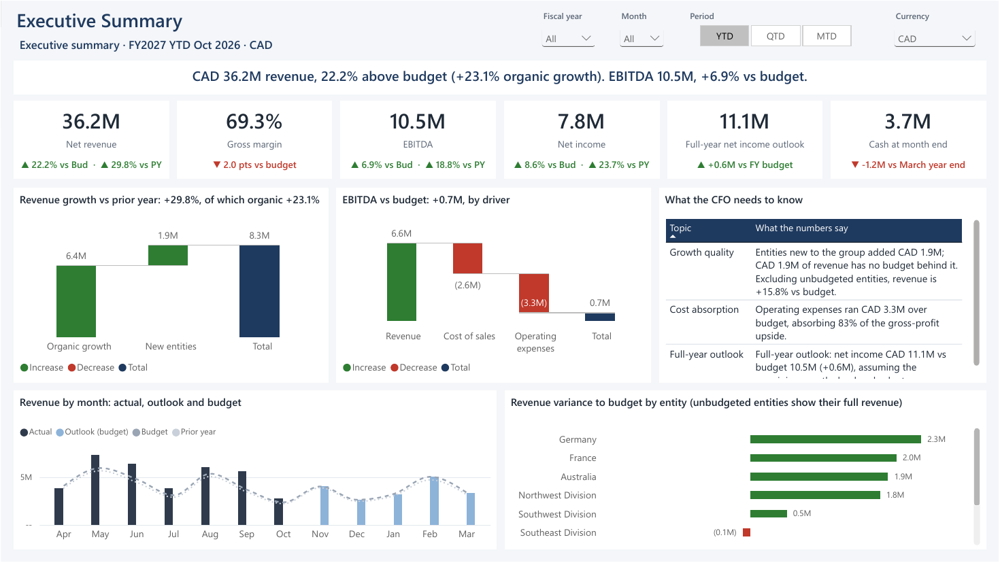
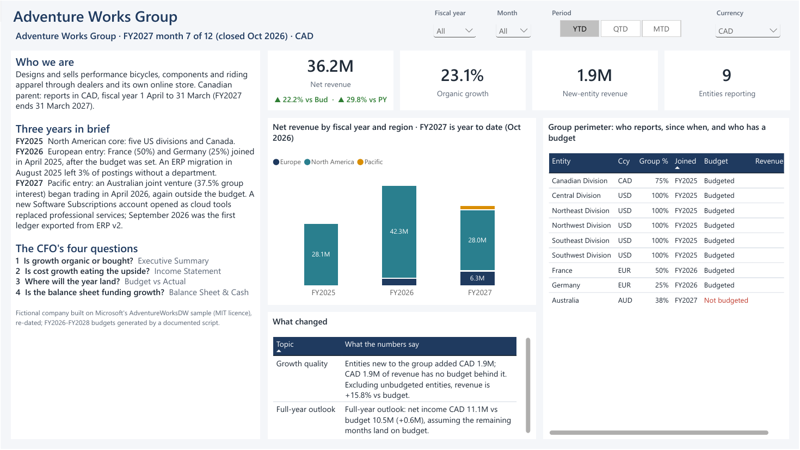
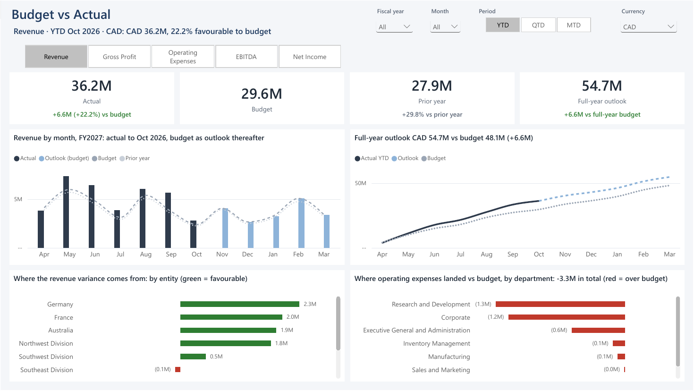
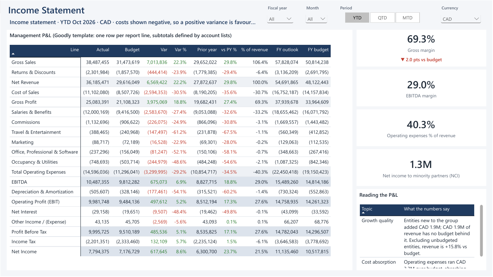
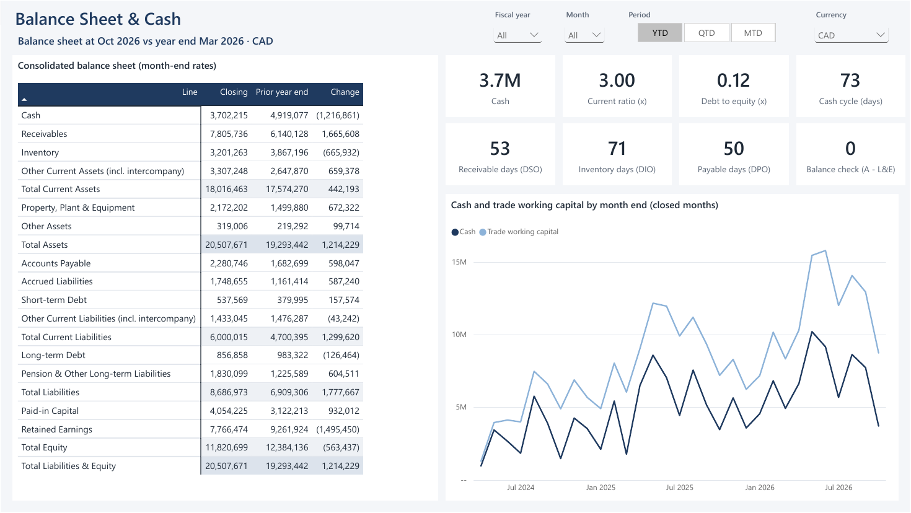
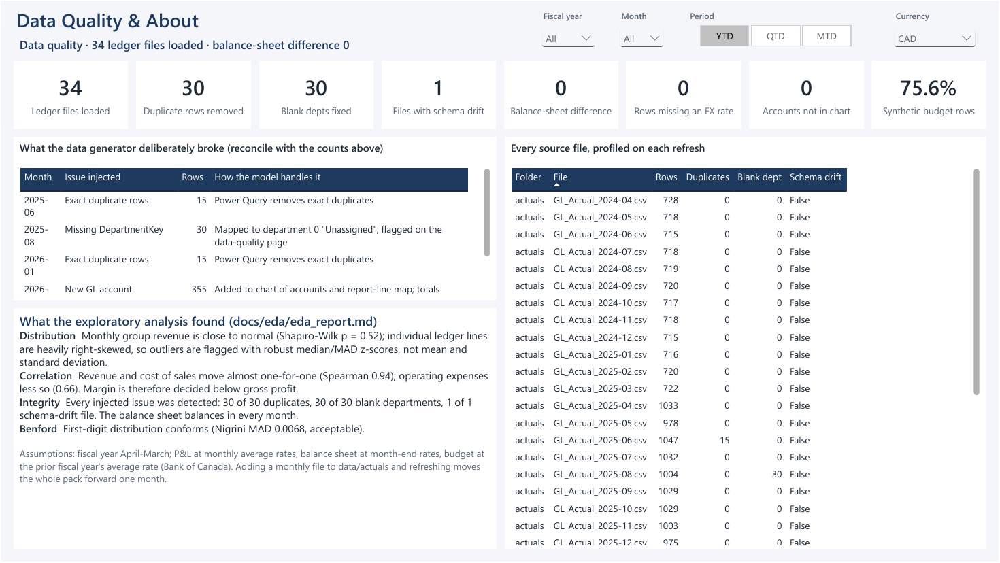

# CFO Performance Pack · Power BI financial reporting built as code

An executive reporting pack for a fictional multi-currency group, built end to end in Power BI: reproducible source data with realistic data-quality problems, a documented star-schema model with 221 DAX measures, and six report pages that answer the questions a CFO actually asks at month end.

The whole Power BI project (semantic model **and** report pages) is generated from Python (`scripts/build_pbip.py`) in the open PBIP format (TMDL + PBIR), so every measure, visual and colour is reviewable in a diff.

> **Report preview:** [PDF of all six pages](docs/CFO-Performance-Pack.pdf) · page images below. A public Publish-to-web link is not provided; see [docs/02-startup-guide.md](docs/02-startup-guide.md) for why (licensing).



---

## The business question

Adventure Works Group (fictional; Canadian parent, reports in CAD, fiscal year 1 April to 31 March) closes October 2026, month 7 of FY2027, with revenue **22% above budget**. The board will hear "we beat budget". The pack tests whether that is true in the way that matters:

| Question | What the pack shows (FY2027 YTD, CAD) |
|---|---|
| **Is growth organic or bought?** | Revenue +29.8% vs prior year, of which **+23.1% organic**. CAD 1.9M comes from an Australian joint venture that has **no budget**; on budgeted entities only, revenue is +15.8% vs budget. |
| **Is cost growth eating the upside?** | Operating expenses ran **CAD 3.3M over budget**, absorbing 83% of the gross-profit upside. EBITDA beat budget by only 6.9%, and gross margin is 2.0 pts below budget. |
| **Where will the year land?** | Rolling outlook (7 months actual + 5 months budget): net income **CAD 11.1M vs 10.5M budget**. |
| **Is the balance sheet funding growth?** | Not yet in cash: cash **fell CAD 1.2M** since the March year end while receivables **rose CAD 1.7M**, so growth is being financed through customer credit (DSO 53 days). Liquidity is not at risk: current ratio 3.0x, debt/equity 0.12x. |

Full narrative: [docs/00-company-and-thesis.md](docs/00-company-and-thesis.md).

## Report pages

| Page | Purpose | Highlights |
|---|---|---|
| Company Overview | Who the group is and what changed | Story and the CFO's four questions, revenue by fiscal year and region, perimeter table flagging unbudgeted entities |
| Executive Summary | Are we on plan? | Headline sentence written by DAX, KPI tiles vs budget and PY, organic vs acquired growth bridge, EBITDA variance bridge by driver |
| Budget vs Actual | Where are the variances? | Measure selector (revenue to net income), monthly actual / outlook / budget / PY, cumulative full-year outlook, variance by entity and by department |
| Income Statement | Line-by-line performance | Dynamic P&L (Goodly template method): actual, budget, variance, growth, % of revenue, full-year outlook |
| Balance Sheet & Cash | Liquidity and working capital | Closing vs year-end balances, current ratio, leverage, DSO/DIO/DPO and cash conversion cycle, cash by month |
| Data Quality | Can I trust it? | Integrity checks, injected-vs-detected reconciliation, per-file profile, EDA findings |

Every page responds to **fiscal year, month, MTD/QTD/YTD and CAD/USD** selectors; titles and narrative text are DAX measures, so they rewrite themselves for every selection. Colour is used only to carry meaning: dark = actual, grey dashed = budget, light blue = outlook, **green/red = favourable/unfavourable** (sign-normalised, so green is always good).

| | |
|---|---|
|  **Company Overview** |  **Budget vs Actual** |
|  **Income Statement** |  **Balance Sheet & Cash** |
|  **Data Quality** |  **Executive Summary** |

Images are rendered from the PDF export at the October 2026 close (YTD, CAD).

## What is in the repo

```
CFO-Performance-Pack.pbip               open this in Power BI Desktop
CFO-Performance-Pack.SemanticModel/     TMDL model (generated)
CFO-Performance-Pack.Report/            PBIR report pages + theme (generated)
data/                                   reference, actuals, budget, fx, inbox (demo files)
docs/00-company-and-thesis.md           company story and reporting thesis
docs/01-semantic-model.md               model reference (generated: tables, relationships, every measure with DAX)
docs/02-startup-guide.md                free tenant, security and Publish to web, step by step
docs/CFO-Performance-Pack.pdf           PDF export of all six pages
docs/images/                            page images used in this README
docs/eda/                               data-quality and exploratory analysis report + charts
scripts/build_data.py                   builds data/ from AdventureWorksDW (seeded, deterministic)
scripts/eda.py                          data-quality checks and EDA -> docs/eda/
scripts/model_def.py                    the semantic model: Power Query, tables, 221 measures
scripts/build_pbip.py                   writes the TMDL model and PBIR report from model_def.py
scripts/document_model.py               writes docs/01-semantic-model.md
scripts/privacy_check.sh                blocks commits containing local paths or e-mail addresses
```

## How it was built

The model and report were never assembled by hand in the Power BI canvas. The workflow was:

1. **Generate:** `scripts/model_def.py` defines the semantic model as data (Power Query, columns, 221 measures, display folders, descriptions); `scripts/build_pbip.py` renders it to TMDL and renders every page and visual to PBIR JSON (positions, fields, conditional colours, measure-driven titles, synced slicers, theme).
2. **Apply:** Power BI Desktop picks up the regenerated files with *Apply external changes* (or a reopen) and refreshes.
3. **Validate:** DAX queries run against the live model through the Power BI Modeling MCP bridge reconcile every headline number to the independent pandas EDA, and the rendered pages are reviewed visually before each commit.

That loop caught real defects that a screenshot-only review would have missed. The EDA was adding returns to budgeted revenue instead of netting them (CAD 33.5M vs the correct 29.6M). A function-built folder path made Power BI demand a gateway. A slicer property name was silently ignored. A department chart was meaningless because the source ledger posts all revenue to one department.

## Run it

1. Clone the repo and open `CFO-Performance-Pack.pbip` in a recent Power BI Desktop. If it will not open, enable *Options → Preview features → Power BI Project (.pbip) save option* and restart.
2. **Transform data → Edit parameters → DataRoot**: set it to the full path of this repo's `data\` folder, ending with a backslash, e.g. `C:\src\cfo-performance-pack\data\`.
3. Click **Refresh**. Every query reads through one folder source, so there are no privacy prompts.

### Live demo: close the next month

The pack is "closed" at October 2026. Move `data/inbox/GL_Actual_2026-11.csv` into `data/actuals/` and refresh: the as-of month, every title, the YTD figures and the outlook all move to November with no model change. Drop `GL_Budget_FY2028.csv` into `data/budget/` and FY2028 appears in the calendar and selectors. Remove a file and the period disappears.

### Rebuild everything from source

```bash
python -I scripts/build_data.py <adventureworksdw_csv_dir> data      # source files (deterministic)
python -I scripts/eda.py data docs/eda                                # data-quality + EDA report
python scripts/build_pbip.py . --data-root "C:\path\to\repo\data\\"   # TMDL model + PBIR report
python scripts/document_model.py                                      # model reference doc
```

`build_data.py` expects the pipe-delimited AdventureWorksDW CSVs from the [microsoft/sql-server-samples](https://github.com/microsoft/sql-server-samples) "adventureworks" release.

## Data quality and EDA

The generator injects realistic source-system problems (seeded and logged in `data/dq_injection_log.csv`); Power Query fixes them and the Data Quality page proves it:

| Injected | Detected | Treatment |
|---|---|---|
| 30 exact duplicate rows (re-export) | 30 | Removed in Power Query |
| 30 rows with blank department (ERP migration) | 30 | Mapped to department 0 "Unassigned" |
| 1 file with reordered columns + extra column (ERP v2) | 1 | Columns matched by name |
| New GL account mid-year (software subscriptions) | mapped | Added to chart and report-line map |

Integrity: balance sheet balances in every month; no rows without an FX rate; no unmapped accounts. EDA ([report](docs/eda/eda_report.md)): monthly group revenue is normal (Shapiro-Wilk p = 0.52) but ledger lines are heavily skewed, so outliers use median/MAD; revenue and cost of sales correlate at Spearman 0.94; first digits conform to Benford's law (MAD 0.0068). The EDA reconciles to the model to the dollar (YTD revenue CAD 36,185,471; budget CAD 29,616,049).

## Modelling decisions

- **Fiscal year April-March**, named by the year it ends. Calendar is a DAX table spanning whatever years the ledger contains.
- **FX (Bank of Canada, CAD per unit):** P&L at monthly average rates, balance sheet at month-end rates, budget at the prior fiscal year's average rate, so budget variance excludes FX noise. Months after the last published rate carry the last rate forward and are flagged.
- **Sign convention:** revenue and liabilities positive, costs negative; every variance is actual minus budget and positive is favourable.
- **Goodly template method:** report lines live in a table; subtotals are lists of accounts, applied with `TREATAS`, so the P&L layout is data, not DAX.
- **Perimeter:** like-for-like (organic) revenue counts only entities that traded in the same period last year; unbudgeted revenue is isolated so acquisitions cannot masquerade as outperformance.
- **Ownership:** entities are fully consolidated; effective ownership (multiplied down the hierarchy) splits net income between the group and non-controlling interests.

## Limitations (read before quoting numbers)

- Fictional company. The ledger is Microsoft's AdventureWorksDW finance sample, re-dated; FY2026-FY2028 budgets are synthetic (prior-year actual × growth × seeded noise) and tagged as such.
- The source ledger posts all revenue and cost of sales to one department, so department analysis is shown for operating expenses only.
- Germany's FY2027 budget is very small relative to its actuals (a feature of the source data), which inflates its variance.
- FX rates come from the Bank of Canada Valet API. A sample of 33 month-end rates (every month Jun-Oct 2026 plus six earlier month ends, including the March year ends) was checked against the source on 2026-11-12 and matched exactly; months after the last published rate carry the last rate forward.

## Credits

- Report structure inspired by Goodly's [Budget vs Actual](https://www.youtube.com/watch?v=_JE5oTFmkeQ) and [dynamic P&L](https://www.youtube.com/watch?v=tEe727ar8SY) techniques.
- Data: AdventureWorksDW, © Microsoft, MIT licence. FX rates: Bank of Canada.

## Licence

MIT; see [LICENSE](LICENSE).
