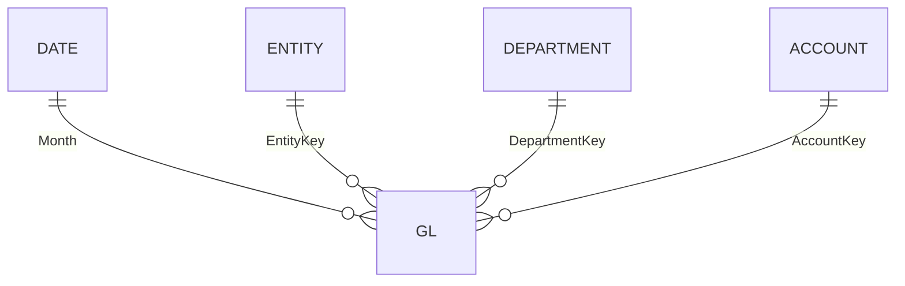

# Semantic model reference

> Generated by `scripts/document_model.py` from `scripts/model_def.py`. Do not edit by hand.

**21 tables · 427 measures · 4 relationships** · import mode · culture en-CA · fiscal year April-March named by the year it ends.

## Star schema



All relationships are many-to-one, single direction, from the `GL` fact to its dimensions. Report-line, selector and bridge tables are deliberately disconnected: measures apply them with `TREATAS` or `SELECTEDVALUE`, which is the Goodly "template table" pattern for financial statements.

## Power Query

Every query reads through one static source, `Folder.Files(DataRoot)`, and filters to the subfolder it needs. That keeps refresh free of privacy-level prompts and gateway requirements, and makes adding or removing a period a file operation.

| Function | Purpose |
|---|---|
| `fnReadCsv(subfolder, fileName)` | One UTF-8 CSV; blank strings become null |
| `fnLoadLedgerFolder(subfolder, scenario)` | Every `GL_*.csv` in a folder: columns matched by name (handles schema drift), exact duplicates removed, blank department mapped to 0 "Unassigned" |

<details><summary>fnReadCsv</summary>

```powerquery
(subfolder as text, fileName as text) as table =>
let
    // Folder path to match, lower-cased. An empty subfolder means DataRoot itself.
    Target = Text.Lower(if subfolder = "" then DataRoot else DataRoot & subfolder & "\"),
    // One static source for the whole model (Folder.Files(DataRoot)), filtered to the file: no gateway or privacy prompt.
    Hit = Table.SelectRows(Folder.Files(DataRoot), each Text.Lower([Folder Path]) = Target and Text.Lower([Name]) = Text.Lower(fileName)),
    // Parse as UTF-8 CSV (65001).
    Source = Csv.Document(Hit{0}[Content], [Delimiter = ",", Encoding = 65001, QuoteStyle = QuoteStyle.Csv]),
    Promoted = Table.PromoteHeaders(Source, [PromoteAllScalars = true]),
    // Empty strings become null so type conversion and null checks behave.
    Blanks = Table.TransformColumns(Promoted, {}, (x) => if x = "" then null else x)
in
    Blanks
```

</details>

<details><summary>fnLoadLedgerFolder</summary>

```powerquery
(subfolder as text, scenario as text) as table =>
let
    // Folder to load, e.g. DataRoot\actuals\.
    Target = Text.Lower(DataRoot & subfolder & "\"),
    Files = Table.SelectRows(Folder.Files(DataRoot), each Text.Lower([Folder Path]) = Target),
    // Only ledger files: GL_*.csv. Dropping a file in adds a period; removing it removes the period.
    Csvs = Table.SelectRows(Files, each Text.Lower([Extension]) = ".csv" and Text.StartsWith([Name], "GL_")),
    // Per file: promote headers, pick the six columns BY NAME (survives reordered or extra columns; a missing column becomes null), drop exact duplicate rows.
    Parsed = Table.AddColumn(Csvs, "Data", each Table.Distinct(Table.SelectColumns(Table.PromoteHeaders(Csv.Document([Content], [Delimiter = ",", Encoding = 65001, QuoteStyle = QuoteStyle.Csv]), [PromoteAllScalars = true]), {"Month", "EntityKey", "DepartmentKey", "AccountKey", "AmountLC", "BudgetSource"}, MissingField.UseNull))),
    Kept = Table.SelectColumns(Parsed, {"Name", "Data"}),
    Expanded = Table.ExpandTableColumn(Kept, "Data", {"Month", "EntityKey", "DepartmentKey", "AccountKey", "AmountLC", "BudgetSource"}),
    // Blank department (ERP migration gap) is mapped to key 0 = "Unassigned" so no row is lost in the Department relationship.
    DeptFixed = Table.ReplaceValue(Table.ReplaceValue(Expanded, "", "0", Replacer.ReplaceValue, {"DepartmentKey"}), null, "0", Replacer.ReplaceValue, {"DepartmentKey"}),
    // Tag every row with the scenario of the folder it came from (Actual or Budget).
    WithScenario = Table.AddColumn(DeptFixed, "Scenario", each scenario, type text)
in
    WithScenario
```

</details>

Queries are organised in groups: Parameters and functions, Dimensions, Facts, Report helpers, Data quality.

## How to read the model (start here)

1. **One fact, four dimensions.** `GL` holds every posting (actual and budget) in local currency; `Date`, `Entity`, `Department` and `Account` filter it.
2. **Amounts.** `[Amount]` picks the CAD or USD column; `[Actual]` and `[Budget]` split it by scenario. Everything else builds on these three.
3. **Periods.** `[Selected Month]` is the reporting month. Period measures (`... MTD/QTD/YTD`, `... (Period)`) replace the date slicer with an explicit fiscal window.
4. **Report lines.** A P&L or balance-sheet line is a row in `Report Line`; `Report Line Map` lists its accounts. Measures apply that list with `TREATAS`.
5. **KPIs.** Folder `3 KPIs` has one sub-folder per KPI with the same eight measures (actual, budget, PY, variance, variance %, growth %, outlook, FY budget).
6. **Text, colour and layout.** Folders 6 and 8 to 11 only format: titles, narrative sentences, theme colours and KPI card text. They never change a number.
7. **Number format.** Money text: $ with one decimal in millions, whole thousands below 1M; tables in thousands; percentages to one decimal.

## Tables

### Account

Chart of accounts (parent-child) with statement type. *Source: Power Query.*

| Column | Type | Notes |
|---|---|---|
| AccountKey | int64 | Surrogate key of the account; joins to GL. |
| ParentAccountKey | int64 | hidden; Parent account in the chart-of-accounts hierarchy. |
| AccountCode | string | Account code as used in the ledger. |
| AccountName | string | Account name. |
| AccountType | string | Revenue, Expenditures, Assets, Liabilities or Statistical; drives the sign. |
| UnaryOperator | string | hidden; Roll-up operator from the source chart (not used by the measures). |
| Statement | string | Income Statement, Balance Sheet or Statistical; decides which exchange rate applies. |
| Sign | int64 | calculated; hidden; Ledger stores revenue and costs as positive values; costs are shown negative so subtotals sum and a positive variance is always favourable. |

<details><summary>Power Query (group: Dimensions)</summary>

```powerquery
// Chart of accounts (parent-child) with statement type.
let
    Src = fnReadCsv("reference", "Account.csv"),
    Typed = Table.TransformColumnTypes(Src, {{"AccountKey", Int64.Type}, {"ParentAccountKey", Int64.Type}, {"AccountCode", type text}, {"AccountName", type text}, {"AccountType", type text}, {"UnaryOperator", type text}, {"Statement", type text}}, "en-US")
in
    Typed
```

</details>

### Entity

Reporting entities with local currency and ownership %. *Source: Power Query.*

| Column | Type | Notes |
|---|---|---|
| EntityKey | int64 | Surrogate key of the reporting entity; joins to GL. |
| ParentEntityKey | int64 | hidden; Parent in the group hierarchy (group > region > entity). |
| EntityName | string | Entity name. |
| OwnershipPct | double | Share of this entity owned by its direct parent. |
| CurrencyCode | string | Local (functional) currency of the entity. |
| Effective Ownership | double | calculated; Group economic interest: product of ownership % along the entity hierarchy. |
| Region | string | calculated; Operating region (level 2 of the entity hierarchy). |

<details><summary>Power Query (group: Dimensions)</summary>

```powerquery
// Reporting entities with local currency and ownership %.
let
    Src = fnReadCsv("reference", "Entity.csv"),
    Typed = Table.TransformColumnTypes(Src, {{"EntityKey", Int64.Type}, {"ParentEntityKey", Int64.Type}, {"EntityName", type text}, {"OwnershipPct", type number}, {"CurrencyCode", type text}}, "en-US")
in
    Typed
```

</details>

### Department

Department groups; 0 = Unassigned (blank department in source). *Source: Power Query.*

| Column | Type | Notes |
|---|---|---|
| DepartmentKey | int64 | Surrogate key of the department; 0 = Unassigned. |
| ParentDepartmentKey | int64 | hidden; Parent department group. |
| DepartmentName | string | Department name. |

<details><summary>Power Query (group: Dimensions)</summary>

```powerquery
// Department groups; 0 = Unassigned (blank department in source).
let
    Src = fnReadCsv("reference", "Department.csv"),
    Typed = Table.TransformColumnTypes(Src, {{"DepartmentKey", Int64.Type}, {"ParentDepartmentKey", Int64.Type}, {"DepartmentName", type text}}, "en-US"),
    WithUnassigned = Table.Combine({Typed, #table(type table [DepartmentKey = Int64.Type, ParentDepartmentKey = Int64.Type, DepartmentName = text], {{0, 1, "Unassigned"}})})
in
    WithUnassigned
```

</details>

### GL

General ledger fact in local currency: actuals one file per month, budgets one file per fiscal year. Grain: month x entity x department x account x scenario. *Source: Power Query.*

| Column | Type | Notes |
|---|---|---|
| Month | dateTime | First day of the posting month. |
| EntityKey | int64 | hidden; Entity that posted the amount. |
| DepartmentKey | int64 | hidden; Department; 0 when blank in the source. |
| AccountKey | int64 | hidden; Account posted to. |
| AmountLC | double | hidden; Amount in the entity's local currency, as posted (always positive in the source; closing balance for balance-sheet accounts). |
| Scenario | string | Actual or Budget. |
| BudgetSource | string | Ledger (from the source data) or Synthetic (generated budget). |
| SourceFile | string | hidden; CSV file the row came from; used for data-quality counts. |
| Rate Type | string | calculated; hidden; Which exchange rate the row uses: End (balance sheet), Budget (budget rows) or Avg (P&L actuals). |
| Rate to CAD | double | calculated; hidden; CAD per unit of the entity currency for the row's month and rate type. |
| Rate USD to CAD | double | calculated; hidden; CAD per USD for the row's month and rate type; used to present results in USD. |
| Amount CAD | double | calculated; hidden; Amount in CAD with the reporting sign applied (costs negative). Base of [Amount]. |
| Amount USD | double | calculated; hidden; Amount in USD: the CAD amount divided by the USD rate. |
| Amount CAD (budget rate) | double | calculated; hidden; Local-currency amount translated to CAD at the budget rate (prior fiscal-year average) instead of the actual rate: the constant-currency view of P&L rows. |
| Amount USD (budget rate) | double | calculated; hidden; Constant-currency amount expressed in USD, using the budget USD/CAD rate. |

<details><summary>Power Query (group: Facts)</summary>

```powerquery
// General ledger fact in local currency: actuals one file per month, budgets one file per fiscal year. Grain: month x entity x department x account x scenario.
let
    // One file per month in actuals\, one file per fiscal year in budget\.
    Actuals = fnLoadLedgerFolder("actuals", "Actual"),
    Budget = fnLoadLedgerFolder("budget", "Budget"),
    Combined = Table.Combine({Actuals, Budget}),
    Renamed = Table.RenameColumns(Combined, {{"Name", "SourceFile"}}),
    // Rows from the source ledger have no BudgetSource: label them "Ledger" (synthetic budget rows already say "Synthetic").
    Source = Table.TransformColumns(Renamed, {{"BudgetSource", each if _ = null or _ = "" then "Ledger" else _}}),
    // Types are set with the en-US culture because the files use a point as the decimal separator.
    Typed = Table.TransformColumnTypes(Source, {{"Month", type date}, {"EntityKey", Int64.Type}, {"DepartmentKey", Int64.Type}, {"AccountKey", Int64.Type}, {"AmountLC", type number}, {"BudgetSource", type text}, {"SourceFile", type text}}, "en-US")
in
    Typed
```

</details>

### FX

Bank of Canada rates (CAD per unit): monthly average for P&L, month-end for balance sheet, budget rate = prior fiscal-year average. Months after the last observed rate carry it forward. *Source: Power Query.*

| Column | Type | Notes |
|---|---|---|
| FXKey | string | hidden; Currency code | yyyy-MM; lookup key used by the GL rate columns. |
| CurrencyCode | string | Currency the rate converts from. |
| Month | dateTime | First day of the month. |
| AvgRate | double | Monthly average rate, CAD per unit (P&L actuals). |
| EndRate | double | Month-end rate, CAD per unit (balance sheet). |
| BudgetRate | double | Average rate of the previous fiscal year (budget and constant currency). |
| RateStatus | string | Observed (published by the Bank of Canada) or Carried forward (after the last published month). |

<details><summary>Power Query (group: Facts)</summary>

```powerquery
// Bank of Canada rates (CAD per unit): monthly average for P&L, month-end for balance sheet, budget rate = prior fiscal-year average. Months after the last observed rate carry it forward.
let
    // Fiscal year of a date: April to March, named by the year it ends.
    FY = (d as date) as number => Date.Year(d) + (if Date.Month(d) >= 4 then 1 else 0),
    Src = fnReadCsv("fx", "FX_Rates.csv"),
    Typed = Table.TransformColumnTypes(Src, {{"Month", type date}, {"CurrencyCode", type text}, {"AvgRate", type number}, {"EndRate", type number}}, "en-US"),
    // Rates published by the Bank of Canada (CAD per unit).
    Observed = Table.SelectColumns(Typed, {"Month", "CurrencyCode", "AvgRate", "EndRate"}),
    LastObserved = List.Max(Observed[Month]),
    // Build a complete currency x month grid to the end of the fiscal year after the last published rate, so budget months always find a rate.
    GridEnd = #date(FY(LastObserved) + 1, 3, 1),
    FirstMonth = List.Min(Observed[Month]),
    Months = List.Generate(() => FirstMonth, each _ <= GridEnd, each Date.AddMonths(_, 1)),
    Currencies = List.Distinct(Observed[CurrencyCode]),
    Grid = Table.FromRows(List.TransformMany(Currencies, each Months, (c, m) => {c, m}), type table [CurrencyCode = text, Month = date]),
    Joined = Table.NestedJoin(Grid, {"CurrencyCode", "Month"}, Observed, {"CurrencyCode", "Month"}, "R", JoinKind.LeftOuter),
    Expanded = Table.ExpandTableColumn(Joined, "R", {"AvgRate", "EndRate"}),
    // Months with no published rate are flagged, then filled with the last published rate (FillDown below).
    Status = Table.AddColumn(Expanded, "RateStatus", each if [AvgRate] = null then "Carried forward" else "Observed", type text),
    EndFallback = Table.AddColumn(Status, "EndRate2", each if [EndRate] = null then [AvgRate] else [EndRate]),
    Sorted = Table.Sort(Table.RemoveColumns(EndFallback, {"EndRate"}), {{"CurrencyCode", Order.Ascending}, {"Month", Order.Ascending}}),
    Filled = Table.FillDown(Table.RenameColumns(Sorted, {{"EndRate2", "EndRate"}}), {"AvgRate", "EndRate"}),
    // Budget rate = average of the PREVIOUS fiscal year, so budget variances are not distorted by currency moves.
    FYAvg = Table.Group(Table.AddColumn(Table.SelectRows(Filled, each [RateStatus] = "Observed"), "FiscalYear", each FY([Month]), Int64.Type), {"CurrencyCode", "FiscalYear"}, {{"BudgetRate", each List.Average([AvgRate]), type number}}),
    WithBY = Table.AddColumn(Filled, "BudgetBaseFY", each FY([Month]) - 1, Int64.Type),
    JoinedB = Table.NestedJoin(WithBY, {"CurrencyCode", "BudgetBaseFY"}, FYAvg, {"CurrencyCode", "FiscalYear"}, "B", JoinKind.LeftOuter),
    ExpandedB = Table.ExpandTableColumn(JoinedB, "B", {"BudgetRate"}),
    SortedB = Table.Sort(ExpandedB, {{"CurrencyCode", Order.Ascending}, {"Month", Order.Ascending}}),
    FilledB = Table.FillDown(SortedB, {"BudgetRate"}),
    // First fiscal year has no previous year: fall back to the month's average rate.
    BudgetFix = Table.AddColumn(FilledB, "BudgetRate2", each if [BudgetRate] = null then [AvgRate] else [BudgetRate]),
    // Text key "CCY|yyyy-MM" used by LOOKUPVALUE in the GL rate columns.
    Keyed = Table.AddColumn(BudgetFix, "FXKey", each [CurrencyCode] & "|" & Date.ToText([Month], "yyyy-MM"), type text),
    Final = Table.RenameColumns(Table.SelectColumns(Keyed, {"FXKey", "CurrencyCode", "Month", "AvgRate", "EndRate", "BudgetRate2", "RateStatus"}), {{"BudgetRate2", "BudgetRate"}}),
    Typed2 = Table.TransformColumnTypes(Final, {{"AvgRate", type number}, {"EndRate", type number}, {"BudgetRate", type number}})
in
    Typed2
```

</details>

### Report Line

Management P&L and balance-sheet template (Goodly method). Order follows LineKey. *Source: Power Query.*

| Column | Type | Notes |
|---|---|---|
| LineKey | int64 | Line number; also the display order. 1-20 income statement, 101-120 balance sheet. |
| LineName | string | sorted by LineKey; Line caption shown in statements. |
| Section | string | Statement section the line belongs to. |
| LineType | string | Detail, Subtotal or Total; drives row shading. |
| Statement | string | Income Statement or Balance Sheet. |

<details><summary>Power Query (group: Dimensions)</summary>

```powerquery
// Management P&L and balance-sheet template (Goodly method). Order follows LineKey.
let
    Source = #table(type table [LineKey = Int64.Type, LineName = text, Section = text, LineType = text, Statement = text], {
        {1, "Gross Sales", "Revenue", "Detail", "Income Statement"},
        {2, "Returns & Discounts", "Revenue", "Detail", "Income Statement"},
        {3, "Net Revenue", "Revenue", "Subtotal", "Income Statement"},
        {4, "Cost of Sales", "Cost of Sales", "Detail", "Income Statement"},
        {5, "Gross Profit", "Gross Profit", "Subtotal", "Income Statement"},
        {6, "Salaries & Benefits", "Operating Expenses", "Detail", "Income Statement"},
        {7, "Commissions", "Operating Expenses", "Detail", "Income Statement"},
        {8, "Travel & Entertainment", "Operating Expenses", "Detail", "Income Statement"},
        {9, "Marketing", "Operating Expenses", "Detail", "Income Statement"},
        {10, "Office, Professional & Software", "Operating Expenses", "Detail", "Income Statement"},
        {11, "Occupancy & Utilities", "Operating Expenses", "Detail", "Income Statement"},
        {12, "Total Operating Expenses", "Operating Expenses", "Subtotal", "Income Statement"},
        {13, "EBITDA", "EBITDA", "Total", "Income Statement"},
        {14, "Depreciation & Amortization", "Below EBITDA", "Detail", "Income Statement"},
        {15, "Operating Profit (EBIT)", "EBIT", "Total", "Income Statement"},
        {16, "Net Interest", "Below EBIT", "Detail", "Income Statement"},
        {17, "Other Income / (Expense)", "Below EBIT", "Detail", "Income Statement"},
        {18, "Profit Before Tax", "Profit Before Tax", "Total", "Income Statement"},
        {19, "Income Tax", "Below PBT", "Detail", "Income Statement"},
        {20, "Net Income", "Net Income", "Total", "Income Statement"},
        {101, "Cash", "Assets", "Detail", "Balance Sheet"},
        {102, "Receivables", "Assets", "Detail", "Balance Sheet"},
        {103, "Inventory", "Assets", "Detail", "Balance Sheet"},
        {104, "Other Current Assets (incl. intercompany)", "Assets", "Detail", "Balance Sheet"},
        {105, "Total Current Assets", "Assets", "Subtotal", "Balance Sheet"},
        {106, "Property, Plant & Equipment", "Assets", "Detail", "Balance Sheet"},
        {107, "Other Assets", "Assets", "Detail", "Balance Sheet"},
        {108, "Total Assets", "Assets", "Total", "Balance Sheet"},
        {109, "Accounts Payable", "Liabilities", "Detail", "Balance Sheet"},
        {110, "Accrued Liabilities", "Liabilities", "Detail", "Balance Sheet"},
        {111, "Short-term Debt", "Liabilities", "Detail", "Balance Sheet"},
        {112, "Other Current Liabilities (incl. intercompany)", "Liabilities", "Detail", "Balance Sheet"},
        {113, "Total Current Liabilities", "Liabilities", "Subtotal", "Balance Sheet"},
        {114, "Long-term Debt", "Liabilities", "Detail", "Balance Sheet"},
        {115, "Pension & Other Long-term Liabilities", "Liabilities", "Detail", "Balance Sheet"},
        {116, "Total Liabilities", "Liabilities", "Subtotal", "Balance Sheet"},
        {117, "Paid-in Capital", "Equity", "Detail", "Balance Sheet"},
        {118, "Retained Earnings", "Equity", "Detail", "Balance Sheet"},
        {119, "Total Equity", "Equity", "Subtotal", "Balance Sheet"},
        {120, "Total Liabilities & Equity", "Liabilities & Equity", "Total", "Balance Sheet"}
    })
in
    Source
```

</details>

| Key | Line | Type | Accounts |
|---|---|---|---|
| 1 | Gross Sales | Detail | 52, 101 |
| 2 | Returns & Discounts | Detail | 53, 54 |
| 3 | Net Revenue | Subtotal | 52, 101, 53, 54 |
| 4 | Cost of Sales | Detail | 56, 57 |
| 5 | Gross Profit | Subtotal | 52, 101, 53, 54, 56, 57 |
| 6 | Salaries & Benefits | Detail | 60, 61, 62 |
| 7 | Commissions | Detail | 63 |
| 8 | Travel & Entertainment | Detail | 65, 66, 67, 68, 69 |
| 9 | Marketing | Detail | 71, 72 |
| 10 | Office, Professional & Software | Detail | 73, 74, 78, 102 |
| 11 | Occupancy & Utilities | Detail | 76, 77, 87 |
| 12 | Total Operating Expenses | Subtotal | 60, 61, 62, 63, 65, 66, 67, 68, 69, 71, 72, 73, 74, 78, 102, 76, 77, 87 |
| 13 | EBITDA | Total | 52, 101, 53, 54, 56, 57, 60, 61, 62, 63, 65, 66, 67, 68, 69, 71, 72, 73, 74, 78, 102, 76, 77, 87 |
| 14 | Depreciation & Amortization | Detail | 80, 81, 82, 83, 84, 85 |
| 15 | Operating Profit (EBIT) | Total | 52, 101, 53, 54, 56, 57, 60, 61, 62, 63, 65, 66, 67, 68, 69, 71, 72, 73, 74, 78, 102, 76, 77, 87, 80, 81, 82, 83, 84, 85 |
| 16 | Net Interest | Detail | 89, 90 |
| 17 | Other Income / (Expense) | Detail | 91, 92, 93 |
| 18 | Profit Before Tax | Total | 52, 101, 53, 54, 56, 57, 60, 61, 62, 63, 65, 66, 67, 68, 69, 71, 72, 73, 74, 78, 102, 76, 77, 87, 80, 81, 82, 83, 84, 85, 89, 90, 91, 92, 93 |
| 19 | Income Tax | Detail | 94 |
| 20 | Net Income | Total | 52, 101, 53, 54, 56, 57, 60, 61, 62, 63, 65, 66, 67, 68, 69, 71, 72, 73, 74, 78, 102, 76, 77, 87, 80, 81, 82, 83, 84, 85, 89, 90, 91, 92, 93, 94 |
| 101 | Cash | Detail | 4 |
| 102 | Receivables | Detail | 6, 7, 8 |
| 103 | Inventory | Detail | 10, 11, 12 |
| 104 | Other Current Assets (incl. intercompany) | Detail | 13, 14, 15 |
| 105 | Total Current Assets | Subtotal | 4, 6, 7, 8, 10, 11, 12, 13, 14, 15 |
| 106 | Property, Plant & Equipment | Detail | 18, 19, 20, 21, 22, 23 |
| 107 | Other Assets | Detail | 24 |
| 108 | Total Assets | Total | 4, 6, 7, 8, 10, 11, 12, 13, 14, 15, 18, 19, 20, 21, 22, 23, 24 |
| 109 | Accounts Payable | Detail | 29 |
| 110 | Accrued Liabilities | Detail | 31, 32, 33 |
| 111 | Short-term Debt | Detail | 28, 100 |
| 112 | Other Current Liabilities (incl. intercompany) | Detail | 34, 35 |
| 113 | Total Current Liabilities | Subtotal | 29, 31, 32, 33, 28, 100, 34, 35 |
| 114 | Long-term Debt | Detail | 37 |
| 115 | Pension & Other Long-term Liabilities | Detail | 38, 39, 40 |
| 116 | Total Liabilities | Subtotal | 29, 31, 32, 33, 28, 100, 34, 35, 37, 38, 39, 40 |
| 117 | Paid-in Capital | Detail | 42, 43 |
| 118 | Retained Earnings | Detail | 45, 46 |
| 119 | Total Equity | Subtotal | 42, 43, 45, 46 |
| 120 | Total Liabilities & Equity | Total | 29, 31, 32, 33, 28, 100, 34, 35, 37, 38, 39, 40, 42, 43, 45, 46 |

### Report Line Map (hidden)

Each report line mapped to every account it includes; subtotals repeat the accounts of the lines they roll up. *Source: Power Query.*

| Column | Type | Notes |
|---|---|---|
| LineKey | int64 | Report line. |
| AccountKey | int64 | Account included in that line. |

<details><summary>Power Query (group: Dimensions)</summary>

```powerquery
// Each report line mapped to every account it includes; subtotals repeat the accounts of the lines they roll up.
let
    Source = #table(type table [LineKey = Int64.Type, AccountKey = Int64.Type], {
        {1, 52},
        {1, 101},
        {2, 53},
        {2, 54},
        {3, 52},
        {3, 101},
        {3, 53},
        {3, 54},
        {4, 56},
        {4, 57},
        {5, 52},
        {5, 101},
        {5, 53},
        {5, 54},
        {5, 56},
        {5, 57},
        {6, 60},
        {6, 61},
        {6, 62},
        {7, 63},
        {8, 65},
        {8, 66},
        {8, 67},
        {8, 68},
        {8, 69},
        {9, 71},
        {9, 72},
        {10, 73},
        {10, 74},
        {10, 78},
        {10, 102},
        {11, 76},
        {11, 77},
        {11, 87},
        {12, 60},
        {12, 61},
        {12, 62},
        {12, 63},
        {12, 65},
        {12, 66},
        {12, 67},
        {12, 68},
        {12, 69},
        {12, 71},
        {12, 72},
        {12, 73},
        {12, 74},
        {12, 78},
        {12, 102},
        {12, 76},
        {12, 77},
        {12, 87},
        {13, 52},
        {13, 101},
        {13, 53},
        {13, 54},
        {13, 56},
        {13, 57},
        {13, 60},
        {13, 61},
        {13, 62},
        {13, 63},
        {13, 65},
        {13, 66},
        {13, 67},
        {13, 68},
        {13, 69},
        {13, 71},
        {13, 72},
        {13, 73},
        {13, 74},
        {13, 78},
        {13, 102},
        {13, 76},
        {13, 77},
        {13, 87},
        {14, 80},
        {14, 81},
        {14, 82},
        {14, 83},
        {14, 84},
        {14, 85},
        {15, 52},
        {15, 101},
        {15, 53},
        {15, 54},
        {15, 56},
        {15, 57},
        {15, 60},
        {15, 61},
        {15, 62},
        {15, 63},
        {15, 65},
        {15, 66},
        {15, 67},
        {15, 68},
        {15, 69},
        {15, 71},
        {15, 72},
        {15, 73},
        {15, 74},
        {15, 78},
        {15, 102},
        {15, 76},
        {15, 77},
        {15, 87},
        {15, 80},
        {15, 81},
        {15, 82},
        {15, 83},
        {15, 84},
        {15, 85},
        {16, 89},
        {16, 90},
        {17, 91},
        {17, 92},
        {17, 93},
        {18, 52},
        {18, 101},
        {18, 53},
        {18, 54},
        {18, 56},
        {18, 57},
        {18, 60},
        {18, 61},
        {18, 62},
        {18, 63},
        {18, 65},
        {18, 66},
        {18, 67},
        {18, 68},
        {18, 69},
        {18, 71},
        {18, 72},
        {18, 73},
        {18, 74},
        {18, 78},
        {18, 102},
        {18, 76},
        {18, 77},
        {18, 87},
        {18, 80},
        {18, 81},
        {18, 82},
        {18, 83},
        {18, 84},
        {18, 85},
        {18, 89},
        {18, 90},
        {18, 91},
        {18, 92},
        {18, 93},
        {19, 94},
        {20, 52},
        {20, 101},
        {20, 53},
        {20, 54},
        {20, 56},
        {20, 57},
        {20, 60},
        {20, 61},
        {20, 62},
        {20, 63},
        {20, 65},
        {20, 66},
        {20, 67},
        {20, 68},
        {20, 69},
        {20, 71},
        {20, 72},
        {20, 73},
        {20, 74},
        {20, 78},
        {20, 102},
        {20, 76},
        {20, 77},
        {20, 87},
        {20, 80},
        {20, 81},
        {20, 82},
        {20, 83},
        {20, 84},
        {20, 85},
        {20, 89},
        {20, 90},
        {20, 91},
        {20, 92},
        {20, 93},
        {20, 94},
        {101, 4},
        {102, 6},
        {102, 7},
        {102, 8},
        {103, 10},
        {103, 11},
        {103, 12},
        {104, 13},
        {104, 14},
        {104, 15},
        {105, 4},
        {105, 6},
        {105, 7},
        {105, 8},
        {105, 10},
        {105, 11},
        {105, 12},
        {105, 13},
        {105, 14},
        {105, 15},
        {106, 18},
        {106, 19},
        {106, 20},
        {106, 21},
        {106, 22},
        {106, 23},
        {107, 24},
        {108, 4},
        {108, 6},
        {108, 7},
        {108, 8},
        {108, 10},
        {108, 11},
        {108, 12},
        {108, 13},
        {108, 14},
        {108, 15},
        {108, 18},
        {108, 19},
        {108, 20},
        {108, 21},
        {108, 22},
        {108, 23},
        {108, 24},
        {109, 29},
        {110, 31},
        {110, 32},
        {110, 33},
        {111, 28},
        {111, 100},
        {112, 34},
        {112, 35},
        {113, 29},
        {113, 31},
        {113, 32},
        {113, 33},
        {113, 28},
        {113, 100},
        {113, 34},
        {113, 35},
        {114, 37},
        {115, 38},
        {115, 39},
        {115, 40},
        {116, 29},
        {116, 31},
        {116, 32},
        {116, 33},
        {116, 28},
        {116, 100},
        {116, 34},
        {116, 35},
        {116, 37},
        {116, 38},
        {116, 39},
        {116, 40},
        {117, 42},
        {117, 43},
        {118, 45},
        {118, 46},
        {119, 42},
        {119, 43},
        {119, 45},
        {119, 46},
        {120, 29},
        {120, 31},
        {120, 32},
        {120, 33},
        {120, 28},
        {120, 100},
        {120, 34},
        {120, 35},
        {120, 37},
        {120, 38},
        {120, 39},
        {120, 40},
        {120, 42},
        {120, 43},
        {120, 45},
        {120, 46}
    })
in
    Source
```

</details>

### Date

Monthly fiscal calendar (April-March, named by the year it ends). Spans every fiscal year in GL, so a new year appears when its files land. *Source: calculated (DAX).*

| Column | Type | Notes |
|---|---|---|
| Month | dateTime | First day of the month; key of the calendar. |
| Year | int64 | Calendar year. |
| Fiscal Year Number | int64 | hidden; Fiscal year as a number (the year in which it ends). |
| Fiscal Year | string | sorted by Fiscal Year Number; Fiscal year label, e.g. FY2027. |
| Fiscal Month Number | int64 | hidden; April = 1 ... March = 12. |
| Fiscal Quarter | string | Fiscal quarter, Q1 = April to June. |
| Month Name | string | sorted by Fiscal Month Number; Three-letter month, sorted in fiscal order. |
| Year Month | string | sorted by Month Index; Month and year, e.g. Oct 2026. |
| Month Index | int64 | hidden; Running month number, for sorting. |
| IsClosed | boolean | True for months up to the latest actuals month. |
| Period Status | string | Actual for closed months, Outlook for later months. |

<details><summary>DAX</summary>

```dax
VAR FYOf = YEAR ( MIN ( GL[Month] ) ) + IF ( MONTH ( MIN ( GL[Month] ) ) >= 4, 1, 0 )
VAR FYTo = YEAR ( MAX ( GL[Month] ) ) + IF ( MONTH ( MAX ( GL[Month] ) ) >= 4, 1, 0 )
VAR AsOf = CALCULATE ( MAX ( GL[Month] ), GL[Scenario] = "Actual" )
RETURN
    SELECTCOLUMNS (
        FILTER ( CALENDAR ( DATE ( FYOf - 1, 4, 1 ), DATE ( FYTo, 3, 1 ) ), DAY ( [Date] ) = 1 ),
        "Month", [Date],
        "Year", YEAR ( [Date] ),
        "Fiscal Year Number", YEAR ( [Date] ) + IF ( MONTH ( [Date] ) >= 4, 1, 0 ),
        "Fiscal Year", "FY" & ( YEAR ( [Date] ) + IF ( MONTH ( [Date] ) >= 4, 1, 0 ) ),
        "Fiscal Month Number", MOD ( MONTH ( [Date] ) + 8, 12 ) + 1,
        "Fiscal Quarter", "Q" & ( INT ( MOD ( MONTH ( [Date] ) + 8, 12 ) / 3 ) + 1 ),
        "Month Name", FORMAT ( [Date], "mmm" ),
        "Year Month", FORMAT ( [Date], "mmm yyyy" ),
        "Month Index", YEAR ( [Date] ) * 12 + MONTH ( [Date] ),
        "IsClosed", [Date] <= AsOf,
        "Period Status", IF ( [Date] <= AsOf, "Actual", "Outlook" )
    )
```

</details>

### Reporting Currency

Slicer: presentation currency (CAD default). *Source: Power Query.*

| Column | Type | Notes |
|---|---|---|
| Currency | string | sorted by Sort; Presentation currency. |
| Sort | int64 | hidden; Display order. |

<details><summary>Power Query (group: Report helpers)</summary>

```powerquery
// Slicer: presentation currency (CAD default).
let
    Source = #table(type table [Currency = text, Sort = Int64.Type], {
        {"CAD", 1},
        {"USD", 2}
    })
in
    Source
```

</details>

### Period View

Slicer: MTD, QTD or YTD (default YTD). *Source: Power Query.*

| Column | Type | Notes |
|---|---|---|
| View | string | sorted by Sort; Period view: YTD, QTD or MTD. |
| Sort | int64 | hidden; Display order. |

<details><summary>Power Query (group: Report helpers)</summary>

```powerquery
// Slicer: MTD, QTD or YTD (default YTD).
let
    Source = #table(type table [View = text, Sort = Int64.Type], {
        {"YTD", 1},
        {"QTD", 2},
        {"MTD", 3}
    })
in
    Source
```

</details>

### Metric

Slicer: which P&L measure the Budget vs Actual page analyses. *Source: Power Query.*

| Column | Type | Notes |
|---|---|---|
| Metric | string | sorted by Sort; P&L measure offered by the Metric slicer. |
| LineKey | int64 | hidden; Report line the metric maps to. |
| Sort | int64 | hidden; Display order. |

<details><summary>Power Query (group: Report helpers)</summary>

```powerquery
// Slicer: which P&L measure the Budget vs Actual page analyses.
let
    Source = #table(type table [Metric = text, LineKey = Int64.Type, Sort = Int64.Type], {
        {"Revenue", 3, 1},
        {"Gross Profit", 5, 2},
        {"Operating Expenses", 12, 3},
        {"EBITDA", 13, 4},
        {"Net Income", 20, 5}
    })
in
    Source
```

</details>

### Revenue Bridge

Axis for the prior-year to current-year revenue bridge. *Source: Power Query.*

| Column | Type | Notes |
|---|---|---|
| Step | string | sorted by Sort; Step shown on the bridge axis. |
| Sort | int64 | hidden; Display order. |

<details><summary>Power Query (group: Report helpers)</summary>

```powerquery
// Axis for the prior-year to current-year revenue bridge.
let
    Source = #table(type table [Step = text, Sort = Int64.Type], {
        {"Organic growth", 1},
        {"New entities", 2}
    })
in
    Source
```

</details>

### EBITDA Bridge

Axis for the budget to actual EBITDA bridge. *Source: Power Query.*

| Column | Type | Notes |
|---|---|---|
| Step | string | sorted by Sort; Step shown on the bridge axis. |
| Sort | int64 | hidden; Display order. |

<details><summary>Power Query (group: Report helpers)</summary>

```powerquery
// Axis for the budget to actual EBITDA bridge.
let
    Source = #table(type table [Step = text, Sort = Int64.Type], {
        {"Revenue", 1},
        {"Cost of sales", 2},
        {"Operating expenses", 3}
    })
in
    Source
```

</details>

### Insight

Rows for the insight tables: each topic shows one narrative measure. *Source: Power Query.*

| Column | Type | Notes |
|---|---|---|
| Key | int64 | hidden; Topic number; selects the narrative measure in [Insight Text]. |
| Topic | string | sorted by Key; Topic caption. |

<details><summary>Power Query (group: Report helpers)</summary>

```powerquery
// Rows for the insight tables: each topic shows one narrative measure.
let
    Source = #table(type table [Key = Int64.Type, Topic = text], {
        {1, "Growth quality"},
        {2, "Cost absorption"},
        {3, "Full-year outlook"},
        {4, "People cost"},
        {5, "Currency effect"}
    })
in
    Source
```

</details>

### DQ File Log

Profile of every source file on each refresh: raw rows, exact duplicates, blank departments, schema drift. *Source: Power Query.*

| Column | Type | Notes |
|---|---|---|
| Name | string | Source file name. |
| Folder | string | actuals or budget. |
| RawRows | int64 | Rows in the file before cleaning. |
| DuplicateRows | int64 | Exact duplicate rows found (and removed). |
| MissingDepartmentRows | int64 | Rows with a blank department. |
| SchemaDrift | boolean | True when the columns differ from the expected order or set. |
| Columns | string | Column names found in the file. |

<details><summary>Power Query (group: Data quality)</summary>

```powerquery
// Profile of every source file on each refresh: raw rows, exact duplicates, blank departments, schema drift.
let
    // Column order of a clean export. Anything else is reported as schema drift.
    Expected = {"Month", "EntityKey", "DepartmentKey", "AccountKey", "AmountLC"},
    // Profile every ledger file in one subfolder: raw rows, exact duplicates, blank departments and schema drift, measured BEFORE cleaning.
    Profile = (sub as text) as table =>
        let
            F = Table.SelectRows(Folder.Files(DataRoot), each Text.Lower([Folder Path]) = Text.Lower(DataRoot & sub & "\") and Text.Lower([Extension]) = ".csv" and Text.StartsWith([Name], "GL_")),
            WithStats = Table.AddColumn(F, "Stats", each
                let
                    T = Table.PromoteHeaders(Csv.Document([Content], [Delimiter = ",", Encoding = 65001, QuoteStyle = QuoteStyle.Csv]), [PromoteAllScalars = true]),
                    Cols = Table.ColumnNames(T),
                    Core = Table.SelectColumns(T, Expected, MissingField.UseNull),
                    Raw = Table.RowCount(T),
                    Distinct = Table.RowCount(Table.Distinct(T)),
                    MissingDept = Table.RowCount(Table.SelectRows(Core, each [DepartmentKey] = null or [DepartmentKey] = "")),
                    Drift = List.FirstN(Cols, 5) <> Expected or List.Count(List.RemoveItems(Cols, Expected & {"BudgetSource"})) > 0
                in
                    [RawRows = Raw, DuplicateRows = Raw - Distinct, MissingDepartmentRows = MissingDept, SchemaDrift = Drift, Columns = Text.Combine(Cols, ", ")]),
            Out = Table.AddColumn(Table.SelectColumns(WithStats, {"Name", "Stats"}), "Folder", each sub, type text)
        in
            Out,
    // Profile both folders so the Data Quality page can reconcile detected issues with the injection log.
    Combined = Table.Combine({Profile("actuals"), Profile("budget")}),
    Expanded = Table.ExpandRecordColumn(Combined, "Stats", {"RawRows", "DuplicateRows", "MissingDepartmentRows", "SchemaDrift", "Columns"}),
    Typed = Table.TransformColumnTypes(Expanded, {{"Name", type text}, {"RawRows", Int64.Type}, {"DuplicateRows", Int64.Type}, {"MissingDepartmentRows", Int64.Type}, {"SchemaDrift", type logical}, {"Columns", type text}})
in
    Typed
```

</details>

### DQ Injection Log

What the reproducible generator deliberately broke (data/dq_injection_log.csv), for reconciliation to what was detected. *Source: Power Query.*

| Column | Type | Notes |
|---|---|---|
| Month | string | Month or range the injected issue affects. |
| Issue | string | Type of issue injected by the data generator. |
| RowsAffected | int64 | Rows affected. |
| Cause | string | Realistic cause the issue imitates. |
| Treatment | string | How the model handles it. |

<details><summary>Power Query (group: Data quality)</summary>

```powerquery
// What the reproducible generator deliberately broke (data/dq_injection_log.csv), for reconciliation to what was detected.
let
    Src = fnReadCsv("", "dq_injection_log.csv"),
    Typed = Table.TransformColumnTypes(Src, {{"Month", type text}, {"Issue", type text}, {"RowsAffected", Int64.Type}, {"Cause", type text}, {"Treatment", type text}}, "en-US")
in
    Typed
```

</details>

### Theme Mode

Selector for the light/dark toggle; every colour measure reads it. *Source: Power Query.*

| Column | Type | Notes |
|---|---|---|
| Mode | string | sorted by Sort; Light or Dark. |
| Sort | int64 | hidden; Display order. |

<details><summary>Power Query (group: Report helpers)</summary>

```powerquery
// Selector for the light/dark toggle; every colour measure reads it.
let
    Source = #table(type table [Mode = text, Sort = Int64.Type], {
        {"Light", 1},
        {"Dark", 2}
    })
in
    Source
```

</details>

### Story

Static narrative shown in themed tables (text boxes cannot change colour with the theme). *Source: Power Query.*

| Column | Type | Notes |
|---|---|---|
| Page | string | hidden; Page the row belongs to (Overview, DQ, Notes, Defs). |
| Sort | int64 | hidden; Display order within the page. |
| Section | string | sorted by Sort; Topic shown in the first column. |
| Text | string | Narrative text. |

<details><summary>Power Query (group: Report helpers)</summary>

```powerquery
// Static narrative shown in themed tables (text boxes cannot change colour with the theme).
let
    Source = #table(type table [Page = text, Sort = Int64.Type, Section = text, Text = text], {
        {"Overview", 1, "Who we are", "Designs and sells performance bicycles, components and riding apparel through dealers and its own online store. Canadian parent: reports in CAD; fiscal year 1 April to 31 March."},
        {"Overview", 2, "FY2025", "North American core: five US sales divisions and Canada."},
        {"Overview", 3, "FY2026", "European entry: France (50%) and Germany (25%) joined in April 2025, after the budget was set. An ERP migration left 3% of August 2025 postings without a department."},
        {"Overview", 4, "FY2027", "Pacific entry: an Australian joint venture (37.5% group interest) began trading in April 2026, outside the budget. A Software Subscriptions account opened; September 2026 was the first ERP v2 export."},
        {"Overview", 5, "Four questions", "1 Is growth organic or bought?  2 Is cost growth eating the upside?  3 Where will the year land?  4 Is the balance sheet funding growth?"},
        {"Overview", 6, "Disclosure", "Fictional company on Microsoft AdventureWorksDW (MIT licence), re-dated. FY2026-FY2028 budgets are synthetic and generated by a documented script."},
        {"DQ", 1, "Distribution", "Monthly group revenue is close to normal (Shapiro-Wilk p = 0.52); ledger lines are heavily skewed, so outliers use median and MAD, not mean and standard deviation."},
        {"DQ", 2, "Correlation", "Revenue and cost of sales move almost one-for-one (Spearman 0.94); operating expenses less so (0.66), so margin is decided below gross profit."},
        {"DQ", 3, "Integrity", "Every injected issue was detected and treated; the balance sheet balances in every month; no rows lack an FX rate."},
        {"DQ", 4, "Benford", "First-digit distribution conforms (Nigrini MAD 0.0068, acceptable)."},
        {"DQ", 5, "Known gaps", "Equity roll-forward does not reconcile in the source data (retained earnings vs net income); intercompany balances are not eliminated."},
        {"Notes", 1, "Fiscal calendar", "Fiscal year runs 1 April to 31 March and is named by the year it ends (FY2027 = Apr 2026 to Mar 2027). YTD, QTD and MTD are fiscal."},
        {"Notes", 2, "Close and as-of month", "The reporting month is the latest month with an actuals file (""books closed""). Selecting a later month falls back to the close."},
        {"Notes", 3, "Sign convention", "Revenue is positive and costs are negative, so subtotals add up. Every variance is actual minus budget: positive is favourable, on revenue and on cost lines."},
        {"Notes", 4, "Colour", "Green = favourable, red = unfavourable, amber = caution (budget not credible), blue = actual, light blue = outlook, grey = budget or prior year. Arrows show direction only."},
        {"Notes", 5, "Number format", "Text and cards: $ with millions to one decimal, thousands whole. Tables: thousands, negatives in brackets. Percentages to one decimal. ""n.m."" or blank = not meaningful."},
        {"Notes", 6, "Currency", "Bank of Canada rates, CAD per unit. P&L at monthly average, balance sheet at month end, budget at the prior fiscal-year average. USD view translates the CAD result at the USD rate."},
        {"Notes", 7, "Currency effect", "Constant currency = actuals translated at budget rates. The difference to reported actuals is translation, not trading. Rates after the last published month are carried forward."},
        {"Notes", 8, "Budget", "FY2026 to FY2028 budgets are synthetic (prior-year actual x growth x seeded noise). Entities that joined after the budget was set have no budget and are flagged."},
        {"Notes", 9, "Budget credibility", "Not budgeted = no budget for the period. Under-budgeted = actual revenue above 2x budget. Their favourable variance is a planning gap, not outperformance."},
        {"Notes", 10, "Outlook", "Full-year outlook = actuals to the close + budget for the remaining months. The run-rate figure instead assumes the remaining months beat budget by the year-to-date ratio."},
        {"Notes", 11, "Organic growth", "Like-for-like revenue counts only entities that also traded in the same period last year. New-entity revenue is the rest."},
        {"Notes", 12, "Ownership", "Entities are consolidated at 100%. Effective ownership (multiplied down the hierarchy) splits net income between the group and non-controlling interests."},
        {"Notes", 13, "Cash bridge", "Balance-sheet method: each step is the change in a balance since the year end, signed by cash effect, so the steps tie to the cash change. It is not a statutory cash-flow statement."},
        {"Notes", 14, "Known gaps", "Retained earnings do not roll forward from net income in the source data; intercompany balances are not eliminated; revenue and cost of sales post to one department."},
        {"Notes", 15, "Data", "Fictional company built on Microsoft AdventureWorksDW (MIT licence), re-dated. Source issues are injected on purpose and reconciled on the Data Quality page."},
        {"Defs", 1, "Net revenue", "Gross sales less returns and discounts."},
        {"Defs", 2, "Gross margin", "Gross profit (net revenue less cost of sales) / net revenue."},
        {"Defs", 3, "EBITDA", "Gross profit less operating expenses, before depreciation, amortization, interest, other items and tax."},
        {"Defs", 4, "Variance %", "Variance / absolute budget. Shown only when actual and budget share a sign and the result is below 1,000%."},
        {"Defs", 5, "Pacing bar", "Year-to-date actual as a share of the full-year budget. The tick marks the share of the year elapsed: a bar beyond the tick is ahead of a straight-line year."},
        {"Defs", 6, "Receivable days (DSO)", "Receivables / trailing-twelve-month revenue x 365."},
        {"Defs", 7, "Inventory days (DIO)", "Inventory / trailing-twelve-month cost of sales x 365."},
        {"Defs", 8, "Payable days (DPO)", "Payables / trailing-twelve-month cost of sales x 365."},
        {"Defs", 9, "Cash cycle", "Receivable days + inventory days - payable days."},
        {"Defs", 10, "Current ratio", "Current assets / current liabilities."},
        {"Defs", 11, "Debt to equity", "Short-term + long-term debt / total equity."},
        {"Defs", 12, "Salary cost per head", "Salaries and benefits for the period / closing headcount (statistical account)."},
        {"Defs", 13, "Trade working capital", "Receivables + inventory - payables."}
    })
in
    Source
```

</details>

### Refresh Info (hidden)

One row stamped with the UTC time of the last refresh. *Source: calculated (DAX).*

| Column | Type | Notes |
|---|---|---|
| Refreshed At | dateTime | UTC time of the last refresh. |

<details><summary>DAX</summary>

```dax
ROW ( "Refreshed At", UTCNOW () )
```

</details>

### Cash Bridge

Axis for the cash bridge on the Balance Sheet page: one step per balance-sheet group. *Source: Power Query.*

| Column | Type | Notes |
|---|---|---|
| Step | string | sorted by Sort; Step shown on the bridge axis. |
| Sort | int64 | hidden; Display order. |

<details><summary>Power Query (group: Report helpers)</summary>

```powerquery
// Axis for the cash bridge on the Balance Sheet page: one step per balance-sheet group.
let
    Source = #table(type table [Step = text, Sort = Int64.Type], {
        {"Receivables", 1},
        {"Inventory", 2},
        {"Other assets", 3},
        {"Payables", 4},
        {"Other liabilities", 5},
        {"Debt", 6},
        {"Equity", 7}
    })
in
    Source
```

</details>

### _Measures

Home table for all measures, organised in display folders. *Source: Power Query.*

| Column | Type | Notes |
|---|---|---|
| Placeholder | string | hidden; Empty column: a table needs one column to exist. |

<details><summary>Power Query (group: Report helpers)</summary>

```powerquery
// Home table for all measures, organised in display folders.
#table(type table [Placeholder = text], {})
```

</details>

## Measures

Conventions: costs are stored negative, so every variance is "actual minus budget" and **positive is always favourable**. Period measures follow the **Period View** selector (MTD/QTD/YTD) and the **Selected Month**, which defaults to the latest closed month.

### 0 Base

**Amount** · format `#,0;(#,0);-`  
Ledger amount in the selected reporting currency (CAD default). Costs are negative.
```dax
IF ( SELECTEDVALUE ( 'Reporting Currency'[Currency], "CAD" ) = "USD", SUM ( GL[Amount USD] ), SUM ( GL[Amount CAD] ) )
```

**Currency Label**  
Reporting currency code chosen in the Currency slicer (CAD when nothing is selected).
```dax
SELECTEDVALUE ( 'Reporting Currency'[Currency], "CAD" )
```

**As Of Month** · format `mmm yyyy`  
Latest month with actuals loaded (the close). Moves forward automatically when a new actuals file is added.
```dax
CALCULATE ( MAX ( GL[Month] ), REMOVEFILTERS (), GL[Scenario] = "Actual" )
```

**Selected Month** · format `mmm yyyy`  
Reporting month: the latest month selected in the date slicers, capped at the close. Defaults to the close.
```dax
VAR picked = CALCULATE ( MAX ( 'Date'[Month] ), ALLSELECTED ( 'Date' ) )
VAR asOf = [As Of Month]
RETURN IF ( ISBLANK ( picked ) || picked > asOf, asOf, picked )
```

**Selected Fiscal Year**  
Fiscal-year label of the selected month, e.g. FY2027.
```dax
VAR m = [Selected Month] RETURN "FY" & ( YEAR ( m ) + IF ( MONTH ( m ) >= 4, 1, 0 ) )
```

**Fiscal Month Of Selection** · format `0`  
Fiscal month number of the selected month (April = 1, March = 12).
```dax
MOD ( MONTH ( [Selected Month] ) + 8, 12 ) + 1
```

**Period Label**  
Text such as "YTD Oct 2026 · CAD" used in titles.
```dax
SELECTEDVALUE ( 'Period View'[View], "YTD" ) & " " & FORMAT ( [Selected Month], "mmm yyyy" ) & " · " & [Currency Label]
```

**Actual** · format `#,0;(#,0);-`  
Amount for the Actual scenario. Base of every actual measure.
```dax
CALCULATE ( [Amount], GL[Scenario] = "Actual" )
```

**Budget** · format `#,0;(#,0);-`  
Amount for the Budget scenario. Base of every budget measure.
```dax
CALCULATE ( [Amount], GL[Scenario] = "Budget" )
```

### 1 Period (fiscal)

**Actual MTD** · format `#,0;(#,0);-`  
Actual for the selected month only. Ignores the date slicer except to find the selected month.
```dax
// Date pattern: the date slicers are removed and replaced by an explicit month window built from [Selected Month], so every visual agrees on the period.
VAR m = [Selected Month]
RETURN CALCULATE ( [Actual], REMOVEFILTERS ( 'Date' ), 'Date'[Month] = m )
```

**Budget MTD** · format `#,0;(#,0);-`  
Budget for the selected month only. Ignores the date slicer except to find the selected month.
```dax
// Date pattern: the date slicers are removed and replaced by an explicit month window built from [Selected Month], so every visual agrees on the period.
VAR m = [Selected Month]
RETURN CALCULATE ( [Budget], REMOVEFILTERS ( 'Date' ), 'Date'[Month] = m )
```

**Prior Year MTD** · format `#,0;(#,0);-`  
Actual one year earlier for the selected month only. Ignores the date slicer except to find the selected month.
```dax
// Date pattern: the date slicers are removed and replaced by an explicit month window built from [Selected Month], so every visual agrees on the period.
VAR m = EDATE ( [Selected Month], -12 )
RETURN CALCULATE ( [Actual], REMOVEFILTERS ( 'Date' ), 'Date'[Month] = m )
```

**Actual QTD** · format `#,0;(#,0);-`  
Actual for the calendar quarter to the selected month. Ignores the date slicer except to find the selected month.
```dax
// Date pattern: the date slicers are removed and replaced by an explicit month window built from [Selected Month], so every visual agrees on the period.
VAR m = [Selected Month]
RETURN CALCULATE ( [Actual], REMOVEFILTERS ( 'Date' ), 'Date'[Month] >= DATE ( YEAR ( m ), INT ( ( MONTH ( m ) - 1 ) / 3 ) * 3 + 1, 1 ) && 'Date'[Month] <= m )
```

**Budget QTD** · format `#,0;(#,0);-`  
Budget for the calendar quarter to the selected month. Ignores the date slicer except to find the selected month.
```dax
// Date pattern: the date slicers are removed and replaced by an explicit month window built from [Selected Month], so every visual agrees on the period.
VAR m = [Selected Month]
RETURN CALCULATE ( [Budget], REMOVEFILTERS ( 'Date' ), 'Date'[Month] >= DATE ( YEAR ( m ), INT ( ( MONTH ( m ) - 1 ) / 3 ) * 3 + 1, 1 ) && 'Date'[Month] <= m )
```

**Prior Year QTD** · format `#,0;(#,0);-`  
Actual one year earlier for the calendar quarter to the selected month. Ignores the date slicer except to find the selected month.
```dax
// Date pattern: the date slicers are removed and replaced by an explicit month window built from [Selected Month], so every visual agrees on the period.
VAR m = EDATE ( [Selected Month], -12 )
RETURN CALCULATE ( [Actual], REMOVEFILTERS ( 'Date' ), 'Date'[Month] >= DATE ( YEAR ( m ), INT ( ( MONTH ( m ) - 1 ) / 3 ) * 3 + 1, 1 ) && 'Date'[Month] <= m )
```

**Actual YTD** · format `#,0;(#,0);-`  
Actual for the fiscal year (from 1 April) to the selected month. Ignores the date slicer except to find the selected month.
```dax
// Date pattern: the date slicers are removed and replaced by an explicit month window built from [Selected Month], so every visual agrees on the period.
VAR m = [Selected Month]
RETURN CALCULATE ( [Actual], REMOVEFILTERS ( 'Date' ), 'Date'[Month] >= DATE ( ( YEAR ( m ) + IF ( MONTH ( m ) >= 4, 1, 0 ) ) - 1, 4, 1 ) && 'Date'[Month] <= m )
```

**Budget YTD** · format `#,0;(#,0);-`  
Budget for the fiscal year (from 1 April) to the selected month. Ignores the date slicer except to find the selected month.
```dax
// Date pattern: the date slicers are removed and replaced by an explicit month window built from [Selected Month], so every visual agrees on the period.
VAR m = [Selected Month]
RETURN CALCULATE ( [Budget], REMOVEFILTERS ( 'Date' ), 'Date'[Month] >= DATE ( ( YEAR ( m ) + IF ( MONTH ( m ) >= 4, 1, 0 ) ) - 1, 4, 1 ) && 'Date'[Month] <= m )
```

**Prior Year YTD** · format `#,0;(#,0);-`  
Actual one year earlier for the fiscal year (from 1 April) to the selected month. Ignores the date slicer except to find the selected month.
```dax
// Date pattern: the date slicers are removed and replaced by an explicit month window built from [Selected Month], so every visual agrees on the period.
VAR m = EDATE ( [Selected Month], -12 )
RETURN CALCULATE ( [Actual], REMOVEFILTERS ( 'Date' ), 'Date'[Month] >= DATE ( ( YEAR ( m ) + IF ( MONTH ( m ) >= 4, 1, 0 ) ) - 1, 4, 1 ) && 'Date'[Month] <= m )
```

**Budget FY** · format `#,0;(#,0);-`  
Full fiscal-year budget for the year of the selected month.
```dax
// Date pattern: the date slicers are removed and replaced by an explicit month window built from [Selected Month], so every visual agrees on the period.
VAR m = [Selected Month] VAR fy = ( YEAR ( m ) + IF ( MONTH ( m ) >= 4, 1, 0 ) )
RETURN CALCULATE ( [Budget], REMOVEFILTERS ( 'Date' ), 'Date'[Fiscal Year Number] = fy )
```

**Outlook FY** · format `#,0;(#,0);-`  
Rolling fiscal-year outlook: actuals to the selected month + budget for the remaining months (Goodly level-3 pattern).
```dax
// Date pattern: the date slicers are removed and replaced by an explicit month window built from [Selected Month], so every visual agrees on the period.
VAR m = [Selected Month] VAR fy = ( YEAR ( m ) + IF ( MONTH ( m ) >= 4, 1, 0 ) )
RETURN [Actual YTD] + CALCULATE ( [Budget], REMOVEFILTERS ( 'Date' ), 'Date'[Fiscal Year Number] = fy && 'Date'[Month] > m )
```

**Actual (Period)** · format `#,0;(#,0);-`  
Actual for the period chosen in the Period slicer (MTD, QTD or YTD) ending at the selected month.
```dax
SWITCH ( SELECTEDVALUE ( 'Period View'[View], "YTD" ), "MTD", [Actual MTD], "QTD", [Actual QTD], [Actual YTD] )
```

**Budget (Period)** · format `#,0;(#,0);-`  
Budget for the period chosen in the Period slicer (MTD, QTD or YTD) ending at the selected month.
```dax
SWITCH ( SELECTEDVALUE ( 'Period View'[View], "YTD" ), "MTD", [Budget MTD], "QTD", [Budget QTD], [Budget YTD] )
```

**Prior Year (Period)** · format `#,0;(#,0);-`  
Actual for the same period one year earlier (for the period chosen in the Period slicer (MTD, QTD or YTD) ending at the selected month).
```dax
SWITCH ( SELECTEDVALUE ( 'Period View'[View], "YTD" ), "MTD", [Prior Year MTD], "QTD", [Prior Year QTD], [Prior Year YTD] )
```

**Closing Balance** · format `#,0;(#,0);-`  
Balance-sheet value at the selected month end.
```dax
// Date pattern: the date slicers are removed and replaced by an explicit month window built from [Selected Month], so every visual agrees on the period.
VAR m = [Selected Month]
RETURN CALCULATE ( [Actual], REMOVEFILTERS ( 'Date' ), 'Date'[Month] = m )
```

**Prior Year-End Balance** · format `#,0;(#,0);-`  
Balance at the previous fiscal year end (31 March).
```dax
// Date pattern: the date slicers are removed and replaced by an explicit month window built from [Selected Month], so every visual agrees on the period.
VAR m = [Selected Month] VAR ye = DATE ( ( YEAR ( m ) + IF ( MONTH ( m ) >= 4, 1, 0 ) ) - 1, 3, 1 )
RETURN CALCULATE ( [Actual], REMOVEFILTERS ( 'Date' ), 'Date'[Month] = ye )
```

**Year Elapsed %** · format `0%`  
Share of the fiscal year closed at the selected month.
```dax
DIVIDE ( [Fiscal Month Of Selection], 12 )
```

### 1 Period (fiscal)\Month axis

**Monthly Actual (Selected FY)** · format `#,0;(#,0);-`  
Month-axis charts: actual for each fiscal month of the selected year, up to the selected month. Independent of which years the date slicer shows.
```dax
// Date pattern: the date slicers are removed and replaced by an explicit month window built from [Selected Month], so every visual agrees on the period.
IF ( HASONEVALUE ( 'Date'[Fiscal Month Number] ),
    VAR fm = MAX ( 'Date'[Fiscal Month Number] ) VAR fy = ( YEAR ( [Selected Month] ) + IF ( MONTH ( [Selected Month] ) >= 4, 1, 0 ) )
    VAR d = DATE ( fy - 1, 3 + fm, 1 ) VAR sel = [Selected Month] VAR fyStart = DATE ( fy - 1, 4, 1 )
    RETURN IF ( d <= sel, CALCULATE ( [Actual], REMOVEFILTERS ( 'Date' ), 'Date'[Month] = d ) )
)
```

**Monthly Budget (Selected FY)** · format `#,0;(#,0);-`  
Month-axis charts: budget for each fiscal month of the selected year.
```dax
// Date pattern: the date slicers are removed and replaced by an explicit month window built from [Selected Month], so every visual agrees on the period.
IF ( HASONEVALUE ( 'Date'[Fiscal Month Number] ),
    VAR fm = MAX ( 'Date'[Fiscal Month Number] ) VAR fy = ( YEAR ( [Selected Month] ) + IF ( MONTH ( [Selected Month] ) >= 4, 1, 0 ) )
    VAR d = DATE ( fy - 1, 3 + fm, 1 ) VAR sel = [Selected Month] VAR fyStart = DATE ( fy - 1, 4, 1 )
    RETURN CALCULATE ( [Budget], REMOVEFILTERS ( 'Date' ), 'Date'[Month] = d )
)
```

**Monthly Outlook (Selected FY)** · format `#,0;(#,0);-`  
Budget shown as the outlook for months after the selected month.
```dax
// Date pattern: the date slicers are removed and replaced by an explicit month window built from [Selected Month], so every visual agrees on the period.
IF ( HASONEVALUE ( 'Date'[Fiscal Month Number] ),
    VAR fm = MAX ( 'Date'[Fiscal Month Number] ) VAR fy = ( YEAR ( [Selected Month] ) + IF ( MONTH ( [Selected Month] ) >= 4, 1, 0 ) )
    VAR d = DATE ( fy - 1, 3 + fm, 1 ) VAR sel = [Selected Month] VAR fyStart = DATE ( fy - 1, 4, 1 )
    RETURN IF ( d > sel, CALCULATE ( [Budget], REMOVEFILTERS ( 'Date' ), 'Date'[Month] = d ) )
)
```

**Monthly Prior Year (Selected FY)** · format `#,0;(#,0);-`  
Month-axis charts: actual for the same fiscal month one year earlier.
```dax
// Date pattern: the date slicers are removed and replaced by an explicit month window built from [Selected Month], so every visual agrees on the period.
IF ( HASONEVALUE ( 'Date'[Fiscal Month Number] ),
    VAR fm = MAX ( 'Date'[Fiscal Month Number] ) VAR fy = ( YEAR ( [Selected Month] ) + IF ( MONTH ( [Selected Month] ) >= 4, 1, 0 ) )
    VAR d = DATE ( fy - 1, 3 + fm, 1 ) VAR sel = [Selected Month] VAR fyStart = DATE ( fy - 1, 4, 1 )
    RETURN CALCULATE ( [Actual], REMOVEFILTERS ( 'Date' ), 'Date'[Month] = EDATE ( d, -12 ) )
)
```

**Cumulative Actual (Selected FY)** · format `#,0;(#,0);-`  
Month-axis charts: actual accumulated from 1 April to each month, up to the selected month.
```dax
// Date pattern: the date slicers are removed and replaced by an explicit month window built from [Selected Month], so every visual agrees on the period.
IF ( HASONEVALUE ( 'Date'[Fiscal Month Number] ),
    VAR fm = MAX ( 'Date'[Fiscal Month Number] ) VAR fy = ( YEAR ( [Selected Month] ) + IF ( MONTH ( [Selected Month] ) >= 4, 1, 0 ) )
    VAR d = DATE ( fy - 1, 3 + fm, 1 ) VAR sel = [Selected Month] VAR fyStart = DATE ( fy - 1, 4, 1 )
    RETURN IF ( d <= sel, CALCULATE ( [Actual], REMOVEFILTERS ( 'Date' ), 'Date'[Month] >= fyStart && 'Date'[Month] <= d ) )
)
```

**Cumulative Outlook (Selected FY)** · format `#,0;(#,0);-`  
Actual to the selected month plus budget for later months, accumulated: where the year is heading.
```dax
// Date pattern: the date slicers are removed and replaced by an explicit month window built from [Selected Month], so every visual agrees on the period.
IF ( HASONEVALUE ( 'Date'[Fiscal Month Number] ),
    VAR fm = MAX ( 'Date'[Fiscal Month Number] ) VAR fy = ( YEAR ( [Selected Month] ) + IF ( MONTH ( [Selected Month] ) >= 4, 1, 0 ) )
    VAR d = DATE ( fy - 1, 3 + fm, 1 ) VAR sel = [Selected Month] VAR fyStart = DATE ( fy - 1, 4, 1 )
    RETURN IF ( d >= sel, CALCULATE ( [Actual], REMOVEFILTERS ( 'Date' ), 'Date'[Month] >= fyStart && 'Date'[Month] <= sel ) + CALCULATE ( [Budget], REMOVEFILTERS ( 'Date' ), 'Date'[Month] > sel && 'Date'[Month] <= d ) )
)
```

**Cumulative Budget (Selected FY)** · format `#,0;(#,0);-`  
Month-axis charts: budget accumulated from 1 April to each month.
```dax
// Date pattern: the date slicers are removed and replaced by an explicit month window built from [Selected Month], so every visual agrees on the period.
IF ( HASONEVALUE ( 'Date'[Fiscal Month Number] ),
    VAR fm = MAX ( 'Date'[Fiscal Month Number] ) VAR fy = ( YEAR ( [Selected Month] ) + IF ( MONTH ( [Selected Month] ) >= 4, 1, 0 ) )
    VAR d = DATE ( fy - 1, 3 + fm, 1 ) VAR sel = [Selected Month] VAR fyStart = DATE ( fy - 1, 4, 1 )
    RETURN CALCULATE ( [Budget], REMOVEFILTERS ( 'Date' ), 'Date'[Month] >= fyStart && 'Date'[Month] <= d )
)
```

### 2 Statement Lines

**Line Actual** · format `#,0,;(#,0,);-`  
Report-line value for the Period View; one line at a time.
```dax
// Template pattern: the report line (or metric) in context decides which accounts are summed, via TREATAS.
IF ( HASONEVALUE ( 'Report Line'[LineKey] ),
    VAR accts = CALCULATETABLE ( VALUES ( 'Report Line Map'[AccountKey] ), TREATAS ( VALUES ( 'Report Line'[LineKey] ), 'Report Line Map'[LineKey] ) )
    RETURN CALCULATE ( [Actual (Period)], TREATAS ( accts, Account[AccountKey] ) )
)
```

**Line Budget** · format `#,0,;(#,0,);-`  
Budget for the report line on the row, for the Period view.
```dax
// Template pattern: the report line (or metric) in context decides which accounts are summed, via TREATAS.
IF ( HASONEVALUE ( 'Report Line'[LineKey] ),
    VAR accts = CALCULATETABLE ( VALUES ( 'Report Line Map'[AccountKey] ), TREATAS ( VALUES ( 'Report Line'[LineKey] ), 'Report Line Map'[LineKey] ) )
    RETURN CALCULATE ( [Budget (Period)], TREATAS ( accts, Account[AccountKey] ) )
)
```

**Line Prior Year** · format `#,0,;(#,0,);-`  
Same period last year for the report line on the row.
```dax
// Template pattern: the report line (or metric) in context decides which accounts are summed, via TREATAS.
IF ( HASONEVALUE ( 'Report Line'[LineKey] ),
    VAR accts = CALCULATETABLE ( VALUES ( 'Report Line Map'[AccountKey] ), TREATAS ( VALUES ( 'Report Line'[LineKey] ), 'Report Line Map'[LineKey] ) )
    RETURN CALCULATE ( [Prior Year (Period)], TREATAS ( accts, Account[AccountKey] ) )
)
```

**Line Var vs Budget** · format `#,0,;(#,0,);-`  
Positive = favourable (costs are stored negative).
```dax
[Line Actual] - [Line Budget]
```

**Line Var % vs Budget** · format `0.0%;-0.0%;-`  
Budget variance %. Blank (n.m.) when actual and budget have different signs or the variance exceeds 1,000% (base too small to be meaningful).
```dax
VAR p = IF ( [Line Actual] * [Line Budget] > 0, DIVIDE ( [Line Actual] - [Line Budget], ABS ( [Line Budget] ) ) ) RETURN IF ( ABS ( p ) < 10, p )
```

**Line Var vs Prior Year** · format `#,0;(#,0);-`  
Line actual minus the same period last year.
```dax
[Line Actual] - [Line Prior Year]
```

**Line Growth %** · format `0.0%;-0.0%;-`  
Growth vs the same period last year. Blank (n.m.) when the signs differ or the change exceeds 1,000%.
```dax
VAR p = IF ( [Line Actual] * [Line Prior Year] > 0, DIVIDE ( [Line Actual] - [Line Prior Year], ABS ( [Line Prior Year] ) ) ) RETURN IF ( ABS ( p ) < 10, p )
```

**Line % of Revenue** · format `0.0%;-0.0%;-`  
Report line as a share of net revenue (common-size P&L).
```dax
// Report-line pattern: the accounts mapped to a report line (Report Line Map) are applied to Account with TREATAS, so a line is data, not hard-coded DAX.
DIVIDE ( [Line Actual], CALCULATE ( [Actual (Period)], TREATAS ( CALCULATETABLE ( VALUES ( 'Report Line Map'[AccountKey] ), 'Report Line Map'[LineKey] = 3 ), Account[AccountKey] ) ) )
```

**Line Outlook FY** · format `#,0,;(#,0,);-`  
Full-year outlook (actual to date + remaining budget) for the report line.
```dax
// Template pattern: the report line (or metric) in context decides which accounts are summed, via TREATAS.
IF ( HASONEVALUE ( 'Report Line'[LineKey] ),
    VAR accts = CALCULATETABLE ( VALUES ( 'Report Line Map'[AccountKey] ), TREATAS ( VALUES ( 'Report Line'[LineKey] ), 'Report Line Map'[LineKey] ) )
    RETURN CALCULATE ( [Outlook FY], TREATAS ( accts, Account[AccountKey] ) )
)
```

**Line Budget FY** · format `#,0,;(#,0,);-`  
Full fiscal-year budget for the report line.
```dax
// Template pattern: the report line (or metric) in context decides which accounts are summed, via TREATAS.
IF ( HASONEVALUE ( 'Report Line'[LineKey] ),
    VAR accts = CALCULATETABLE ( VALUES ( 'Report Line Map'[AccountKey] ), TREATAS ( VALUES ( 'Report Line'[LineKey] ), 'Report Line Map'[LineKey] ) )
    RETURN CALCULATE ( [Budget FY], TREATAS ( accts, Account[AccountKey] ) )
)
```

**Line Closing Balance** · format `#,0,;(#,0,);-`  
Balance at the selected month end for the balance-sheet line on the row.
```dax
// Template pattern: the report line (or metric) in context decides which accounts are summed, via TREATAS.
IF ( HASONEVALUE ( 'Report Line'[LineKey] ),
    VAR accts = CALCULATETABLE ( VALUES ( 'Report Line Map'[AccountKey] ), TREATAS ( VALUES ( 'Report Line'[LineKey] ), 'Report Line Map'[LineKey] ) )
    RETURN CALCULATE ( [Closing Balance], TREATAS ( accts, Account[AccountKey] ) )
)
```

**Line Prior Year-End Balance** · format `#,0,;(#,0,);-`  
Balance at the previous fiscal year end (31 March) for the balance-sheet line.
```dax
// Template pattern: the report line (or metric) in context decides which accounts are summed, via TREATAS.
IF ( HASONEVALUE ( 'Report Line'[LineKey] ),
    VAR accts = CALCULATETABLE ( VALUES ( 'Report Line Map'[AccountKey] ), TREATAS ( VALUES ( 'Report Line'[LineKey] ), 'Report Line Map'[LineKey] ) )
    RETURN CALCULATE ( [Prior Year-End Balance], TREATAS ( accts, Account[AccountKey] ) )
)
```

**Line Balance Change** · format `#,0,;(#,0,);-`  
Closing balance minus the previous year-end balance.
```dax
[Line Closing Balance] - [Line Prior Year-End Balance]
```

### 8 Formatting

**Line Var Color**  
Text colour for line variances: green when favourable (variance >= 0), red when unfavourable.
```dax
IF ( [Line Var vs Budget] < 0, [Col Bad], [Col Good] )
```

**Revenue Var Color**  
Green when revenue is favourable to budget, red when unfavourable.
```dax
IF ( [Revenue Var vs Budget] < 0, [Col Bad], [Col Good] )
```

**Operating Expenses Var Color**  
Green when operating expenses is favourable to budget, red when unfavourable.
```dax
IF ( [Operating Expenses Var vs Budget] < 0, [Col Bad], [Col Good] )
```

**EBITDA Var Color**  
Green when ebitda is favourable to budget, red when unfavourable.
```dax
IF ( [EBITDA Var vs Budget] < 0, [Col Bad], [Col Good] )
```

**Net Income Var Color**  
Green when net income is favourable to budget, red when unfavourable.
```dax
IF ( [Net Income Var vs Budget] < 0, [Col Bad], [Col Good] )
```

**Gross Margin Var Color**  
Green when gross margin is at or above the budget margin.
```dax
IF ( [Gross Profit Margin pts vs Budget] < 0, [Col Bad], [Col Good] )
```

**Line Row Background**  
Row shading for statement tables: subtotal and total rows are tinted, detail rows use the panel colour.
```dax
// Theme pattern: colours come from the [Col ...] measures, which switch with the Light/Dark toggle.
IF ( HASONEVALUE ( 'Report Line'[LineKey] ), SWITCH ( SELECTEDVALUE ( 'Report Line'[LineType] ), "Subtotal", [Col Subtotal], "Total", [Col Total], [Col Panel] ), [Col Panel] )
```

**Line Growth Color**  
Text colour for growth vs prior year on statement lines: green when favourable.
```dax
IF ( [Line Growth %] < 0, [Col Bad], [Col Good] )
```

**Balance Change Color**  
Balance-sheet movements are shown neutral: a rise in receivables or debt is not good or bad by itself. The cash bridge colours them by cash effect instead.
```dax
[Col Text]
```

**Metric Var Color**  
Green when the selected metric is favourable to budget, red when unfavourable.
```dax
IF ( [Metric Var vs Budget] < 0, [Col Bad], [Col Good] )
```

**Metric Gap Color**  
Green when the full-year outlook for the selected metric is at or above the full-year budget.
```dax
IF ( [Metric Outlook Gap] < 0, [Col Bad], [Col Good] )
```

**Entity Budget Status Color**  
Red for entities with no budget, amber for under-budgeted entities, neutral otherwise.
```dax
SWITCH ( [Entity Budget Status], "Not budgeted", [Col Bad], "Under-budgeted", [Col Warn], [Col Text] )
```

**Net Income Outlook Gap Color**  
Green when the full-year net income outlook is at or above the full-year budget.
```dax
IF ( [Net Income Outlook FY] < [Net Income Budget FY], [Col Bad], [Col Good] )
```

**Cash Change Color**  
Green when cash is at or above the previous year-end balance, red when it fell.
```dax
// Report-line pattern: the accounts mapped to a report line (Report Line Map) are applied to Account with TREATAS, so a line is data, not hard-coded DAX.
// Theme pattern: colours come from the [Col ...] measures, which switch with the Light/Dark toggle.
IF ( [Cash] < CALCULATE ( [Prior Year-End Balance], TREATAS ( CALCULATETABLE ( VALUES ( 'Report Line Map'[AccountKey] ), 'Report Line Map'[LineKey] = 101 ), Account[AccountKey] ) ), [Col Bad], [Col Good] )
```

**Exception Color**  
Text colour in the top-5 exception table: green favourable, red unfavourable.
```dax
IF ( [Exception Var] < 0, [Col Bad], [Col Good] )
```

**Metric Growth Color**  
Green when the selected metric is at or above the same period last year.
```dax
// Theme pattern: colours come from the [Col ...] measures, which switch with the Light/Dark toggle.
VAR g = IF ( NOT ISBLANK ( [Metric Growth %] ), [Metric Actual] >= [Metric PY] ) RETURN IF ( ISBLANK ( g ), [Col Muted], IF ( g, [Col Good], [Col Bad] ) )
```

**Revenue Growth Color**  
Green when revenue grew versus the same period last year.
```dax
// Theme pattern: colours come from the [Col ...] measures, which switch with the Light/Dark toggle.
VAR g = IF ( NOT ISBLANK ( [Revenue Growth %] ), [Revenue Growth %] >= 0 ) RETURN IF ( ISBLANK ( g ), [Col Muted], IF ( g, [Col Good], [Col Bad] ) )
```

**EBITDA Margin Var Color**  
Green when EBITDA margin is at or above the budget margin.
```dax
// Theme pattern: colours come from the [Col ...] measures, which switch with the Light/Dark toggle.
VAR g = IF ( NOT ISBLANK ( [EBITDA Margin pts vs Budget] ), [EBITDA Margin pts vs Budget] >= 0 ) RETURN IF ( ISBLANK ( g ), [Col Muted], IF ( g, [Col Good], [Col Bad] ) )
```

**OpEx Ratio Var Color**  
Green when operating expenses take a smaller share of revenue than budgeted.
```dax
// Theme pattern: colours come from the [Col ...] measures, which switch with the Light/Dark toggle.
VAR g = IF ( NOT ISBLANK ( [OpEx % of Revenue Budget] ), [OpEx % of Revenue] <= [OpEx % of Revenue Budget] ) RETURN IF ( ISBLANK ( g ), [Col Muted], IF ( g, [Col Good], [Col Bad] ) )
```

**Salary per Head Color**  
Green when salary cost per head is at or below last year.
```dax
// Theme pattern: colours come from the [Col ...] measures, which switch with the Light/Dark toggle.
VAR g = IF ( NOT ISBLANK ( [Salary Cost per Head PY] ), [Salary Cost per Head] <= [Salary Cost per Head PY] ) RETURN IF ( ISBLANK ( g ), [Col Muted], IF ( g, [Col Good], [Col Bad] ) )
```

**DSO Change Color**  
Green when DSO (days) moved in the favourable direction since the year end.
```dax
// Theme pattern: colours come from the [Col ...] measures, which switch with the Light/Dark toggle.
VAR g = IF ( NOT ISBLANK ( [DSO (year end)] ), [DSO (days)] <= [DSO (year end)] ) RETURN IF ( ISBLANK ( g ), [Col Muted], IF ( g, [Col Good], [Col Bad] ) )
```

**DIO Change Color**  
Green when DIO (days) moved in the favourable direction since the year end.
```dax
// Theme pattern: colours come from the [Col ...] measures, which switch with the Light/Dark toggle.
VAR g = IF ( NOT ISBLANK ( [DIO (year end)] ), [DIO (days)] <= [DIO (year end)] ) RETURN IF ( ISBLANK ( g ), [Col Muted], IF ( g, [Col Good], [Col Bad] ) )
```

**DPO Change Color**  
Neutral: longer payment terms help cash but can strain suppliers, so no good/bad colour is applied.
```dax
[Col Muted]
```

**CCC Change Color**  
Green when Cash Conversion Cycle (days) moved in the favourable direction since the year end.
```dax
// Theme pattern: colours come from the [Col ...] measures, which switch with the Light/Dark toggle.
VAR g = IF ( NOT ISBLANK ( [Cash Conversion Cycle (year end)] ), [Cash Conversion Cycle (days)] <= [Cash Conversion Cycle (year end)] ) RETURN IF ( ISBLANK ( g ), [Col Muted], IF ( g, [Col Good], [Col Bad] ) )
```

**Current Ratio Change Color**  
Green when Current Ratio moved in the favourable direction since the year end.
```dax
// Theme pattern: colours come from the [Col ...] measures, which switch with the Light/Dark toggle.
VAR g = IF ( NOT ISBLANK ( [Current Ratio (year end)] ), [Current Ratio] >= [Current Ratio (year end)] ) RETURN IF ( ISBLANK ( g ), [Col Muted], IF ( g, [Col Good], [Col Bad] ) )
```

**Debt to Equity Change Color**  
Green when Debt to Equity moved in the favourable direction since the year end.
```dax
// Theme pattern: colours come from the [Col ...] measures, which switch with the Light/Dark toggle.
VAR g = IF ( NOT ISBLANK ( [Debt to Equity (year end)] ), [Debt to Equity] <= [Debt to Equity (year end)] ) RETURN IF ( ISBLANK ( g ), [Col Muted], IF ( g, [Col Good], [Col Bad] ) )
```

**Balance Check Color**  
Green when [DQ Balance Sheet Difference] is 0 (check passed).
```dax
// Theme pattern: colours come from the [Col ...] measures, which switch with the Light/Dark toggle.
VAR g = [DQ Balance Sheet Difference] = 0 RETURN IF ( ISBLANK ( g ), [Col Muted], IF ( g, [Col Good], [Col Bad] ) )
```

**FX Check Color**  
Green when [DQ Rows Missing FX Rate] is 0 (check passed).
```dax
// Theme pattern: colours come from the [Col ...] measures, which switch with the Light/Dark toggle.
VAR g = [DQ Rows Missing FX Rate] = 0 RETURN IF ( ISBLANK ( g ), [Col Muted], IF ( g, [Col Good], [Col Bad] ) )
```

**Chart Check Color**  
Green when [DQ Accounts Missing From Chart] is 0 (check passed).
```dax
// Theme pattern: colours come from the [Col ...] measures, which switch with the Light/Dark toggle.
VAR g = [DQ Accounts Missing From Chart] = 0 RETURN IF ( ISBLANK ( g ), [Col Muted], IF ( g, [Col Good], [Col Bad] ) )
```

### 3 KPIs\Revenue

**Revenue** · format `#,0;(#,0);-`  
Net revenue (gross sales less returns and discounts) for the period chosen in the Period slicer (MTD, QTD or YTD) ending at the selected month.
```dax
// Report-line pattern: the accounts mapped to a report line (Report Line Map) are applied to Account with TREATAS, so a line is data, not hard-coded DAX.
CALCULATE ( [Actual (Period)], TREATAS ( CALCULATETABLE ( VALUES ( 'Report Line Map'[AccountKey] ), 'Report Line Map'[LineKey] = 3 ), Account[AccountKey] ) )
```

**Revenue Budget** · format `#,0;(#,0);-`  
Budget for revenue, for the period chosen in the Period slicer (MTD, QTD or YTD) ending at the selected month.
```dax
// Report-line pattern: the accounts mapped to a report line (Report Line Map) are applied to Account with TREATAS, so a line is data, not hard-coded DAX.
CALCULATE ( [Budget (Period)], TREATAS ( CALCULATETABLE ( VALUES ( 'Report Line Map'[AccountKey] ), 'Report Line Map'[LineKey] = 3 ), Account[AccountKey] ) )
```

**Revenue PY** · format `#,0;(#,0);-`  
Revenue for the same period one year earlier.
```dax
// Report-line pattern: the accounts mapped to a report line (Report Line Map) are applied to Account with TREATAS, so a line is data, not hard-coded DAX.
CALCULATE ( [Prior Year (Period)], TREATAS ( CALCULATETABLE ( VALUES ( 'Report Line Map'[AccountKey] ), 'Report Line Map'[LineKey] = 3 ), Account[AccountKey] ) )
```

**Revenue Var vs Budget** · format `#,0;(#,0);-`  
Revenue: actual minus budget. Positive = favourable (costs are stored negative).
```dax
[Revenue] - [Revenue Budget]
```

**Revenue Var % vs Budget** · format `0.0%;-0.0%;-`  
Revenue variance as % of absolute budget. Blank when actual and budget have different signs.
```dax
IF ( [Revenue] * [Revenue Budget] > 0, DIVIDE ( [Revenue] - [Revenue Budget], ABS ( [Revenue Budget] ) ) )
```

**Revenue Growth %** · format `0.0%;-0.0%;-`  
Revenue growth versus the same period last year. Blank when the signs differ.
```dax
IF ( [Revenue] * [Revenue PY] > 0, DIVIDE ( [Revenue] - [Revenue PY], ABS ( [Revenue PY] ) ) )
```

**Revenue Outlook FY** · format `#,0;(#,0);-`  
Revenue full-year outlook: actual to the selected month + budget for the remaining months.
```dax
// Report-line pattern: the accounts mapped to a report line (Report Line Map) are applied to Account with TREATAS, so a line is data, not hard-coded DAX.
CALCULATE ( [Outlook FY], TREATAS ( CALCULATETABLE ( VALUES ( 'Report Line Map'[AccountKey] ), 'Report Line Map'[LineKey] = 3 ), Account[AccountKey] ) )
```

**Revenue Budget FY** · format `#,0;(#,0);-`  
Revenue budget for the full fiscal year of the selected month.
```dax
// Report-line pattern: the accounts mapped to a report line (Report Line Map) are applied to Account with TREATAS, so a line is data, not hard-coded DAX.
CALCULATE ( [Budget FY], TREATAS ( CALCULATETABLE ( VALUES ( 'Report Line Map'[AccountKey] ), 'Report Line Map'[LineKey] = 3 ), Account[AccountKey] ) )
```

**Revenue vs Budget Text**  
Card text for revenue: variance % to budget and growth % versus last year, with direction arrows.
```dax
VAR v = [Revenue Var % vs Budget] VAR g = [Revenue Growth %] RETURN IF ( ISBLANK ( v ), "n.m.", FORMAT ( v, "▲ 0.0%;▼ 0.0%;0.0%" ) ) & " vs Bud  ·  " & IF ( ISBLANK ( g ), "n.m.", FORMAT ( g, "▲ 0.0%;▼ 0.0%;0.0%" ) ) & " vs PY"
```

**Revenue Actual (in context)** · format `#,0;(#,0);-`  
Net revenue for whatever dates are on the axis (e.g. a fiscal-year column).
```dax
// Report-line pattern: the accounts mapped to a report line (Report Line Map) are applied to Account with TREATAS, so a line is data, not hard-coded DAX.
CALCULATE ( [Actual], TREATAS ( CALCULATETABLE ( VALUES ( 'Report Line Map'[AccountKey] ), 'Report Line Map'[LineKey] = 3 ), Account[AccountKey] ) )
```

**Revenue (M)** · format `#,0.0`  
Net revenue in millions, for compact tables.
```dax
DIVIDE ( [Revenue], 1e6 )
```

### 3 KPIs\Cost of Sales

**Cost of Sales** · format `#,0;(#,0);-`  
Cost of sales (negative) for the period chosen in the Period slicer (MTD, QTD or YTD) ending at the selected month.
```dax
// Report-line pattern: the accounts mapped to a report line (Report Line Map) are applied to Account with TREATAS, so a line is data, not hard-coded DAX.
CALCULATE ( [Actual (Period)], TREATAS ( CALCULATETABLE ( VALUES ( 'Report Line Map'[AccountKey] ), 'Report Line Map'[LineKey] = 4 ), Account[AccountKey] ) )
```

**Cost of Sales Budget** · format `#,0;(#,0);-`  
Budget for cost of sales, for the period chosen in the Period slicer (MTD, QTD or YTD) ending at the selected month.
```dax
// Report-line pattern: the accounts mapped to a report line (Report Line Map) are applied to Account with TREATAS, so a line is data, not hard-coded DAX.
CALCULATE ( [Budget (Period)], TREATAS ( CALCULATETABLE ( VALUES ( 'Report Line Map'[AccountKey] ), 'Report Line Map'[LineKey] = 4 ), Account[AccountKey] ) )
```

**Cost of Sales PY** · format `#,0;(#,0);-`  
Cost of Sales for the same period one year earlier.
```dax
// Report-line pattern: the accounts mapped to a report line (Report Line Map) are applied to Account with TREATAS, so a line is data, not hard-coded DAX.
CALCULATE ( [Prior Year (Period)], TREATAS ( CALCULATETABLE ( VALUES ( 'Report Line Map'[AccountKey] ), 'Report Line Map'[LineKey] = 4 ), Account[AccountKey] ) )
```

**Cost of Sales Var vs Budget** · format `#,0;(#,0);-`  
Cost of Sales: actual minus budget. Positive = favourable (costs are stored negative).
```dax
[Cost of Sales] - [Cost of Sales Budget]
```

**Cost of Sales Var % vs Budget** · format `0.0%;-0.0%;-`  
Cost of Sales variance as % of absolute budget. Blank when actual and budget have different signs.
```dax
IF ( [Cost of Sales] * [Cost of Sales Budget] > 0, DIVIDE ( [Cost of Sales] - [Cost of Sales Budget], ABS ( [Cost of Sales Budget] ) ) )
```

**Cost of Sales Growth %** · format `0.0%;-0.0%;-`  
Cost of Sales growth versus the same period last year. Blank when the signs differ.
```dax
IF ( [Cost of Sales] * [Cost of Sales PY] > 0, DIVIDE ( [Cost of Sales] - [Cost of Sales PY], ABS ( [Cost of Sales PY] ) ) )
```

**Cost of Sales Outlook FY** · format `#,0;(#,0);-`  
Cost of Sales full-year outlook: actual to the selected month + budget for the remaining months.
```dax
// Report-line pattern: the accounts mapped to a report line (Report Line Map) are applied to Account with TREATAS, so a line is data, not hard-coded DAX.
CALCULATE ( [Outlook FY], TREATAS ( CALCULATETABLE ( VALUES ( 'Report Line Map'[AccountKey] ), 'Report Line Map'[LineKey] = 4 ), Account[AccountKey] ) )
```

**Cost of Sales Budget FY** · format `#,0;(#,0);-`  
Cost of Sales budget for the full fiscal year of the selected month.
```dax
// Report-line pattern: the accounts mapped to a report line (Report Line Map) are applied to Account with TREATAS, so a line is data, not hard-coded DAX.
CALCULATE ( [Budget FY], TREATAS ( CALCULATETABLE ( VALUES ( 'Report Line Map'[AccountKey] ), 'Report Line Map'[LineKey] = 4 ), Account[AccountKey] ) )
```

### 3 KPIs\Gross Profit

**Gross Profit** · format `#,0;(#,0);-`  
Gross profit (net revenue less cost of sales) for the period chosen in the Period slicer (MTD, QTD or YTD) ending at the selected month.
```dax
// Report-line pattern: the accounts mapped to a report line (Report Line Map) are applied to Account with TREATAS, so a line is data, not hard-coded DAX.
CALCULATE ( [Actual (Period)], TREATAS ( CALCULATETABLE ( VALUES ( 'Report Line Map'[AccountKey] ), 'Report Line Map'[LineKey] = 5 ), Account[AccountKey] ) )
```

**Gross Profit Budget** · format `#,0;(#,0);-`  
Budget for gross profit, for the period chosen in the Period slicer (MTD, QTD or YTD) ending at the selected month.
```dax
// Report-line pattern: the accounts mapped to a report line (Report Line Map) are applied to Account with TREATAS, so a line is data, not hard-coded DAX.
CALCULATE ( [Budget (Period)], TREATAS ( CALCULATETABLE ( VALUES ( 'Report Line Map'[AccountKey] ), 'Report Line Map'[LineKey] = 5 ), Account[AccountKey] ) )
```

**Gross Profit PY** · format `#,0;(#,0);-`  
Gross Profit for the same period one year earlier.
```dax
// Report-line pattern: the accounts mapped to a report line (Report Line Map) are applied to Account with TREATAS, so a line is data, not hard-coded DAX.
CALCULATE ( [Prior Year (Period)], TREATAS ( CALCULATETABLE ( VALUES ( 'Report Line Map'[AccountKey] ), 'Report Line Map'[LineKey] = 5 ), Account[AccountKey] ) )
```

**Gross Profit Var vs Budget** · format `#,0;(#,0);-`  
Gross Profit: actual minus budget. Positive = favourable (costs are stored negative).
```dax
[Gross Profit] - [Gross Profit Budget]
```

**Gross Profit Var % vs Budget** · format `0.0%;-0.0%;-`  
Gross Profit variance as % of absolute budget. Blank when actual and budget have different signs.
```dax
IF ( [Gross Profit] * [Gross Profit Budget] > 0, DIVIDE ( [Gross Profit] - [Gross Profit Budget], ABS ( [Gross Profit Budget] ) ) )
```

**Gross Profit Growth %** · format `0.0%;-0.0%;-`  
Gross Profit growth versus the same period last year. Blank when the signs differ.
```dax
IF ( [Gross Profit] * [Gross Profit PY] > 0, DIVIDE ( [Gross Profit] - [Gross Profit PY], ABS ( [Gross Profit PY] ) ) )
```

**Gross Profit Outlook FY** · format `#,0;(#,0);-`  
Gross Profit full-year outlook: actual to the selected month + budget for the remaining months.
```dax
// Report-line pattern: the accounts mapped to a report line (Report Line Map) are applied to Account with TREATAS, so a line is data, not hard-coded DAX.
CALCULATE ( [Outlook FY], TREATAS ( CALCULATETABLE ( VALUES ( 'Report Line Map'[AccountKey] ), 'Report Line Map'[LineKey] = 5 ), Account[AccountKey] ) )
```

**Gross Profit Budget FY** · format `#,0;(#,0);-`  
Gross Profit budget for the full fiscal year of the selected month.
```dax
// Report-line pattern: the accounts mapped to a report line (Report Line Map) are applied to Account with TREATAS, so a line is data, not hard-coded DAX.
CALCULATE ( [Budget FY], TREATAS ( CALCULATETABLE ( VALUES ( 'Report Line Map'[AccountKey] ), 'Report Line Map'[LineKey] = 5 ), Account[AccountKey] ) )
```

### 3 KPIs\Operating Expenses

**Operating Expenses** · format `#,0;(#,0);-`  
Total operating expenses (negative) for the period chosen in the Period slicer (MTD, QTD or YTD) ending at the selected month.
```dax
// Report-line pattern: the accounts mapped to a report line (Report Line Map) are applied to Account with TREATAS, so a line is data, not hard-coded DAX.
CALCULATE ( [Actual (Period)], TREATAS ( CALCULATETABLE ( VALUES ( 'Report Line Map'[AccountKey] ), 'Report Line Map'[LineKey] = 12 ), Account[AccountKey] ) )
```

**Operating Expenses Budget** · format `#,0;(#,0);-`  
Budget for operating expenses, for the period chosen in the Period slicer (MTD, QTD or YTD) ending at the selected month.
```dax
// Report-line pattern: the accounts mapped to a report line (Report Line Map) are applied to Account with TREATAS, so a line is data, not hard-coded DAX.
CALCULATE ( [Budget (Period)], TREATAS ( CALCULATETABLE ( VALUES ( 'Report Line Map'[AccountKey] ), 'Report Line Map'[LineKey] = 12 ), Account[AccountKey] ) )
```

**Operating Expenses PY** · format `#,0;(#,0);-`  
Operating Expenses for the same period one year earlier.
```dax
// Report-line pattern: the accounts mapped to a report line (Report Line Map) are applied to Account with TREATAS, so a line is data, not hard-coded DAX.
CALCULATE ( [Prior Year (Period)], TREATAS ( CALCULATETABLE ( VALUES ( 'Report Line Map'[AccountKey] ), 'Report Line Map'[LineKey] = 12 ), Account[AccountKey] ) )
```

**Operating Expenses Var vs Budget** · format `#,0;(#,0);-`  
Operating Expenses: actual minus budget. Positive = favourable (costs are stored negative).
```dax
[Operating Expenses] - [Operating Expenses Budget]
```

**Operating Expenses Var % vs Budget** · format `0.0%;-0.0%;-`  
Operating Expenses variance as % of absolute budget. Blank when actual and budget have different signs.
```dax
IF ( [Operating Expenses] * [Operating Expenses Budget] > 0, DIVIDE ( [Operating Expenses] - [Operating Expenses Budget], ABS ( [Operating Expenses Budget] ) ) )
```

**Operating Expenses Growth %** · format `0.0%;-0.0%;-`  
Operating Expenses growth versus the same period last year. Blank when the signs differ.
```dax
IF ( [Operating Expenses] * [Operating Expenses PY] > 0, DIVIDE ( [Operating Expenses] - [Operating Expenses PY], ABS ( [Operating Expenses PY] ) ) )
```

**Operating Expenses Outlook FY** · format `#,0;(#,0);-`  
Operating Expenses full-year outlook: actual to the selected month + budget for the remaining months.
```dax
// Report-line pattern: the accounts mapped to a report line (Report Line Map) are applied to Account with TREATAS, so a line is data, not hard-coded DAX.
CALCULATE ( [Outlook FY], TREATAS ( CALCULATETABLE ( VALUES ( 'Report Line Map'[AccountKey] ), 'Report Line Map'[LineKey] = 12 ), Account[AccountKey] ) )
```

**Operating Expenses Budget FY** · format `#,0;(#,0);-`  
Operating Expenses budget for the full fiscal year of the selected month.
```dax
// Report-line pattern: the accounts mapped to a report line (Report Line Map) are applied to Account with TREATAS, so a line is data, not hard-coded DAX.
CALCULATE ( [Budget FY], TREATAS ( CALCULATETABLE ( VALUES ( 'Report Line Map'[AccountKey] ), 'Report Line Map'[LineKey] = 12 ), Account[AccountKey] ) )
```

### 3 KPIs\EBITDA

**EBITDA** · format `#,0;(#,0);-`  
EBITDA (gross profit less operating expenses) for the period chosen in the Period slicer (MTD, QTD or YTD) ending at the selected month.
```dax
// Report-line pattern: the accounts mapped to a report line (Report Line Map) are applied to Account with TREATAS, so a line is data, not hard-coded DAX.
CALCULATE ( [Actual (Period)], TREATAS ( CALCULATETABLE ( VALUES ( 'Report Line Map'[AccountKey] ), 'Report Line Map'[LineKey] = 13 ), Account[AccountKey] ) )
```

**EBITDA Budget** · format `#,0;(#,0);-`  
Budget for ebitda, for the period chosen in the Period slicer (MTD, QTD or YTD) ending at the selected month.
```dax
// Report-line pattern: the accounts mapped to a report line (Report Line Map) are applied to Account with TREATAS, so a line is data, not hard-coded DAX.
CALCULATE ( [Budget (Period)], TREATAS ( CALCULATETABLE ( VALUES ( 'Report Line Map'[AccountKey] ), 'Report Line Map'[LineKey] = 13 ), Account[AccountKey] ) )
```

**EBITDA PY** · format `#,0;(#,0);-`  
EBITDA for the same period one year earlier.
```dax
// Report-line pattern: the accounts mapped to a report line (Report Line Map) are applied to Account with TREATAS, so a line is data, not hard-coded DAX.
CALCULATE ( [Prior Year (Period)], TREATAS ( CALCULATETABLE ( VALUES ( 'Report Line Map'[AccountKey] ), 'Report Line Map'[LineKey] = 13 ), Account[AccountKey] ) )
```

**EBITDA Var vs Budget** · format `#,0;(#,0);-`  
EBITDA: actual minus budget. Positive = favourable (costs are stored negative).
```dax
[EBITDA] - [EBITDA Budget]
```

**EBITDA Var % vs Budget** · format `0.0%;-0.0%;-`  
EBITDA variance as % of absolute budget. Blank when actual and budget have different signs.
```dax
IF ( [EBITDA] * [EBITDA Budget] > 0, DIVIDE ( [EBITDA] - [EBITDA Budget], ABS ( [EBITDA Budget] ) ) )
```

**EBITDA Growth %** · format `0.0%;-0.0%;-`  
EBITDA growth versus the same period last year. Blank when the signs differ.
```dax
IF ( [EBITDA] * [EBITDA PY] > 0, DIVIDE ( [EBITDA] - [EBITDA PY], ABS ( [EBITDA PY] ) ) )
```

**EBITDA Outlook FY** · format `#,0;(#,0);-`  
EBITDA full-year outlook: actual to the selected month + budget for the remaining months.
```dax
// Report-line pattern: the accounts mapped to a report line (Report Line Map) are applied to Account with TREATAS, so a line is data, not hard-coded DAX.
CALCULATE ( [Outlook FY], TREATAS ( CALCULATETABLE ( VALUES ( 'Report Line Map'[AccountKey] ), 'Report Line Map'[LineKey] = 13 ), Account[AccountKey] ) )
```

**EBITDA Budget FY** · format `#,0;(#,0);-`  
EBITDA budget for the full fiscal year of the selected month.
```dax
// Report-line pattern: the accounts mapped to a report line (Report Line Map) are applied to Account with TREATAS, so a line is data, not hard-coded DAX.
CALCULATE ( [Budget FY], TREATAS ( CALCULATETABLE ( VALUES ( 'Report Line Map'[AccountKey] ), 'Report Line Map'[LineKey] = 13 ), Account[AccountKey] ) )
```

**EBITDA vs Budget Text**  
Card text for ebitda: variance % to budget and growth % versus last year, with direction arrows.
```dax
VAR v = [EBITDA Var % vs Budget] VAR g = [EBITDA Growth %] RETURN IF ( ISBLANK ( v ), "n.m.", FORMAT ( v, "▲ 0.0%;▼ 0.0%;0.0%" ) ) & " vs Bud  ·  " & IF ( ISBLANK ( g ), "n.m.", FORMAT ( g, "▲ 0.0%;▼ 0.0%;0.0%" ) ) & " vs PY"
```

**EBITDA Bridge Value** · format `#,0;(#,0);-`  
EBITDA variance to budget split by driver; the waterfall total is the EBITDA variance.
```dax
SWITCH ( SELECTEDVALUE ( 'EBITDA Bridge'[Step] ), "Revenue", [Revenue Var vs Budget], "Cost of sales", [Cost of Sales Var vs Budget], "Operating expenses", [Operating Expenses Var vs Budget] )
```

### 3 KPIs\EBIT

**EBIT** · format `#,0;(#,0);-`  
Operating profit (EBITDA less depreciation and amortization) for the period chosen in the Period slicer (MTD, QTD or YTD) ending at the selected month.
```dax
// Report-line pattern: the accounts mapped to a report line (Report Line Map) are applied to Account with TREATAS, so a line is data, not hard-coded DAX.
CALCULATE ( [Actual (Period)], TREATAS ( CALCULATETABLE ( VALUES ( 'Report Line Map'[AccountKey] ), 'Report Line Map'[LineKey] = 15 ), Account[AccountKey] ) )
```

**EBIT Budget** · format `#,0;(#,0);-`  
Budget for ebit, for the period chosen in the Period slicer (MTD, QTD or YTD) ending at the selected month.
```dax
// Report-line pattern: the accounts mapped to a report line (Report Line Map) are applied to Account with TREATAS, so a line is data, not hard-coded DAX.
CALCULATE ( [Budget (Period)], TREATAS ( CALCULATETABLE ( VALUES ( 'Report Line Map'[AccountKey] ), 'Report Line Map'[LineKey] = 15 ), Account[AccountKey] ) )
```

**EBIT PY** · format `#,0;(#,0);-`  
EBIT for the same period one year earlier.
```dax
// Report-line pattern: the accounts mapped to a report line (Report Line Map) are applied to Account with TREATAS, so a line is data, not hard-coded DAX.
CALCULATE ( [Prior Year (Period)], TREATAS ( CALCULATETABLE ( VALUES ( 'Report Line Map'[AccountKey] ), 'Report Line Map'[LineKey] = 15 ), Account[AccountKey] ) )
```

**EBIT Var vs Budget** · format `#,0;(#,0);-`  
EBIT: actual minus budget. Positive = favourable (costs are stored negative).
```dax
[EBIT] - [EBIT Budget]
```

**EBIT Var % vs Budget** · format `0.0%;-0.0%;-`  
EBIT variance as % of absolute budget. Blank when actual and budget have different signs.
```dax
IF ( [EBIT] * [EBIT Budget] > 0, DIVIDE ( [EBIT] - [EBIT Budget], ABS ( [EBIT Budget] ) ) )
```

**EBIT Growth %** · format `0.0%;-0.0%;-`  
EBIT growth versus the same period last year. Blank when the signs differ.
```dax
IF ( [EBIT] * [EBIT PY] > 0, DIVIDE ( [EBIT] - [EBIT PY], ABS ( [EBIT PY] ) ) )
```

**EBIT Outlook FY** · format `#,0;(#,0);-`  
EBIT full-year outlook: actual to the selected month + budget for the remaining months.
```dax
// Report-line pattern: the accounts mapped to a report line (Report Line Map) are applied to Account with TREATAS, so a line is data, not hard-coded DAX.
CALCULATE ( [Outlook FY], TREATAS ( CALCULATETABLE ( VALUES ( 'Report Line Map'[AccountKey] ), 'Report Line Map'[LineKey] = 15 ), Account[AccountKey] ) )
```

**EBIT Budget FY** · format `#,0;(#,0);-`  
EBIT budget for the full fiscal year of the selected month.
```dax
// Report-line pattern: the accounts mapped to a report line (Report Line Map) are applied to Account with TREATAS, so a line is data, not hard-coded DAX.
CALCULATE ( [Budget FY], TREATAS ( CALCULATETABLE ( VALUES ( 'Report Line Map'[AccountKey] ), 'Report Line Map'[LineKey] = 15 ), Account[AccountKey] ) )
```

### 3 KPIs\Net Income

**Net Income** · format `#,0;(#,0);-`  
Net income after interest, other items and tax for the period chosen in the Period slicer (MTD, QTD or YTD) ending at the selected month.
```dax
// Report-line pattern: the accounts mapped to a report line (Report Line Map) are applied to Account with TREATAS, so a line is data, not hard-coded DAX.
CALCULATE ( [Actual (Period)], TREATAS ( CALCULATETABLE ( VALUES ( 'Report Line Map'[AccountKey] ), 'Report Line Map'[LineKey] = 20 ), Account[AccountKey] ) )
```

**Net Income Budget** · format `#,0;(#,0);-`  
Budget for net income, for the period chosen in the Period slicer (MTD, QTD or YTD) ending at the selected month.
```dax
// Report-line pattern: the accounts mapped to a report line (Report Line Map) are applied to Account with TREATAS, so a line is data, not hard-coded DAX.
CALCULATE ( [Budget (Period)], TREATAS ( CALCULATETABLE ( VALUES ( 'Report Line Map'[AccountKey] ), 'Report Line Map'[LineKey] = 20 ), Account[AccountKey] ) )
```

**Net Income PY** · format `#,0;(#,0);-`  
Net Income for the same period one year earlier.
```dax
// Report-line pattern: the accounts mapped to a report line (Report Line Map) are applied to Account with TREATAS, so a line is data, not hard-coded DAX.
CALCULATE ( [Prior Year (Period)], TREATAS ( CALCULATETABLE ( VALUES ( 'Report Line Map'[AccountKey] ), 'Report Line Map'[LineKey] = 20 ), Account[AccountKey] ) )
```

**Net Income Var vs Budget** · format `#,0;(#,0);-`  
Net Income: actual minus budget. Positive = favourable (costs are stored negative).
```dax
[Net Income] - [Net Income Budget]
```

**Net Income Var % vs Budget** · format `0.0%;-0.0%;-`  
Net Income variance as % of absolute budget. Blank when actual and budget have different signs.
```dax
IF ( [Net Income] * [Net Income Budget] > 0, DIVIDE ( [Net Income] - [Net Income Budget], ABS ( [Net Income Budget] ) ) )
```

**Net Income Growth %** · format `0.0%;-0.0%;-`  
Net Income growth versus the same period last year. Blank when the signs differ.
```dax
IF ( [Net Income] * [Net Income PY] > 0, DIVIDE ( [Net Income] - [Net Income PY], ABS ( [Net Income PY] ) ) )
```

**Net Income Outlook FY** · format `#,0;(#,0);-`  
Net Income full-year outlook: actual to the selected month + budget for the remaining months.
```dax
// Report-line pattern: the accounts mapped to a report line (Report Line Map) are applied to Account with TREATAS, so a line is data, not hard-coded DAX.
CALCULATE ( [Outlook FY], TREATAS ( CALCULATETABLE ( VALUES ( 'Report Line Map'[AccountKey] ), 'Report Line Map'[LineKey] = 20 ), Account[AccountKey] ) )
```

**Net Income Budget FY** · format `#,0;(#,0);-`  
Net Income budget for the full fiscal year of the selected month.
```dax
// Report-line pattern: the accounts mapped to a report line (Report Line Map) are applied to Account with TREATAS, so a line is data, not hard-coded DAX.
CALCULATE ( [Budget FY], TREATAS ( CALCULATETABLE ( VALUES ( 'Report Line Map'[AccountKey] ), 'Report Line Map'[LineKey] = 20 ), Account[AccountKey] ) )
```

**Net Income vs Budget Text**  
Card text for net income: variance % to budget and growth % versus last year, with direction arrows.
```dax
VAR v = [Net Income Var % vs Budget] VAR g = [Net Income Growth %] RETURN IF ( ISBLANK ( v ), "n.m.", FORMAT ( v, "▲ 0.0%;▼ 0.0%;0.0%" ) ) & " vs Bud  ·  " & IF ( ISBLANK ( g ), "n.m.", FORMAT ( g, "▲ 0.0%;▼ 0.0%;0.0%" ) ) & " vs PY"
```

### 3 KPIs\Margins

**Gross Profit Margin %** · format `0.0%;-0.0%;-`  
Gross Profit as a share of net revenue.
```dax
DIVIDE ( [Gross Profit], [Revenue] )
```

**Gross Profit Margin % Budget** · format `0.0%;-0.0%;-`  
Budgeted gross profit as a share of budgeted net revenue.
```dax
DIVIDE ( [Gross Profit Budget], [Revenue Budget] )
```

**Gross Profit Margin pts vs Budget** · format `+0.0%;-0.0%;-`  
Gross Profit margin minus budget margin, in percentage points.
```dax
[Gross Profit Margin %] - [Gross Profit Margin % Budget]
```

**EBITDA Margin %** · format `0.0%;-0.0%;-`  
EBITDA as a share of net revenue.
```dax
DIVIDE ( [EBITDA], [Revenue] )
```

**EBITDA Margin % Budget** · format `0.0%;-0.0%;-`  
Budgeted ebitda as a share of budgeted net revenue.
```dax
DIVIDE ( [EBITDA Budget], [Revenue Budget] )
```

**EBITDA Margin pts vs Budget** · format `+0.0%;-0.0%;-`  
EBITDA margin minus budget margin, in percentage points.
```dax
[EBITDA Margin %] - [EBITDA Margin % Budget]
```

**Net Income Margin %** · format `0.0%;-0.0%;-`  
Net Income as a share of net revenue.
```dax
DIVIDE ( [Net Income], [Revenue] )
```

**Net Income Margin % Budget** · format `0.0%;-0.0%;-`  
Budgeted net income as a share of budgeted net revenue.
```dax
DIVIDE ( [Net Income Budget], [Revenue Budget] )
```

**Net Income Margin pts vs Budget** · format `+0.0%;-0.0%;-`  
Net Income margin minus budget margin, in percentage points.
```dax
[Net Income Margin %] - [Net Income Margin % Budget]
```

**OpEx % of Revenue** · format `0.0%;-0.0%;-`  
Operating expenses as a share of net revenue (shown positive).
```dax
DIVIDE ( -[Operating Expenses], [Revenue] )
```

**Gross Margin Text**  
Gross margin versus budget margin, in percentage points.
```dax
FORMAT ( [Gross Profit Margin pts vs Budget] * 100, "▲ 0.0;▼ 0.0;0.0" ) & " pts vs budget"
```

**EBITDA Margin Text**  
EBITDA margin versus budget margin, in percentage points.
```dax
FORMAT ( [EBITDA Margin pts vs Budget] * 100, "▲ 0.0;▼ 0.0;0.0" ) & " pts vs budget"
```

**OpEx % of Revenue Budget** · format `0.0%;-0.0%;-`  
Budgeted operating expenses as a share of budgeted revenue.
```dax
DIVIDE ( -[Operating Expenses Budget], [Revenue Budget] )
```

**OpEx Ratio Text**  
Operating-expense ratio versus the budget ratio, in percentage points (a rise is unfavourable).
```dax
FORMAT ( ( [OpEx % of Revenue] - [OpEx % of Revenue Budget] ) * 100, "▲ 0.0;▼ 0.0;0.0" ) & " pts vs budget"
```

### 3 KPIs\Perimeter

**Revenue Like-for-Like** · format `#,0;(#,0);-`  
Revenue from entities that also traded in the same period last year.
```dax
SUMX ( VALUES ( Entity[EntityKey] ), IF ( NOT ISBLANK ( [Revenue PY] ), [Revenue] ) )
```

**Revenue New Entities** · format `#,0;(#,0);-`  
Revenue from entities that joined the group within the last twelve months.
```dax
[Revenue] - [Revenue Like-for-Like]
```

**Organic Growth %** · format `0.0%;-0.0%;-`  
Growth of like-for-like revenue versus the same period last year (entities that traded in both periods).
```dax
DIVIDE ( [Revenue Like-for-Like] - [Revenue PY], ABS ( [Revenue PY] ) )
```

**Revenue Unbudgeted** · format `#,0;(#,0);-`  
Revenue earned by entities with no budget for the period (acquired after the budget was set).
```dax
SUMX ( VALUES ( Entity[EntityKey] ), IF ( ISBLANK ( [Revenue Budget] ), [Revenue] ) )
```

**Revenue Var vs Budget (Budgeted Entities)** · format `#,0;(#,0);-`  
Revenue variance to budget counting only entities that have a budget for the period.
```dax
SUMX ( VALUES ( Entity[EntityKey] ), IF ( NOT ISBLANK ( [Revenue Budget] ), [Revenue] - [Revenue Budget] ) )
```

**Revenue Var % vs Budget (Budgeted Entities)** · format `0.0%;-0.0%;-`  
Revenue variance % to budget counting only entities that have a budget.
```dax
DIVIDE ( [Revenue Var vs Budget (Budgeted Entities)], ABS ( [Revenue Budget] ) )
```

**Entities Reporting** · format `0`  
Number of entities with actuals in the selected month.
```dax
// Date pattern: the date slicers are removed and replaced by an explicit month window built from [Selected Month], so every visual agrees on the period.
VAR m = [Selected Month] RETURN CALCULATE ( DISTINCTCOUNT ( GL[EntityKey] ), GL[Scenario] = "Actual", REMOVEFILTERS ( 'Date' ), 'Date'[Month] = m )
```

**Revenue TTM** · format `#,0;(#,0);-`  
Net revenue for the twelve months ending at the selected month (denominator for receivable days).
```dax
// Report-line pattern: the accounts mapped to a report line (Report Line Map) are applied to Account with TREATAS, so a line is data, not hard-coded DAX.
// Date pattern: the date slicers are removed and replaced by an explicit month window built from [Selected Month], so every visual agrees on the period.
VAR m = [Selected Month]
RETURN CALCULATE ( CALCULATE ( [Actual], TREATAS ( CALCULATETABLE ( VALUES ( 'Report Line Map'[AccountKey] ), 'Report Line Map'[LineKey] = 3 ), Account[AccountKey] ) ), REMOVEFILTERS ( 'Date' ), 'Date'[Month] > EDATE ( m, -12 ) && 'Date'[Month] <= m )
```

**Revenue Bridge Value** · format `#,0;(#,0);-`  
Revenue growth vs prior year split into organic (like-for-like entities) and new entities; the waterfall total is the total growth.
```dax
SWITCH ( SELECTEDVALUE ( 'Revenue Bridge'[Step] ), "Organic growth", [Revenue Like-for-Like] - [Revenue PY], "New entities", [Revenue New Entities] )
```

**Entity First Month** · format `mmm yyyy`  
First month the entity appears in the actuals ledger.
```dax
CALCULATE ( MIN ( GL[Month] ), GL[Scenario] = "Actual", REMOVEFILTERS ( 'Date' ) )
```

**Entity Joined FY**  
Fiscal year in which the entity first reported actuals.
```dax
VAR m = [Entity First Month] RETURN IF ( NOT ISBLANK ( m ), "FY" & ( YEAR ( m ) + IF ( MONTH ( m ) >= 4, 1, 0 ) ) )
```

**Entity Budget Status**  
Not budgeted = no budget for the period; Under-budgeted = actual revenue more than twice budget (budget not credible).
```dax
IF ( NOT ISBLANK ( [Entity First Month] ),
    IF ( ISBLANK ( [Revenue Budget] ), "Not budgeted", IF ( DIVIDE ( [Revenue], [Revenue Budget] ) > 2, "Under-budgeted", "Budgeted" ) ) )
```

**Core Region**  
The region that has reported longest: the like-for-like core against which newer regions are judged.
```dax
VAR t = ADDCOLUMNS ( ALL ( Entity[Region] ), "@f", VAR r = Entity[Region] RETURN CALCULATE ( MIN ( GL[Month] ), REMOVEFILTERS (), GL[Scenario] = "Actual", Entity[Region] = r ) )
RETURN MAXX ( TOPN ( 1, FILTER ( t, NOT ISBLANK ( [@f] ) ), [@f], ASC, Entity[Region], ASC ), Entity[Region] )
```

**Revenue Var Core** · format `#,0;(#,0);-`  
Revenue variance to budget for the core region only.
```dax
VAR r = [Core Region] RETURN CALCULATE ( [Revenue Var vs Budget], KEEPFILTERS ( Entity[Region] = r ) )
```

**Revenue Var % Core** · format `+0.0%;-0.0%;-`  
Revenue variance % to budget for the core region only.
```dax
VAR r = [Core Region] RETURN CALCULATE ( [Revenue Var % vs Budget], KEEPFILTERS ( Entity[Region] = r ) )
```

**EBITDA Var Core** · format `#,0;(#,0);-`  
EBITDA variance to budget for the core region only.
```dax
VAR r = [Core Region] RETURN CALCULATE ( [EBITDA Var vs Budget], KEEPFILTERS ( Entity[Region] = r ) )
```

**EBITDA Var % Core** · format `+0.0%;-0.0%;-`  
EBITDA variance % to budget for the core region only.
```dax
VAR r = [Core Region] RETURN CALCULATE ( [EBITDA Var % vs Budget], KEEPFILTERS ( Entity[Region] = r ) )
```

**Revenue Var Credible** · format `#,0;(#,0);-`  
Revenue variance from entities whose budget is credible (actual within 2x budget).
```dax
// Per-entity pattern: evaluated entity by entity and then summed, because the rule applies to each entity separately.
SUMX ( VALUES ( Entity[EntityKey] ), IF ( NOT ISBLANK ( [Revenue Budget] ) && DIVIDE ( [Revenue], [Revenue Budget] ) <= 2, [Revenue Var vs Budget] ) )
```

### 3 KPIs\Ownership

**Net Income Attributable to Group** · format `#,0;(#,0);-`  
Net income multiplied by the group's effective ownership of each entity: the share belonging to the parent.
```dax
// Per-entity pattern: evaluated entity by entity and then summed, because the rule applies to each entity separately.
SUMX ( VALUES ( Entity[EntityKey] ), CALCULATE ( [Net Income] ) * CALCULATE ( MAX ( Entity[Effective Ownership] ) ) )
```

**Net Income Attributable to NCI** · format `#,0;(#,0);-`  
Share of profit belonging to minority partners in partly owned entities.
```dax
[Net Income] - [Net Income Attributable to Group]
```

**NCI Text**  
Net income belonging to non-controlling interests, as an amount and a share of total net income.
```dax
// Money-text pattern: each ( VAR _x = ... ) block returns an amount as text: $ with one decimal in millions, whole thousands below 1M.
"Minority partners (NCI) " & ( VAR _x = [Net Income Attributable to NCI] RETURN IF ( NOT ISBLANK ( _x ), SWITCH ( TRUE (), ABS ( _x ) >= 1e6, FORMAT ( _x / 1e6, "$#,0.0\M;($#,0.0\M)" ), ABS ( _x ) >= 1e3, FORMAT ( _x / 1e3, "$#,0\K;($#,0\K)" ), FORMAT ( _x, "$#,0;($#,0)" ) ) ) ) & " · " & FORMAT ( DIVIDE ( [Net Income Attributable to NCI], [Net Income] ), "0%" ) & " of net income"
```

### 4 Balance Sheet KPIs

**Cash Balance (month)** · format `#,0;(#,0);-`  
Month-end cash for each month on the axis.
```dax
// Report-line pattern: the accounts mapped to a report line (Report Line Map) are applied to Account with TREATAS, so a line is data, not hard-coded DAX.
CALCULATE ( [Actual], TREATAS ( CALCULATETABLE ( VALUES ( 'Report Line Map'[AccountKey] ), 'Report Line Map'[LineKey] = 101 ), Account[AccountKey] ) )
```

**Working Capital (month)** · format `#,0;(#,0);-`  
Trade working capital at each month end: receivables + inventory - payables.
```dax
// Report-line pattern: the accounts mapped to a report line (Report Line Map) are applied to Account with TREATAS, so a line is data, not hard-coded DAX.
CALCULATE ( [Actual], TREATAS ( CALCULATETABLE ( VALUES ( 'Report Line Map'[AccountKey] ), 'Report Line Map'[LineKey] = 102 ), Account[AccountKey] ) ) + CALCULATE ( [Actual], TREATAS ( CALCULATETABLE ( VALUES ( 'Report Line Map'[AccountKey] ), 'Report Line Map'[LineKey] = 103 ), Account[AccountKey] ) ) - CALCULATE ( [Actual], TREATAS ( CALCULATETABLE ( VALUES ( 'Report Line Map'[AccountKey] ), 'Report Line Map'[LineKey] = 109 ), Account[AccountKey] ) )
```

**Cash** · format `#,0;(#,0);-`  
Cash and cash equivalents at the selected month end.
```dax
// Report-line pattern: the accounts mapped to a report line (Report Line Map) are applied to Account with TREATAS, so a line is data, not hard-coded DAX.
CALCULATE ( [Closing Balance], TREATAS ( CALCULATETABLE ( VALUES ( 'Report Line Map'[AccountKey] ), 'Report Line Map'[LineKey] = 101 ), Account[AccountKey] ) )
```

**Total Assets** · format `#,0;(#,0);-`  
Total assets at the selected month end.
```dax
// Report-line pattern: the accounts mapped to a report line (Report Line Map) are applied to Account with TREATAS, so a line is data, not hard-coded DAX.
CALCULATE ( [Closing Balance], TREATAS ( CALCULATETABLE ( VALUES ( 'Report Line Map'[AccountKey] ), 'Report Line Map'[LineKey] = 108 ), Account[AccountKey] ) )
```

**Total Equity** · format `#,0;(#,0);-`  
Total equity at the selected month end.
```dax
// Report-line pattern: the accounts mapped to a report line (Report Line Map) are applied to Account with TREATAS, so a line is data, not hard-coded DAX.
CALCULATE ( [Closing Balance], TREATAS ( CALCULATETABLE ( VALUES ( 'Report Line Map'[AccountKey] ), 'Report Line Map'[LineKey] = 119 ), Account[AccountKey] ) )
```

**Current Ratio** · format `0.00`  
Current assets / current liabilities at the selected month end.
```dax
// Report-line pattern: the accounts mapped to a report line (Report Line Map) are applied to Account with TREATAS, so a line is data, not hard-coded DAX.
DIVIDE ( CALCULATE ( [Closing Balance], TREATAS ( CALCULATETABLE ( VALUES ( 'Report Line Map'[AccountKey] ), 'Report Line Map'[LineKey] = 105 ), Account[AccountKey] ) ), CALCULATE ( [Closing Balance], TREATAS ( CALCULATETABLE ( VALUES ( 'Report Line Map'[AccountKey] ), 'Report Line Map'[LineKey] = 113 ), Account[AccountKey] ) ) )
```

**Debt to Equity** · format `0.00`  
Short- and long-term debt / total equity at the selected month end.
```dax
// Report-line pattern: the accounts mapped to a report line (Report Line Map) are applied to Account with TREATAS, so a line is data, not hard-coded DAX.
DIVIDE ( CALCULATE ( [Closing Balance], TREATAS ( CALCULATETABLE ( VALUES ( 'Report Line Map'[AccountKey] ), 'Report Line Map'[LineKey] = 111 ), Account[AccountKey] ) ) + CALCULATE ( [Closing Balance], TREATAS ( CALCULATETABLE ( VALUES ( 'Report Line Map'[AccountKey] ), 'Report Line Map'[LineKey] = 114 ), Account[AccountKey] ) ), CALCULATE ( [Closing Balance], TREATAS ( CALCULATETABLE ( VALUES ( 'Report Line Map'[AccountKey] ), 'Report Line Map'[LineKey] = 119 ), Account[AccountKey] ) ) )
```

**Cost of Sales TTM** · format `#,0;(#,0);-`  
Cost of sales for the twelve months ending at the selected month (denominator for inventory and payable days).
```dax
// Report-line pattern: the accounts mapped to a report line (Report Line Map) are applied to Account with TREATAS, so a line is data, not hard-coded DAX.
// Date pattern: the date slicers are removed and replaced by an explicit month window built from [Selected Month], so every visual agrees on the period.
VAR m = [Selected Month]
RETURN CALCULATE ( CALCULATE ( [Actual], TREATAS ( CALCULATETABLE ( VALUES ( 'Report Line Map'[AccountKey] ), 'Report Line Map'[LineKey] = 4 ), Account[AccountKey] ) ), REMOVEFILTERS ( 'Date' ), 'Date'[Month] > EDATE ( m, -12 ) && 'Date'[Month] <= m )
```

**DSO (days)** · format `0`  
Receivables / trailing-twelve-month revenue x 365.
```dax
// Report-line pattern: the accounts mapped to a report line (Report Line Map) are applied to Account with TREATAS, so a line is data, not hard-coded DAX.
DIVIDE ( CALCULATE ( [Closing Balance], TREATAS ( CALCULATETABLE ( VALUES ( 'Report Line Map'[AccountKey] ), 'Report Line Map'[LineKey] = 102 ), Account[AccountKey] ) ), [Revenue TTM] ) * 365
```

**DPO (days)** · format `0`  
Payables / TTM cost of sales x 365.
```dax
// Report-line pattern: the accounts mapped to a report line (Report Line Map) are applied to Account with TREATAS, so a line is data, not hard-coded DAX.
DIVIDE ( CALCULATE ( [Closing Balance], TREATAS ( CALCULATETABLE ( VALUES ( 'Report Line Map'[AccountKey] ), 'Report Line Map'[LineKey] = 109 ), Account[AccountKey] ) ), -[Cost of Sales TTM] ) * 365
```

**DIO (days)** · format `0`  
Inventory / TTM cost of sales x 365.
```dax
// Report-line pattern: the accounts mapped to a report line (Report Line Map) are applied to Account with TREATAS, so a line is data, not hard-coded DAX.
DIVIDE ( CALCULATE ( [Closing Balance], TREATAS ( CALCULATETABLE ( VALUES ( 'Report Line Map'[AccountKey] ), 'Report Line Map'[LineKey] = 103 ), Account[AccountKey] ) ), -[Cost of Sales TTM] ) * 365
```

**Cash Conversion Cycle (days)** · format `0`  
Receivable days + inventory days - payable days: days of trading the group must finance.
```dax
[DSO (days)] + [DIO (days)] - [DPO (days)]
```

**Cash Bridge Value** · format `#,0;(#,0);-`  
Cash effect of each balance-sheet group since the previous fiscal year end. Because assets = liabilities + equity, the steps add up exactly to the change in cash. Equity includes profit, distributions and the unreconciled retained-earnings movement in the source data.
```dax
// Report-line pattern: the accounts mapped to a report line (Report Line Map) are applied to Account with TREATAS, so a line is data, not hard-coded DAX.
SWITCH ( SELECTEDVALUE ( 'Cash Bridge'[Step] ),
    -- assets: an increase ties up cash, so the sign is reversed
    "Receivables", - ( ( CALCULATE ( [Closing Balance], TREATAS ( CALCULATETABLE ( VALUES ( 'Report Line Map'[AccountKey] ), 'Report Line Map'[LineKey] = 102 ), Account[AccountKey] ) ) - CALCULATE ( [Prior Year-End Balance], TREATAS ( CALCULATETABLE ( VALUES ( 'Report Line Map'[AccountKey] ), 'Report Line Map'[LineKey] = 102 ), Account[AccountKey] ) ) ) ),
    "Inventory", - ( ( CALCULATE ( [Closing Balance], TREATAS ( CALCULATETABLE ( VALUES ( 'Report Line Map'[AccountKey] ), 'Report Line Map'[LineKey] = 103 ), Account[AccountKey] ) ) - CALCULATE ( [Prior Year-End Balance], TREATAS ( CALCULATETABLE ( VALUES ( 'Report Line Map'[AccountKey] ), 'Report Line Map'[LineKey] = 103 ), Account[AccountKey] ) ) ) ),
    "Other assets", - ( ( CALCULATE ( [Closing Balance], TREATAS ( CALCULATETABLE ( VALUES ( 'Report Line Map'[AccountKey] ), 'Report Line Map'[LineKey] = 104 ), Account[AccountKey] ) ) - CALCULATE ( [Prior Year-End Balance], TREATAS ( CALCULATETABLE ( VALUES ( 'Report Line Map'[AccountKey] ), 'Report Line Map'[LineKey] = 104 ), Account[AccountKey] ) ) ) + ( CALCULATE ( [Closing Balance], TREATAS ( CALCULATETABLE ( VALUES ( 'Report Line Map'[AccountKey] ), 'Report Line Map'[LineKey] = 106 ), Account[AccountKey] ) ) - CALCULATE ( [Prior Year-End Balance], TREATAS ( CALCULATETABLE ( VALUES ( 'Report Line Map'[AccountKey] ), 'Report Line Map'[LineKey] = 106 ), Account[AccountKey] ) ) ) + ( CALCULATE ( [Closing Balance], TREATAS ( CALCULATETABLE ( VALUES ( 'Report Line Map'[AccountKey] ), 'Report Line Map'[LineKey] = 107 ), Account[AccountKey] ) ) - CALCULATE ( [Prior Year-End Balance], TREATAS ( CALCULATETABLE ( VALUES ( 'Report Line Map'[AccountKey] ), 'Report Line Map'[LineKey] = 107 ), Account[AccountKey] ) ) ) ),
    -- liabilities and equity: an increase is a source of cash
    "Payables", ( CALCULATE ( [Closing Balance], TREATAS ( CALCULATETABLE ( VALUES ( 'Report Line Map'[AccountKey] ), 'Report Line Map'[LineKey] = 109 ), Account[AccountKey] ) ) - CALCULATE ( [Prior Year-End Balance], TREATAS ( CALCULATETABLE ( VALUES ( 'Report Line Map'[AccountKey] ), 'Report Line Map'[LineKey] = 109 ), Account[AccountKey] ) ) ),
    "Other liabilities", ( CALCULATE ( [Closing Balance], TREATAS ( CALCULATETABLE ( VALUES ( 'Report Line Map'[AccountKey] ), 'Report Line Map'[LineKey] = 110 ), Account[AccountKey] ) ) - CALCULATE ( [Prior Year-End Balance], TREATAS ( CALCULATETABLE ( VALUES ( 'Report Line Map'[AccountKey] ), 'Report Line Map'[LineKey] = 110 ), Account[AccountKey] ) ) ) + ( CALCULATE ( [Closing Balance], TREATAS ( CALCULATETABLE ( VALUES ( 'Report Line Map'[AccountKey] ), 'Report Line Map'[LineKey] = 112 ), Account[AccountKey] ) ) - CALCULATE ( [Prior Year-End Balance], TREATAS ( CALCULATETABLE ( VALUES ( 'Report Line Map'[AccountKey] ), 'Report Line Map'[LineKey] = 112 ), Account[AccountKey] ) ) ) + ( CALCULATE ( [Closing Balance], TREATAS ( CALCULATETABLE ( VALUES ( 'Report Line Map'[AccountKey] ), 'Report Line Map'[LineKey] = 115 ), Account[AccountKey] ) ) - CALCULATE ( [Prior Year-End Balance], TREATAS ( CALCULATETABLE ( VALUES ( 'Report Line Map'[AccountKey] ), 'Report Line Map'[LineKey] = 115 ), Account[AccountKey] ) ) ),
    "Debt", ( CALCULATE ( [Closing Balance], TREATAS ( CALCULATETABLE ( VALUES ( 'Report Line Map'[AccountKey] ), 'Report Line Map'[LineKey] = 111 ), Account[AccountKey] ) ) - CALCULATE ( [Prior Year-End Balance], TREATAS ( CALCULATETABLE ( VALUES ( 'Report Line Map'[AccountKey] ), 'Report Line Map'[LineKey] = 111 ), Account[AccountKey] ) ) ) + ( CALCULATE ( [Closing Balance], TREATAS ( CALCULATETABLE ( VALUES ( 'Report Line Map'[AccountKey] ), 'Report Line Map'[LineKey] = 114 ), Account[AccountKey] ) ) - CALCULATE ( [Prior Year-End Balance], TREATAS ( CALCULATETABLE ( VALUES ( 'Report Line Map'[AccountKey] ), 'Report Line Map'[LineKey] = 114 ), Account[AccountKey] ) ) ),
    "Equity", ( CALCULATE ( [Closing Balance], TREATAS ( CALCULATETABLE ( VALUES ( 'Report Line Map'[AccountKey] ), 'Report Line Map'[LineKey] = 117 ), Account[AccountKey] ) ) - CALCULATE ( [Prior Year-End Balance], TREATAS ( CALCULATETABLE ( VALUES ( 'Report Line Map'[AccountKey] ), 'Report Line Map'[LineKey] = 117 ), Account[AccountKey] ) ) ) + ( CALCULATE ( [Closing Balance], TREATAS ( CALCULATETABLE ( VALUES ( 'Report Line Map'[AccountKey] ), 'Report Line Map'[LineKey] = 118 ), Account[AccountKey] ) ) - CALCULATE ( [Prior Year-End Balance], TREATAS ( CALCULATETABLE ( VALUES ( 'Report Line Map'[AccountKey] ), 'Report Line Map'[LineKey] = 118 ), Account[AccountKey] ) ) ) )
```

### 5 Metric Selector

**Metric Name**  
Name of the P&L measure picked in the Metric slicer (Revenue when nothing is selected).
```dax
SELECTEDVALUE ( Metric[Metric], "Revenue" )
```

**Metric Actual** · format `#,0;(#,0);-`  
"Actual" for the P&L measure picked in the Metric slicer on the Budget vs Actual page (Revenue by default).
```dax
// Template pattern: the report line (or metric) in context decides which accounts are summed, via TREATAS.
VAR lk = SELECTEDVALUE ( Metric[LineKey], 3 )
VAR accts = CALCULATETABLE ( VALUES ( 'Report Line Map'[AccountKey] ), 'Report Line Map'[LineKey] = lk )
RETURN CALCULATE ( [Actual (Period)], TREATAS ( accts, Account[AccountKey] ) )
```

**Metric Budget** · format `#,0;(#,0);-`  
"Budget" for the P&L measure picked in the Metric slicer on the Budget vs Actual page (Revenue by default).
```dax
// Template pattern: the report line (or metric) in context decides which accounts are summed, via TREATAS.
VAR lk = SELECTEDVALUE ( Metric[LineKey], 3 )
VAR accts = CALCULATETABLE ( VALUES ( 'Report Line Map'[AccountKey] ), 'Report Line Map'[LineKey] = lk )
RETURN CALCULATE ( [Budget (Period)], TREATAS ( accts, Account[AccountKey] ) )
```

**Metric PY** · format `#,0;(#,0);-`  
"PY" for the P&L measure picked in the Metric slicer on the Budget vs Actual page (Revenue by default).
```dax
// Template pattern: the report line (or metric) in context decides which accounts are summed, via TREATAS.
VAR lk = SELECTEDVALUE ( Metric[LineKey], 3 )
VAR accts = CALCULATETABLE ( VALUES ( 'Report Line Map'[AccountKey] ), 'Report Line Map'[LineKey] = lk )
RETURN CALCULATE ( [Prior Year (Period)], TREATAS ( accts, Account[AccountKey] ) )
```

**Metric Var vs Budget** · format `#,0;(#,0);-`  
"Var vs Budget" for the P&L measure picked in the Metric slicer on the Budget vs Actual page (Revenue by default).
```dax
[Metric Actual] - [Metric Budget]
```

**Metric Var % vs Budget** · format `0.0%;-0.0%;-`  
"Var % vs Budget" for the P&L measure picked in the Metric slicer on the Budget vs Actual page (Revenue by default).
```dax
IF ( [Metric Actual] * [Metric Budget] > 0, DIVIDE ( [Metric Actual] - [Metric Budget], ABS ( [Metric Budget] ) ) )
```

**Metric Growth %** · format `0.0%;-0.0%;-`  
"Growth %" for the P&L measure picked in the Metric slicer on the Budget vs Actual page (Revenue by default).
```dax
IF ( [Metric Actual] * [Metric PY] > 0, DIVIDE ( [Metric Actual] - [Metric PY], ABS ( [Metric PY] ) ) )
```

**Metric Outlook FY** · format `#,0;(#,0);-`  
"Outlook FY" for the P&L measure picked in the Metric slicer on the Budget vs Actual page (Revenue by default).
```dax
// Template pattern: the report line (or metric) in context decides which accounts are summed, via TREATAS.
VAR lk = SELECTEDVALUE ( Metric[LineKey], 3 )
VAR accts = CALCULATETABLE ( VALUES ( 'Report Line Map'[AccountKey] ), 'Report Line Map'[LineKey] = lk )
RETURN CALCULATE ( [Outlook FY], TREATAS ( accts, Account[AccountKey] ) )
```

**Metric Budget FY** · format `#,0;(#,0);-`  
"Budget FY" for the P&L measure picked in the Metric slicer on the Budget vs Actual page (Revenue by default).
```dax
// Template pattern: the report line (or metric) in context decides which accounts are summed, via TREATAS.
VAR lk = SELECTEDVALUE ( Metric[LineKey], 3 )
VAR accts = CALCULATETABLE ( VALUES ( 'Report Line Map'[AccountKey] ), 'Report Line Map'[LineKey] = lk )
RETURN CALCULATE ( [Budget FY], TREATAS ( accts, Account[AccountKey] ) )
```

**Metric Outlook Gap** · format `#,0;(#,0);-`  
Full-year outlook minus full-year budget for the selected metric.
```dax
[Metric Outlook FY] - [Metric Budget FY]
```

**Metric Monthly Actual** · format `#,0;(#,0);-`  
"Monthly Actual" for the P&L measure picked in the Metric slicer on the Budget vs Actual page (Revenue by default).
```dax
// Template pattern: the report line (or metric) in context decides which accounts are summed, via TREATAS.
VAR lk = SELECTEDVALUE ( Metric[LineKey], 3 )
VAR accts = CALCULATETABLE ( VALUES ( 'Report Line Map'[AccountKey] ), 'Report Line Map'[LineKey] = lk )
RETURN CALCULATE ( [Monthly Actual (Selected FY)], TREATAS ( accts, Account[AccountKey] ) )
```

**Metric Monthly Budget** · format `#,0;(#,0);-`  
"Monthly Budget" for the P&L measure picked in the Metric slicer on the Budget vs Actual page (Revenue by default).
```dax
// Template pattern: the report line (or metric) in context decides which accounts are summed, via TREATAS.
VAR lk = SELECTEDVALUE ( Metric[LineKey], 3 )
VAR accts = CALCULATETABLE ( VALUES ( 'Report Line Map'[AccountKey] ), 'Report Line Map'[LineKey] = lk )
RETURN CALCULATE ( [Monthly Budget (Selected FY)], TREATAS ( accts, Account[AccountKey] ) )
```

**Metric Monthly Outlook** · format `#,0;(#,0);-`  
"Monthly Outlook" for the P&L measure picked in the Metric slicer on the Budget vs Actual page (Revenue by default).
```dax
// Template pattern: the report line (or metric) in context decides which accounts are summed, via TREATAS.
VAR lk = SELECTEDVALUE ( Metric[LineKey], 3 )
VAR accts = CALCULATETABLE ( VALUES ( 'Report Line Map'[AccountKey] ), 'Report Line Map'[LineKey] = lk )
RETURN CALCULATE ( [Monthly Outlook (Selected FY)], TREATAS ( accts, Account[AccountKey] ) )
```

**Metric Monthly Prior Year** · format `#,0;(#,0);-`  
"Monthly Prior Year" for the P&L measure picked in the Metric slicer on the Budget vs Actual page (Revenue by default).
```dax
// Template pattern: the report line (or metric) in context decides which accounts are summed, via TREATAS.
VAR lk = SELECTEDVALUE ( Metric[LineKey], 3 )
VAR accts = CALCULATETABLE ( VALUES ( 'Report Line Map'[AccountKey] ), 'Report Line Map'[LineKey] = lk )
RETURN CALCULATE ( [Monthly Prior Year (Selected FY)], TREATAS ( accts, Account[AccountKey] ) )
```

**Metric Cumulative Actual** · format `#,0;(#,0);-`  
"Cumulative Actual" for the P&L measure picked in the Metric slicer on the Budget vs Actual page (Revenue by default).
```dax
// Template pattern: the report line (or metric) in context decides which accounts are summed, via TREATAS.
VAR lk = SELECTEDVALUE ( Metric[LineKey], 3 )
VAR accts = CALCULATETABLE ( VALUES ( 'Report Line Map'[AccountKey] ), 'Report Line Map'[LineKey] = lk )
RETURN CALCULATE ( [Cumulative Actual (Selected FY)], TREATAS ( accts, Account[AccountKey] ) )
```

**Metric Cumulative Outlook** · format `#,0;(#,0);-`  
"Cumulative Outlook" for the P&L measure picked in the Metric slicer on the Budget vs Actual page (Revenue by default).
```dax
// Template pattern: the report line (or metric) in context decides which accounts are summed, via TREATAS.
VAR lk = SELECTEDVALUE ( Metric[LineKey], 3 )
VAR accts = CALCULATETABLE ( VALUES ( 'Report Line Map'[AccountKey] ), 'Report Line Map'[LineKey] = lk )
RETURN CALCULATE ( [Cumulative Outlook (Selected FY)], TREATAS ( accts, Account[AccountKey] ) )
```

**Metric Cumulative Budget** · format `#,0;(#,0);-`  
"Cumulative Budget" for the P&L measure picked in the Metric slicer on the Budget vs Actual page (Revenue by default).
```dax
// Template pattern: the report line (or metric) in context decides which accounts are summed, via TREATAS.
VAR lk = SELECTEDVALUE ( Metric[LineKey], 3 )
VAR accts = CALCULATETABLE ( VALUES ( 'Report Line Map'[AccountKey] ), 'Report Line Map'[LineKey] = lk )
RETURN CALCULATE ( [Cumulative Budget (Selected FY)], TREATAS ( accts, Account[AccountKey] ) )
```

**Metric Outlook Run-Rate** · format `#,0;(#,0);-`  
Outlook if the remaining months beat budget by the same ratio as the year to date.
```dax
// Template pattern: the report line (or metric) in context decides which accounts are summed, via TREATAS.
VAR a = VAR lk = SELECTEDVALUE ( Metric[LineKey], 3 )
VAR accts = CALCULATETABLE ( VALUES ( 'Report Line Map'[AccountKey] ), 'Report Line Map'[LineKey] = lk )
RETURN CALCULATE ( [Actual YTD], TREATAS ( accts, Account[AccountKey] ) ) VAR b = VAR lk = SELECTEDVALUE ( Metric[LineKey], 3 )
VAR accts = CALCULATETABLE ( VALUES ( 'Report Line Map'[AccountKey] ), 'Report Line Map'[LineKey] = lk )
RETURN CALCULATE ( [Budget YTD], TREATAS ( accts, Account[AccountKey] ) )
RETURN a + ( [Metric Budget FY] - b ) * DIVIDE ( a, b )
```

**Metric Actual (in context)** · format `#,0;(#,0);-`  
Selected metric, actual, for whatever dates are in filter context (used inside iterators over months).
```dax
// Template pattern: the report line (or metric) in context decides which accounts are summed, via TREATAS.
VAR lk = SELECTEDVALUE ( Metric[LineKey], 3 )
VAR accts = CALCULATETABLE ( VALUES ( 'Report Line Map'[AccountKey] ), 'Report Line Map'[LineKey] = lk )
RETURN CALCULATE ( [Actual], TREATAS ( accts, Account[AccountKey] ) )
```

**Metric Budget (in context)** · format `#,0;(#,0);-`  
Selected metric, budget, for whatever dates are in filter context.
```dax
// Template pattern: the report line (or metric) in context decides which accounts are summed, via TREATAS.
VAR lk = SELECTEDVALUE ( Metric[LineKey], 3 )
VAR accts = CALCULATETABLE ( VALUES ( 'Report Line Map'[AccountKey] ), 'Report Line Map'[LineKey] = lk )
RETURN CALCULATE ( [Budget], TREATAS ( accts, Account[AccountKey] ) )
```

### 6 Narrative

**Headline**  
Executive headline: total result, then the core region on its own, so newer, unbudgeted entities cannot masquerade as outperformance.
```dax
// Money-text pattern: each ( VAR _x = ... ) block returns an amount as text: $ with one decimal in millions, whole thousands below 1M.
VAR core = [Core Region] VAR rv = [Revenue Var vs Budget] VAR rc = [Revenue Var Core] VAR share = DIVIDE ( rv - rc, rv ) VAR ec = [EBITDA Var Core]
RETURN [Currency Label] & " " & ( VAR _x = [Revenue] RETURN IF ( NOT ISBLANK ( _x ), SWITCH ( TRUE (), ABS ( _x ) >= 1e6, FORMAT ( _x / 1e6, "$#,0.0\M;($#,0.0\M)" ), ABS ( _x ) >= 1e3, FORMAT ( _x / 1e3, "$#,0\K;($#,0\K)" ), FORMAT ( _x, "$#,0;($#,0)" ) ) ) ) & " revenue, " & FORMAT ( [Revenue Var % vs Budget], "+0.0%;-0.0%" ) & " vs budget. "
    & IF ( ISBLANK ( rc ), "",
        "Core " & core & " " & FORMAT ( [Revenue Var % Core], "+0.0%;-0.0%" ) & IF ( rv > 0 && share > 0.5, "; newer regions deliver " & FORMAT ( share, "0%" ) & " of the beat", "" ) & ". " )
    & "EBITDA " & FORMAT ( [EBITDA Var % vs Budget], "+0.0%;-0.0%" ) & " vs budget" & IF ( ISBLANK ( ec ), ".", ", " & core & " " & ( VAR _x = ec RETURN IF ( NOT ISBLANK ( _x ), SWITCH ( TRUE (), ABS ( _x ) >= 1e6, FORMAT ( _x / 1e6, "+$#,0.0\M;-$#,0.0\M;$0.0\M" ), ABS ( _x ) >= 1e3, FORMAT ( _x / 1e3, "+$#,0\K;-$#,0\K;$0\K" ), FORMAT ( _x, "+$#,0;-$#,0;$0" ) ) ) ) & "." )
```

**Insight Perimeter**  
Narrative: revenue from new entities, revenue without a budget, and the variance excluding unbudgeted entities.
```dax
// Money-text pattern: each ( VAR _x = ... ) block returns an amount as text: $ with one decimal in millions, whole thousands below 1M.
VAR nu = [Revenue New Entities] VAR ub = [Revenue Unbudgeted]
RETURN IF ( nu > 0 || ub > 0,
    "Entities new to the group added " & [Currency Label] & " " & ( VAR _x = nu RETURN IF ( NOT ISBLANK ( _x ), SWITCH ( TRUE (), ABS ( _x ) >= 1e6, FORMAT ( _x / 1e6, "$#,0.0\M;($#,0.0\M)" ), ABS ( _x ) >= 1e3, FORMAT ( _x / 1e3, "$#,0\K;($#,0\K)" ), FORMAT ( _x, "$#,0;($#,0)" ) ) ) ) & "; " & [Currency Label] & " " & ( VAR _x = ub RETURN IF ( NOT ISBLANK ( _x ), SWITCH ( TRUE (), ABS ( _x ) >= 1e6, FORMAT ( _x / 1e6, "$#,0.0\M;($#,0.0\M)" ), ABS ( _x ) >= 1e3, FORMAT ( _x / 1e3, "$#,0\K;($#,0\K)" ), FORMAT ( _x, "$#,0;($#,0)" ) ) ) ) & " of revenue has no budget behind it. Excluding unbudgeted entities, revenue is "
        & FORMAT ( [Revenue Var % vs Budget (Budgeted Entities)], "+0.0%;-0.0%" ) & " vs budget.",
    "No change in the group perimeter versus last year." )
```

**Insight Cost Absorption**  
Narrative: how much of the gross-profit upside the operating-expense overrun absorbed.
```dax
// Money-text pattern: each ( VAR _x = ... ) block returns an amount as text: $ with one decimal in millions, whole thousands below 1M.
VAR gp = [Gross Profit Var vs Budget] VAR ox = [Operating Expenses Var vs Budget]
RETURN IF ( gp > 0 && ox < 0,
    "Operating expenses ran " & [Currency Label] & " " & ( VAR _x = -ox RETURN IF ( NOT ISBLANK ( _x ), SWITCH ( TRUE (), ABS ( _x ) >= 1e6, FORMAT ( _x / 1e6, "$#,0.0\M;($#,0.0\M)" ), ABS ( _x ) >= 1e3, FORMAT ( _x / 1e3, "$#,0\K;($#,0\K)" ), FORMAT ( _x, "$#,0;($#,0)" ) ) ) ) & " over budget, absorbing " & FORMAT ( DIVIDE ( -ox, gp ), "0%" ) & " of the gross-profit upside.",
    IF ( ox >= 0, "Operating expenses are within budget.", "Gross profit is below budget and operating expenses are over budget." ) )
```

**Insight Outlook**  
Narrative: full-year net income outlook versus budget.
```dax
// Money-text pattern: each ( VAR _x = ... ) block returns an amount as text: $ with one decimal in millions, whole thousands below 1M.
VAR g = [Net Income Outlook FY] - [Net Income Budget FY]
RETURN "Full-year outlook: net income " & [Currency Label] & " " & ( VAR _x = [Net Income Outlook FY] RETURN IF ( NOT ISBLANK ( _x ), SWITCH ( TRUE (), ABS ( _x ) >= 1e6, FORMAT ( _x / 1e6, "$#,0.0\M;($#,0.0\M)" ), ABS ( _x ) >= 1e3, FORMAT ( _x / 1e3, "$#,0\K;($#,0\K)" ), FORMAT ( _x, "$#,0;($#,0)" ) ) ) ) & " vs budget " & ( VAR _x = [Net Income Budget FY] RETURN IF ( NOT ISBLANK ( _x ), SWITCH ( TRUE (), ABS ( _x ) >= 1e6, FORMAT ( _x / 1e6, "$#,0.0\M;($#,0.0\M)" ), ABS ( _x ) >= 1e3, FORMAT ( _x / 1e3, "$#,0\K;($#,0\K)" ), FORMAT ( _x, "$#,0;($#,0)" ) ) ) )
    & " (" & ( VAR _x = g RETURN IF ( NOT ISBLANK ( _x ), SWITCH ( TRUE (), ABS ( _x ) >= 1e6, FORMAT ( _x / 1e6, "+$#,0.0\M;-$#,0.0\M;$0.0\M" ), ABS ( _x ) >= 1e3, FORMAT ( _x / 1e3, "+$#,0\K;-$#,0\K;$0\K" ), FORMAT ( _x, "+$#,0;-$#,0;$0" ) ) ) ) & "), assuming the remaining months land on budget."
```

**Title BvA**  
Subtitle of the Budget vs Actual page: selected metric, amount and variance % to budget.
```dax
// Money-text pattern: each ( VAR _x = ... ) block returns an amount as text: $ with one decimal in millions, whole thousands below 1M.
[Metric Name] & " · " & [Period Label] & ": " & ( VAR _x = [Metric Actual] RETURN IF ( NOT ISBLANK ( _x ), SWITCH ( TRUE (), ABS ( _x ) >= 1e6, FORMAT ( _x / 1e6, "$#,0.0\M;($#,0.0\M)" ), ABS ( _x ) >= 1e3, FORMAT ( _x / 1e3, "$#,0\K;($#,0\K)" ), FORMAT ( _x, "$#,0;($#,0)" ) ) ) ) & ", " & FORMAT ( ABS ( [Metric Var % vs Budget] ), "0.0%" ) & IF ( [Metric Var vs Budget] >= 0, " favourable", " unfavourable" ) & " to budget"
```

**Title BvA Trend**  
Title of the monthly actual / outlook / budget chart.
```dax
[Metric Name] & " by month, " & [Selected Fiscal Year] & ": actual to " & FORMAT ( [As Of Month], "mmm yyyy" ) & ", budget as outlook thereafter"
```

**Title BvA Outlook**  
Title of the cumulative chart: full-year outlook versus budget.
```dax
// Money-text pattern: each ( VAR _x = ... ) block returns an amount as text: $ with one decimal in millions, whole thousands below 1M.
"Full-year outlook " & [Currency Label] & " " & ( VAR _x = [Metric Outlook FY] RETURN IF ( NOT ISBLANK ( _x ), SWITCH ( TRUE (), ABS ( _x ) >= 1e6, FORMAT ( _x / 1e6, "$#,0.0\M;($#,0.0\M)" ), ABS ( _x ) >= 1e3, FORMAT ( _x / 1e3, "$#,0\K;($#,0\K)" ), FORMAT ( _x, "$#,0;($#,0)" ) ) ) ) & " vs budget " & ( VAR _x = [Metric Budget FY] RETURN IF ( NOT ISBLANK ( _x ), SWITCH ( TRUE (), ABS ( _x ) >= 1e6, FORMAT ( _x / 1e6, "$#,0.0\M;($#,0.0\M)" ), ABS ( _x ) >= 1e3, FORMAT ( _x / 1e3, "$#,0\K;($#,0\K)" ), FORMAT ( _x, "$#,0;($#,0)" ) ) ) ) & " (" & ( VAR _x = [Metric Outlook Gap] RETURN IF ( NOT ISBLANK ( _x ), SWITCH ( TRUE (), ABS ( _x ) >= 1e6, FORMAT ( _x / 1e6, "+$#,0.0\M;-$#,0.0\M;$0.0\M" ), ABS ( _x ) >= 1e3, FORMAT ( _x / 1e3, "+$#,0\K;-$#,0\K;$0\K" ), FORMAT ( _x, "+$#,0;-$#,0;$0" ) ) ) ) & ")"
```

**Title Variance by Entity**  
Title of the variance-by-entity bar chart.
```dax
"Where the " & LOWER ( [Metric Name] ) & " variance comes from: by entity (green = favourable)"
```

**Title Variance by Department**  
Fixed on operating expenses: in the source ledger all revenue and cost of sales post to one department, so only opex has a meaningful department split.
```dax
// Money-text pattern: each ( VAR _x = ... ) block returns an amount as text: $ with one decimal in millions, whole thousands below 1M.
"Where operating expenses landed vs budget, by department: " & ( VAR _x = [Operating Expenses Var vs Budget] RETURN IF ( NOT ISBLANK ( _x ), SWITCH ( TRUE (), ABS ( _x ) >= 1e6, FORMAT ( _x / 1e6, "+$#,0.0\M;-$#,0.0\M;$0.0\M" ), ABS ( _x ) >= 1e3, FORMAT ( _x / 1e3, "+$#,0\K;-$#,0\K;$0\K" ), FORMAT ( _x, "+$#,0;-$#,0;$0" ) ) ) ) & " in total (red = over budget)"
```

**Metric Var Text**  
Card text: variance of the selected metric to budget, amount and %.
```dax
// Money-text pattern: each ( VAR _x = ... ) block returns an amount as text: $ with one decimal in millions, whole thousands below 1M.
( VAR _x = [Metric Var vs Budget] RETURN IF ( NOT ISBLANK ( _x ), SWITCH ( TRUE (), ABS ( _x ) >= 1e6, FORMAT ( _x / 1e6, "+$#,0.0\M;-$#,0.0\M;$0.0\M" ), ABS ( _x ) >= 1e3, FORMAT ( _x / 1e3, "+$#,0\K;-$#,0\K;$0\K" ), FORMAT ( _x, "+$#,0;-$#,0;$0" ) ) ) ) & " (" & FORMAT ( [Metric Var % vs Budget], "+0.0%;-0.0%" ) & ") vs budget"
```

**Metric Gap Text**  
Card text: full-year outlook minus full-year budget.
```dax
// Money-text pattern: each ( VAR _x = ... ) block returns an amount as text: $ with one decimal in millions, whole thousands below 1M.
( VAR _x = [Metric Outlook Gap] RETURN IF ( NOT ISBLANK ( _x ), SWITCH ( TRUE (), ABS ( _x ) >= 1e6, FORMAT ( _x / 1e6, "+$#,0.0\M;-$#,0.0\M;$0.0\M" ), ABS ( _x ) >= 1e3, FORMAT ( _x / 1e3, "+$#,0\K;-$#,0\K;$0\K" ), FORMAT ( _x, "+$#,0;-$#,0;$0" ) ) ) ) & " vs full-year budget"
```

**Metric Growth Text**  
Card text: growth of the selected metric versus last year.
```dax
FORMAT ( [Metric Growth %], "+0.0%;-0.0%" ) & " vs prior year"
```

**Title Revenue Bridge**  
Title of the revenue growth bridge: total and organic growth.
```dax
"Revenue growth vs prior year: " & FORMAT ( [Revenue Growth %], "+0.0%;-0.0%" ) & ", of which organic " & FORMAT ( [Organic Growth %], "+0.0%;-0.0%" )
```

**Title EBITDA Bridge**  
Title of the EBITDA variance bridge.
```dax
// Money-text pattern: each ( VAR _x = ... ) block returns an amount as text: $ with one decimal in millions, whole thousands below 1M.
"EBITDA vs budget: " & ( VAR _x = [EBITDA Var vs Budget] RETURN IF ( NOT ISBLANK ( _x ), SWITCH ( TRUE (), ABS ( _x ) >= 1e6, FORMAT ( _x / 1e6, "+$#,0.0\M;-$#,0.0\M;$0.0\M" ), ABS ( _x ) >= 1e3, FORMAT ( _x / 1e3, "+$#,0\K;-$#,0\K;$0\K" ), FORMAT ( _x, "+$#,0;-$#,0;$0" ) ) ) ) & ", by driver"
```

**Insight Text**  
Narrative for the topic on the row of an insight table.
```dax
SWITCH ( SELECTEDVALUE ( Insight[Key] ), 1, [Insight Perimeter], 2, [Insight Cost Absorption], 3, [Insight Outlook], 4, [Insight People Cost], 5, [Insight Currency] )
```

**Net Income Outlook Gap Text**  
Card text: full-year net income outlook minus budget.
```dax
// Money-text pattern: each ( VAR _x = ... ) block returns an amount as text: $ with one decimal in millions, whole thousands below 1M.
( VAR _x = ( [Net Income Outlook FY] - [Net Income Budget FY] ) RETURN IF ( NOT ISBLANK ( _x ), SWITCH ( TRUE (), ABS ( _x ) >= 1e6, FORMAT ( _x / 1e6, "▲ $#,0.0\M;▼ $#,0.0\M;$0.0\M" ), ABS ( _x ) >= 1e3, FORMAT ( _x / 1e3, "▲ $#,0\K;▼ $#,0\K;$0\K" ), FORMAT ( _x, "▲ $#,0;▼ $#,0;$0" ) ) ) ) & " vs FY budget"
```

**Cash Change Text**  
Card text: change in cash since the previous fiscal year end.
```dax
// Report-line pattern: the accounts mapped to a report line (Report Line Map) are applied to Account with TREATAS, so a line is data, not hard-coded DAX.
// Money-text pattern: each ( VAR _x = ... ) block returns an amount as text: $ with one decimal in millions, whole thousands below 1M.
VAR c = [Cash] - CALCULATE ( [Prior Year-End Balance], TREATAS ( CALCULATETABLE ( VALUES ( 'Report Line Map'[AccountKey] ), 'Report Line Map'[LineKey] = 101 ), Account[AccountKey] ) ) RETURN ( VAR _x = c RETURN IF ( NOT ISBLANK ( _x ), SWITCH ( TRUE (), ABS ( _x ) >= 1e6, FORMAT ( _x / 1e6, "▲ $#,0.0\M;▼ $#,0.0\M;$0.0\M" ), ABS ( _x ) >= 1e3, FORMAT ( _x / 1e3, "▲ $#,0\K;▼ $#,0\K;$0\K" ), FORMAT ( _x, "▲ $#,0;▼ $#,0;$0" ) ) ) ) & " vs " & [Year-End Label]
```

**Insight People Cost**  
Narrative: salaries versus budget, share of the opex overrun, headcount and cost per head versus last year.
```dax
// Money-text pattern: each ( VAR _x = ... ) block returns an amount as text: $ with one decimal in millions, whole thousands below 1M.
VAR sv = [Salaries Var vs Budget] VAR ov = [Operating Expenses Var vs Budget] VAR hc = [Headcount] VAR hp = [Headcount PY]
VAR c = [Salary Cost per Head] VAR cp = [Salary Cost per Head PY]
RETURN "Salaries & benefits ran " & ( VAR _x = ABS ( sv ) RETURN IF ( NOT ISBLANK ( _x ), SWITCH ( TRUE (), ABS ( _x ) >= 1e6, FORMAT ( _x / 1e6, "$#,0.0\M;($#,0.0\M)" ), ABS ( _x ) >= 1e3, FORMAT ( _x / 1e3, "$#,0\K;($#,0\K)" ), FORMAT ( _x, "$#,0;($#,0)" ) ) ) ) & IF ( sv < 0, " over", " under" ) & " budget" & IF ( ov < 0 && sv < 0, ", " & FORMAT ( DIVIDE ( sv, ov ), "0%" ) & " of the opex overrun", "" ) & ". Headcount "
    & FORMAT ( hc, "#,0" ) & " (" & FORMAT ( DIVIDE ( hc, hp ) - 1, "+0%;-0%" ) & " vs PY); salary cost per head " & FORMAT ( DIVIDE ( c, cp ) - 1, "+0.0%;-0.0%" ) & " vs PY."
```

**Insight Currency**  
Narrative: how much of the revenue and EBITDA result is exchange-rate translation rather than trading.
```dax
// Money-text pattern: each ( VAR _x = ... ) block returns an amount as text: $ with one decimal in millions, whole thousands below 1M.
VAR fr = [Revenue FX Effect] VAR fe = [EBITDA FX Effect] VAR rv = [Revenue Var vs Budget]
RETURN IF ( ISBLANK ( fr ), "No foreign-currency activity in this selection.",
    "Exchange rates versus budget rates " & IF ( fr >= 0, "added ", "removed " ) & ( VAR _x = ABS ( fr ) RETURN IF ( NOT ISBLANK ( _x ), SWITCH ( TRUE (), ABS ( _x ) >= 1e6, FORMAT ( _x / 1e6, "$#,0.0\M;($#,0.0\M)" ), ABS ( _x ) >= 1e3, FORMAT ( _x / 1e3, "$#,0\K;($#,0\K)" ), FORMAT ( _x, "$#,0;($#,0)" ) ) ) ) & " of revenue (equal to " & FORMAT ( ABS ( DIVIDE ( fr, rv ) ), "0%" ) & " of the variance) and "
        & IF ( fe >= 0, "added ", "removed " ) & ( VAR _x = ABS ( fe ) RETURN IF ( NOT ISBLANK ( _x ), SWITCH ( TRUE (), ABS ( _x ) >= 1e6, FORMAT ( _x / 1e6, "$#,0.0\M;($#,0.0\M)" ), ABS ( _x ) >= 1e3, FORMAT ( _x / 1e3, "$#,0\K;($#,0\K)" ), FORMAT ( _x, "$#,0;($#,0)" ) ) ) ) & " of EBITDA. At constant currency revenue is " & FORMAT ( [Revenue Var % vs Budget (constant currency)], "+0.0%;-0.0%" ) & " vs budget." )
```

### 9 Data Quality

**DQ Balance Sheet Difference** · format `#,0;(#,0);0`  
Total assets minus total liabilities and equity at the selected month. Must be 0.
```dax
// Report-line pattern: the accounts mapped to a report line (Report Line Map) are applied to Account with TREATAS, so a line is data, not hard-coded DAX.
CALCULATE ( [Closing Balance], TREATAS ( CALCULATETABLE ( VALUES ( 'Report Line Map'[AccountKey] ), 'Report Line Map'[LineKey] = 108 ), Account[AccountKey] ) ) - CALCULATE ( [Closing Balance], TREATAS ( CALCULATETABLE ( VALUES ( 'Report Line Map'[AccountKey] ), 'Report Line Map'[LineKey] = 120 ), Account[AccountKey] ) )
```

**DQ Unmapped Accounts With Activity** · format `0`  
Accounts with postings that no report line includes (excluding statistical accounts). Must be 0.
```dax
COUNTROWS ( FILTER ( VALUES ( GL[AccountKey] ), NOT ( GL[AccountKey] IN VALUES ( 'Report Line Map'[AccountKey] ) ) && LOOKUPVALUE ( Account[Statement], Account[AccountKey], GL[AccountKey] ) <> "Statistical" ) ) + 0
```

**DQ Accounts Missing From Chart** · format `0`  
Account keys in the ledger that are not in the chart of accounts. Must be 0.
```dax
COUNTROWS ( FILTER ( VALUES ( GL[AccountKey] ), ISBLANK ( LOOKUPVALUE ( Account[AccountKey], Account[AccountKey], GL[AccountKey] ) ) ) ) + 0
```

**DQ Rows Missing FX Rate** · format `0`  
Ledger rows for which no exchange rate was found. Must be 0.
```dax
COUNTROWS ( FILTER ( GL, ISBLANK ( GL[Rate to CAD] ) ) ) + 0
```

**DQ Duplicates Removed** · format `0`  
Exact duplicate rows found in source files and removed by Power Query.
```dax
SUM ( 'DQ File Log'[DuplicateRows] ) + 0
```

**DQ Blank Departments Fixed** · format `0`  
Rows with a blank department in the source, mapped to department 0 "Unassigned".
```dax
SUM ( 'DQ File Log'[MissingDepartmentRows] ) + 0
```

**DQ Files With Schema Drift** · format `0`  
Source files whose columns were reordered or extended; columns are matched by name.
```dax
CALCULATE ( COUNTROWS ( 'DQ File Log' ), 'DQ File Log'[SchemaDrift] = TRUE () ) + 0
```

**DQ Files Loaded** · format `0`  
Number of ledger files (actuals and budget) currently loaded.
```dax
DISTINCTCOUNT ( GL[SourceFile] )
```

**DQ Synthetic Budget Share** · format `0.0%;-0.0%;-`  
Share of budget rows generated synthetically rather than taken from the source ledger.
```dax
DIVIDE ( CALCULATE ( COUNTROWS ( GL ), GL[BudgetSource] = "Synthetic" ), CALCULATE ( COUNTROWS ( GL ), GL[Scenario] = "Budget" ) )
```

**Balance Check Text**  
Pass/fail label for [DQ Balance Sheet Difference]: it must be 0.
```dax
IF ( [DQ Balance Sheet Difference] = 0, "✓ assets = liabilities + equity", "✗ out of balance" )
```

**FX Check Text**  
Pass/fail label for [DQ Rows Missing FX Rate]: it must be 0.
```dax
IF ( [DQ Rows Missing FX Rate] = 0, "✓ every row has a rate", "✗ rows without a rate" )
```

**Chart Check Text**  
Pass/fail label for [DQ Accounts Missing From Chart]: it must be 0.
```dax
IF ( [DQ Accounts Missing From Chart] = 0, "✓ all accounts known", "✗ unknown accounts" )
```

### 10 Theme

**Is Dark**  
True when the Dark tile of the theme toggle is selected.
```dax
SELECTEDVALUE ( 'Theme Mode'[Mode], "Light" ) = "Dark"
```

**Col Page**  
Theme colour "Page": #F1F4F8 light / #0B1220 dark.
```dax
IF ( [Is Dark], "#0B1220", "#F1F4F8" )
```

**Col Panel**  
Theme colour "Panel": #FFFFFF light / #141D2E dark.
```dax
IF ( [Is Dark], "#141D2E", "#FFFFFF" )
```

**Col Text**  
Theme colour "Text": #1F2A37 light / #E5E9F0 dark.
```dax
IF ( [Is Dark], "#E5E9F0", "#1F2A37" )
```

**Col Muted**  
Theme colour "Muted": #5B6676 light / #9AA7B8 dark.
```dax
IF ( [Is Dark], "#9AA7B8", "#5B6676" )
```

**Col Accent**  
Theme colour "Accent": #2F5D9F light / #7FB0E6 dark.
```dax
IF ( [Is Dark], "#7FB0E6", "#2F5D9F" )
```

**Col Line**  
Theme colour "Line": #D5DBE3 light / #2A3850 dark.
```dax
IF ( [Is Dark], "#2A3850", "#D5DBE3" )
```

**Col Good**  
Theme colour "Good": #2E7D32 light / #5CC98A dark.
```dax
IF ( [Is Dark], "#5CC98A", "#2E7D32" )
```

**Col Bad**  
Theme colour "Bad": #C0392B light / #F07167 dark.
```dax
IF ( [Is Dark], "#F07167", "#C0392B" )
```

**Col Warn**  
Theme colour "Warn": #B26A00 light / #F2B35E dark.
```dax
IF ( [Is Dark], "#F2B35E", "#B26A00" )
```

**Col Subtotal**  
Theme colour "Subtotal": #EEF1F5 light / #1E2B42 dark.
```dax
IF ( [Is Dark], "#1E2B42", "#EEF1F5" )
```

**Col Total**  
Theme colour "Total": #DCE3EC light / #26375A dark.
```dax
IF ( [Is Dark], "#26375A", "#DCE3EC" )
```

**Col Button**  
Theme colour "Button": #FFFFFF light / #1E2B42 dark.
```dax
IF ( [Is Dark], "#1E2B42", "#FFFFFF" )
```

**Col Accent Soft**  
Theme colour "Accent Soft": #E6EEF8 light / #1E3350 dark.
```dax
IF ( [Is Dark], "#1E3350", "#E6EEF8" )
```

**Col Track**  
Theme colour "Track": #E5E9F0 light / #22314A dark.
```dax
IF ( [Is Dark], "#22314A", "#E5E9F0" )
```

**Col Sidebar**  
Theme colour "Sidebar": #0F2340 light / #070D1A dark.
```dax
IF ( [Is Dark], "#070D1A", "#0F2340" )
```

**Col Sidebar Text**  
Theme colour "Sidebar Text": #E8EDF4 light / #E8EDF4 dark.
```dax
IF ( [Is Dark], "#E8EDF4", "#E8EDF4" )
```

**Col Sidebar Muted**  
Theme colour "Sidebar Muted": #8FA3BF light / #7F8EA6 dark.
```dax
IF ( [Is Dark], "#7F8EA6", "#8FA3BF" )
```

**Col Sidebar Active**  
Theme colour "Sidebar Active": #23497A light / #1E3350 dark.
```dax
IF ( [Is Dark], "#1E3350", "#23497A" )
```

**Col Title**  
Theme colour "Title": #14213D light / #F1F5F9 dark.
```dax
IF ( [Is Dark], "#F1F5F9", "#14213D" )
```

### 10 Layout

**Greeting**  
First name only (text before @, \ or .); never the full sign-in, domain or machine name. Anonymous (Publish to web) viewers see "guest".
```dax
VAR u = USERPRINCIPALNAME ()
VAR a = IF ( CONTAINSSTRING ( u, "@" ), LEFT ( u, FIND ( "@", u ) - 1 ), IF ( CONTAINSSTRING ( u, "\" ), MID ( u, FIND ( "\", u ) + 1, 100 ), u ) )
VAR f = IF ( CONTAINSSTRING ( a, "." ), LEFT ( a, FIND ( ".", a ) - 1 ), a )
RETURN "Hello, " & IF ( LEN ( f ) = 0, "guest", UPPER ( LEFT ( f, 1 ) ) & LOWER ( MID ( f, 2, 40 ) ) )
```

**Brand**  
Report name shown at the top of the sidebar.
```dax
"CFO Performance Pack"
```

**Ctx Period**  
Fiscal year, period view and month currently in effect.
```dax
[Selected Fiscal Year] & " " & SELECTEDVALUE ( 'Period View'[View], "YTD" ) & " " & FORMAT ( [Selected Month], "mmm yy" )
```

**Ctx Currency**  
Reporting currency currently in effect.
```dax
[Currency Label] & IF ( [Currency Label] = "USD", " (translated via CAD)", "" )
```

**Ctx Region**  
Regions selected: "All regions", the names (up to two) or a count.
```dax
VAR n = COUNTROWS ( VALUES ( Entity[Region] ) ) RETURN IF ( NOT ISFILTERED ( Entity[Region] ), "All regions", IF ( n <= 2, CONCATENATEX ( VALUES ( Entity[Region] ), Entity[Region], ", " ), n & " selected" ) )
```

**Ctx Entity**  
Entities selected: all, the names (up to two) or a count.
```dax
VAR n = COUNTROWS ( VALUES ( Entity[EntityName] ) ) RETURN IF ( NOT ISFILTERED ( Entity[EntityName] ), "All entities", IF ( n <= 2, CONCATENATEX ( VALUES ( Entity[EntityName] ), Entity[EntityName], ", " ), n & " selected" ) )
```

**Ctx Department**  
Departments selected: all, the names (up to two) or a count.
```dax
VAR n = COUNTROWS ( VALUES ( Department[DepartmentName] ) ) RETURN IF ( NOT ISFILTERED ( Department[DepartmentName] ), "All departments", IF ( n <= 2, CONCATENATEX ( VALUES ( Department[DepartmentName] ), Department[DepartmentName], ", " ), n & " selected" ) )
```

**Footer Overview**  
Footer of the Overview page: sources, exchange-rate policy, close month and page-specific caveats.
```dax
"Source: AdventureWorksDW (MIT), re-dated; FY2026-28 budgets synthetic · FX Bank of Canada: P&L monthly avg, BS month end, budget prior-FY avg · Closed " & FORMAT ( [As Of Month], "mmm yyyy" ) & " · Group % = effective ownership"
```

**Footer Executive**  
Footer of the Executive page: sources, exchange-rate policy, close month and page-specific caveats.
```dax
"Source: AdventureWorksDW (MIT), re-dated; FY2026-28 budgets synthetic · FX Bank of Canada: P&L monthly avg, BS month end, budget prior-FY avg · Closed " & FORMAT ( [As Of Month], "mmm yyyy" ) & " · Var % shown only when actual and budget share a sign"
```

**Footer BvA**  
Footer of the Budget vs Actual page: sources, exchange-rate policy, close month and page-specific caveats.
```dax
"Source: AdventureWorksDW (MIT), re-dated; FY2026-28 budgets synthetic · FX Bank of Canada: P&L monthly avg, BS month end, budget prior-FY avg · Closed " & FORMAT ( [As Of Month], "mmm yyyy" ) & " · Under-budgeted = actual > 2x budget"
```

**Footer IS**  
Footer of the P&L page: sources, exchange-rate policy, close month and page-specific caveats.
```dax
"Source: AdventureWorksDW (MIT), re-dated; FY2026-28 budgets synthetic · FX Bank of Canada: P&L monthly avg, BS month end, budget prior-FY avg · Closed " & FORMAT ( [As Of Month], "mmm yyyy" ) & " · CAD/USD thousands; costs negative, + = favourable"
```

**Footer BS**  
Footer of the Balance Sheet page: sources, exchange-rate policy, close month and page-specific caveats.
```dax
"Source: AdventureWorksDW (MIT), re-dated; FY2026-28 budgets synthetic · FX Bank of Canada: P&L monthly avg, BS month end, budget prior-FY avg · Closed " & FORMAT ( [As Of Month], "mmm yyyy" ) & " · Equity roll-forward not reconciled in source data"
```

**Footer DQ**  
Footer of the Data Quality page: sources, exchange-rate policy, close month and page-specific caveats.
```dax
"Source: AdventureWorksDW (MIT), re-dated; FY2026-28 budgets synthetic · FX Bank of Canada: P&L monthly avg, BS month end, budget prior-FY avg · Closed " & FORMAT ( [As Of Month], "mmm yyyy" ) & " · Counts recompute on every refresh"
```

**Ctx Line Period**  
Header chip text: "Period: <current selection>".
```dax
"Period: " & [Ctx Period]
```

**Ctx Line Currency**  
Header chip text: "Currency: <current selection>".
```dax
"Currency: " & [Ctx Currency]
```

**Ctx Line Region**  
Header chip text: "Region: <current selection>".
```dax
"Region: " & [Ctx Region]
```

**Ctx Line Entity**  
Header chip text: "Entity: <current selection>".
```dax
"Entity: " & [Ctx Entity]
```

**Ctx Line Department**  
Header chip text: "Department: <current selection>".
```dax
"Department: " & [Ctx Department]
```

**Last Refreshed**  
Refresh time (UTC) and the close month, shown top right on every page.
```dax
"Refreshed " & FORMAT ( MAX ( 'Refresh Info'[Refreshed At] ), "dd mmm yyyy hh:nn" ) & " UTC · books closed " & FORMAT ( [As Of Month], "mmm yyyy" )
```

**Brand Sub**  
Company name shown under the report name.
```dax
"Adventure Works Group"
```

**Tagline**  
Tagline at the bottom of the sidebar.
```dax
"Every number traces to the ledger."
```

**Lbl Filters**  
Heading above the slicers in the sidebar.
```dax
"FILTERS"
```

**Footer Note 1**  
Numbered footer note 1 (same on every page).
```dax
"1  One definition per metric: hover a KPI label for its definition; assumptions and policies are on the Notes page."
```

**Footer Note 2**  
Numbered footer note 2 (same on every page).
```dax
"2  Described in the model: every measure has a description (docs/01-semantic-model.md)."
```

**Footer Notes**  
Footer of the Notes page: sources, exchange-rate policy, close month and page-specific caveats.
```dax
"Source: AdventureWorksDW (MIT), re-dated; FY2026-28 budgets synthetic · FX Bank of Canada: P&L monthly avg, BS month end, budget prior-FY avg · Closed " & FORMAT ( [As Of Month], "mmm yyyy" ) & " · Notes apply to all pages"
```

### 7 Exceptions

**Exception Rank** · format `0`  
Rank of the absolute budget variance across every entity x P&L detail line in the current selection.
```dax
IF ( HASONEVALUE ( Entity[EntityName] ) && HASONEVALUE ( 'Report Line'[LineKey] ) && SELECTEDVALUE ( 'Report Line'[LineType] ) = "Detail",
    VAR cur = ABS ( [Line Var vs Budget] )
    VAR grid = CROSSJOIN ( ALLSELECTED ( Entity[EntityName] ),
        CALCULATETABLE ( VALUES ( 'Report Line'[LineKey] ), REMOVEFILTERS ( 'Report Line' ), 'Report Line'[LineType] = "Detail", 'Report Line'[Statement] = "Income Statement" ) )
    RETURN IF ( NOT ISBLANK ( cur ), RANKX ( grid, CALCULATE ( ABS ( [Line Var vs Budget] ), REMOVEFILTERS ( 'Report Line'[LineName] ) ), cur, DESC, Dense ) ) )
```

**Exception Var** · format `#,0,;(#,0,);-`  
Budget variance for rows ranked in the top 5 exceptions; blank otherwise, which keeps the table to five rows.
```dax
IF ( [Exception Rank] <= 5, [Line Var vs Budget] )
```

**Exception Var %** · format `0.0%;-0.0%;-`  
Budget variance % for the top-5 exception rows.
```dax
IF ( [Exception Rank] <= 5, [Line Var % vs Budget] )
```

**Exception Actual** · format `#,0,;(#,0,);-`  
Actual for the top-5 exception rows.
```dax
IF ( [Exception Rank] <= 5, [Line Actual] )
```

**Exception Rank Shown** · format `0`  
Rank 1 to 5 for the exception rows; blank for everything else.
```dax
IF ( [Exception Rank] <= 5, [Exception Rank] )
```

### 3 KPIs\People

**Headcount** · format `#,0`  
Closing headcount at the selected month (statistical account 96).
```dax
// Date pattern: the date slicers are removed and replaced by an explicit month window built from [Selected Month], so every visual agrees on the period.
VAR m = [Selected Month] RETURN CALCULATE ( SUM ( GL[AmountLC] ), REMOVEFILTERS ( 'Date' ), 'Date'[Month] = m, GL[Scenario] = "Actual", Account[AccountKey] = 96 )
```

**Headcount PY** · format `#,0`  
Closing headcount twelve months before the selected month.
```dax
// Date pattern: the date slicers are removed and replaced by an explicit month window built from [Selected Month], so every visual agrees on the period.
VAR m = EDATE ( [Selected Month], -12 ) RETURN CALCULATE ( SUM ( GL[AmountLC] ), REMOVEFILTERS ( 'Date' ), 'Date'[Month] = m, GL[Scenario] = "Actual", Account[AccountKey] = 96 )
```

**Salaries Var vs Budget** · format `#,0;(#,0);-`  
Salaries and benefits: actual minus budget (negative = over budget).
```dax
// Report-line pattern: the accounts mapped to a report line (Report Line Map) are applied to Account with TREATAS, so a line is data, not hard-coded DAX.
CALCULATE ( [Actual (Period)], TREATAS ( CALCULATETABLE ( VALUES ( 'Report Line Map'[AccountKey] ), 'Report Line Map'[LineKey] = 6 ), Account[AccountKey] ) ) - CALCULATE ( [Budget (Period)], TREATAS ( CALCULATETABLE ( VALUES ( 'Report Line Map'[AccountKey] ), 'Report Line Map'[LineKey] = 6 ), Account[AccountKey] ) )
```

**Salary Cost per Head** · format `#,0;(#,0);-`  
Salaries & benefits for the period / closing headcount.
```dax
// Report-line pattern: the accounts mapped to a report line (Report Line Map) are applied to Account with TREATAS, so a line is data, not hard-coded DAX.
DIVIDE ( -CALCULATE ( [Actual (Period)], TREATAS ( CALCULATETABLE ( VALUES ( 'Report Line Map'[AccountKey] ), 'Report Line Map'[LineKey] = 6 ), Account[AccountKey] ) ), [Headcount] )
```

**Salary Cost per Head PY** · format `#,0;(#,0);-`  
Salary cost per head for the same period last year.
```dax
// Report-line pattern: the accounts mapped to a report line (Report Line Map) are applied to Account with TREATAS, so a line is data, not hard-coded DAX.
DIVIDE ( -CALCULATE ( [Prior Year (Period)], TREATAS ( CALCULATETABLE ( VALUES ( 'Report Line Map'[AccountKey] ), 'Report Line Map'[LineKey] = 6 ), Account[AccountKey] ) ), [Headcount PY] )
```

**Salary per Head Text**  
Change in salary cost per head versus last year, with closing headcount.
```dax
VAR g = DIVIDE ( [Salary Cost per Head], [Salary Cost per Head PY] ) - 1 RETURN IF ( NOT ISBLANK ( [Salary Cost per Head PY] ), FORMAT ( g, "▲ 0.0%;▼ 0.0%;0.0%" ) & " vs PY · headcount " & FORMAT ( [Headcount], "#,0" ) )
```

### 6 Narrative\Visual titles

**VT Story**  
Dynamic visual title: updates with the period, currency and selection.
```dax
"Adventure Works Group at a glance · " & [Selected Fiscal Year]
```

**VT Revenue by FY**  
Dynamic visual title: updates with the period, currency and selection.
```dax
"Net revenue by fiscal year and region · " & [Currency Label]
```

**VT Entities**  
Dynamic visual title: updates with the period, currency and selection.
```dax
"Group perimeter and budget coverage · " & [Selected Fiscal Year]
```

**VT Insights**  
Dynamic visual title: updates with the period, currency and selection.
```dax
"What the numbers say · " & [Period Label]
```

**VT Exceptions**  
Dynamic visual title: updates with the period, currency and selection.
```dax
"Top 5 variances to budget (entity x P&L line) · " & [Period Label]
```

**VT Exec Entity**  
Dynamic visual title: updates with the period, currency and selection.
```dax
"Revenue variance to budget by entity · " & [Period Label]
```

**VT PL**  
Dynamic visual title: updates with the period, currency and selection.
```dax
"Management P&L · " & [Period Label] & " · thousands"
```

**VT BS**  
Dynamic visual title: updates with the period, currency and selection.
```dax
"Balance sheet at " & FORMAT ( [Selected Month], "mmm yyyy" ) & " vs " & FORMAT ( DATE ( ( YEAR ( [Selected Month] ) + IF ( MONTH ( [Selected Month] ) >= 4, 1, 0 ) ) - 1, 3, 1 ), "mmm yyyy" ) & " · " & [Currency Label] & " thousands"
```

**VT Cash**  
Dynamic visual title: updates with the period, currency and selection.
```dax
"Cash and trade working capital by month end · " & [Currency Label]
```

**VT DQ Injected**  
Dynamic visual title: updates with the period, currency and selection.
```dax
"Injected vs detected source issues · " & COUNTROWS ( 'DQ Injection Log' ) & " injections"
```

**VT DQ Files**  
Dynamic visual title: updates with the period, currency and selection.
```dax
"Every source file profiled on refresh · " & [DQ Files Loaded] & " ledger files"
```

**VT EDA**  
Dynamic visual title: updates with the period, currency and selection.
```dax
"What the exploratory analysis found"
```

**VT Cash Bridge**  
Dynamic visual title: updates with the period, currency and selection.
```dax
// Report-line pattern: the accounts mapped to a report line (Report Line Map) are applied to Account with TREATAS, so a line is data, not hard-coded DAX.
// Money-text pattern: each ( VAR _x = ... ) block returns an amount as text: $ with one decimal in millions, whole thousands below 1M.
"What moved cash since " & [Year-End Label] & ": " & ( VAR _x = [Cash] - CALCULATE ( [Prior Year-End Balance], TREATAS ( CALCULATETABLE ( VALUES ( 'Report Line Map'[AccountKey] ), 'Report Line Map'[LineKey] = 101 ), Account[AccountKey] ) ) RETURN IF ( NOT ISBLANK ( _x ), SWITCH ( TRUE (), ABS ( _x ) >= 1e6, FORMAT ( _x / 1e6, "+$#,0.0\M;-$#,0.0\M;$0.0\M" ), ABS ( _x ) >= 1e3, FORMAT ( _x / 1e3, "+$#,0\K;-$#,0\K;$0\K" ), FORMAT ( _x, "+$#,0;-$#,0;$0" ) ) ) ) & " · green = source, red = use"
```

**VT Notes**  
Dynamic visual title: updates with the period, currency and selection.
```dax
"Assumptions and policies"
```

**VT Defs**  
Dynamic visual title: updates with the period, currency and selection.
```dax
"Definitions"
```

### 6 Narrative\Subtitles

**Sub Story**  
Insight subtitle: one sentence computed from the data behind the visual; rewrites itself with every filter.
```dax
"Story and context behind the numbers; the CFO's four questions map to the next pages."
```

**Sub Revenue Mix**  
Insight subtitle: one sentence computed from the data behind the visual; rewrites itself with every filter.
```dax
// Date pattern: the date slicers are removed and replaced by an explicit month window built from [Selected Month], so every visual agrees on the period.
VAR core = [Core Region] VAR fy = ( YEAR ( [Selected Month] ) + IF ( MONTH ( [Selected Month] ) >= 4, 1, 0 ) )
VAR cur = CALCULATE ( [Revenue Actual (in context)], REMOVEFILTERS ( 'Date' ), 'Date'[Fiscal Year Number] = fy, 'Date'[IsClosed] = TRUE () )
VAR curCore = CALCULATE ( [Revenue Actual (in context)], REMOVEFILTERS ( 'Date' ), 'Date'[Fiscal Year Number] = fy, 'Date'[IsClosed] = TRUE (), KEEPFILTERS ( Entity[Region] = core ) )
VAR py = CALCULATE ( [Revenue Actual (in context)], REMOVEFILTERS ( 'Date' ), 'Date'[Fiscal Year Number] = fy - 1 )
VAR pyCore = CALCULATE ( [Revenue Actual (in context)], REMOVEFILTERS ( 'Date' ), 'Date'[Fiscal Year Number] = fy - 1, KEEPFILTERS ( Entity[Region] = core ) )
RETURN "Regions outside " & core & " are " & FORMAT ( 1 - DIVIDE ( curCore, cur ), "0%" ) & " of FY" & fy & " revenue to date (FY" & ( fy - 1 ) & ": " & FORMAT ( 1 - DIVIDE ( pyCore, py ), "0%" ) & ")."
```

**Sub Entities**  
Insight subtitle: one sentence computed from the data behind the visual; rewrites itself with every filter.
```dax
VAR t = FILTER ( ADDCOLUMNS ( VALUES ( Entity[EntityName] ), "@s", [Entity Budget Status] ), NOT ISBLANK ( [@s] ) )
VAR nb = COUNTROWS ( FILTER ( t, [@s] = "Not budgeted" ) ) + 0 VAR ub = COUNTROWS ( FILTER ( t, [@s] = "Under-budgeted" ) ) + 0
RETURN COUNTROWS ( t ) & " reporting entities: " & nb & " not budgeted, " & ub & " under-budgeted (actual > 2x budget)."
```

**Sub Insights**  
Insight subtitle: one sentence computed from the data behind the visual; rewrites itself with every filter.
```dax
"Written by DAX from the numbers on this page; rewrites itself for every filter."
```

**Sub Revenue Bridge**  
Insight subtitle: one sentence computed from the data behind the visual; rewrites itself with every filter.
```dax
VAR o = [Revenue Like-for-Like] - [Revenue PY] VAR nw = [Revenue New Entities]
RETURN FORMAT ( DIVIDE ( o, o + nw ), "0%" ) & " of the growth is organic (entities trading in both years); " & FORMAT ( DIVIDE ( nw, o + nw ), "0%" ) & " comes from entities new this year."
```

**Sub EBITDA Bridge**  
Insight subtitle: one sentence computed from the data behind the visual; rewrites itself with every filter.
```dax
// Money-text pattern: each ( VAR _x = ... ) block returns an amount as text: $ with one decimal in millions, whole thousands below 1M.
VAR r = [Revenue Var vs Budget] VAR c = [Cost of Sales Var vs Budget] VAR o = [Operating Expenses Var vs Budget]
VAR worst = MIN ( r, MIN ( c, o ) )
VAR nm = IF ( worst = o, "Operating expenses", IF ( worst = c, "Cost of sales", "Revenue" ) )
RETURN IF ( worst < 0, nm & " are the largest drag (" & ( VAR _x = worst RETURN IF ( NOT ISBLANK ( _x ), SWITCH ( TRUE (), ABS ( _x ) >= 1e6, FORMAT ( _x / 1e6, "+$#,0.0\M;-$#,0.0\M;$0.0\M" ), ABS ( _x ) >= 1e3, FORMAT ( _x / 1e3, "+$#,0\K;-$#,0\K;$0\K" ), FORMAT ( _x, "+$#,0;-$#,0;$0" ) ) ) ) & ")" & IF ( worst = o, "; salaries are " & FORMAT ( DIVIDE ( [Salaries Var vs Budget], o ), "0%" ) & " of it.", "." ), "Every driver is favourable to budget." )
```

**Sub Exceptions**  
Insight subtitle: one sentence computed from the data behind the visual; rewrites itself with every filter.
```dax
// Money-text pattern: each ( VAR _x = ... ) block returns an amount as text: $ with one decimal in millions, whole thousands below 1M.
VAR t = FILTER ( ADDCOLUMNS ( CROSSJOIN ( VALUES ( Entity[EntityName] ), CALCULATETABLE ( VALUES ( 'Report Line'[LineKey] ), REMOVEFILTERS ( 'Report Line' ), 'Report Line'[LineType] = "Detail", 'Report Line'[Statement] = "Income Statement" ) ), "@v", [Line Var vs Budget] ), NOT ISBLANK ( [@v] ) )
VAR top5 = TOPN ( 5, t, ABS ( [@v] ), DESC )
VAR bad = COUNTROWS ( FILTER ( top5, [@v] < 0 ) ) + 0
RETURN bad & " of the 5 largest variances " & IF ( bad = 1, "is", "are" ) & " unfavourable; together they total " & ( VAR _x = SUMX ( top5, [@v] ) RETURN IF ( NOT ISBLANK ( _x ), SWITCH ( TRUE (), ABS ( _x ) >= 1e6, FORMAT ( _x / 1e6, "+$#,0.0\M;-$#,0.0\M;$0.0\M" ), ABS ( _x ) >= 1e3, FORMAT ( _x / 1e3, "+$#,0\K;-$#,0\K;$0\K" ), FORMAT ( _x, "+$#,0;-$#,0;$0" ) ) ) ) & "."
```

**Sub Monthly**  
Insight subtitle: one sentence computed from the data behind the visual; rewrites itself with every filter.
```dax
// Date pattern: the date slicers are removed and replaced by an explicit month window built from [Selected Month], so every visual agrees on the period.
// Money-text pattern: each ( VAR _x = ... ) block returns an amount as text: $ with one decimal in millions, whole thousands below 1M.
VAR sel = [Selected Month] VAR fy = ( YEAR ( [Selected Month] ) + IF ( MONTH ( [Selected Month] ) >= 4, 1, 0 ) )
VAR ms = SELECTCOLUMNS ( FILTER ( ALL ( 'Date'[Month] ), 'Date'[Month] >= DATE ( fy - 1, 4, 1 ) && 'Date'[Month] <= sel ), "@m", 'Date'[Month] )
VAR t = ADDCOLUMNS ( ms, "@d", VAR m = [@m] RETURN CALCULATE ( [Metric Actual (in context)] - [Metric Budget (in context)], REMOVEFILTERS ( 'Date' ), 'Date'[Month] = m ) )
VAR beat = COUNTROWS ( FILTER ( t, [@d] > 0 ) ) + 0
VAR best = TOPN ( 1, t, [@d], DESC )
RETURN [Metric Name] & " beat budget in " & beat & " of " & COUNTROWS ( t ) & " closed months; strongest " & FORMAT ( MAXX ( best, [@m] ), "mmm yyyy" ) & " (" & ( VAR _x = MAXX ( best, [@d] ) RETURN IF ( NOT ISBLANK ( _x ), SWITCH ( TRUE (), ABS ( _x ) >= 1e6, FORMAT ( _x / 1e6, "+$#,0.0\M;-$#,0.0\M;$0.0\M" ), ABS ( _x ) >= 1e3, FORMAT ( _x / 1e3, "+$#,0\K;-$#,0\K;$0\K" ), FORMAT ( _x, "+$#,0;-$#,0;$0" ) ) ) ) & ")."
```

**Sub Cumulative**  
Insight subtitle: one sentence computed from the data behind the visual; rewrites itself with every filter.
```dax
// Money-text pattern: each ( VAR _x = ... ) block returns an amount as text: $ with one decimal in millions, whole thousands below 1M.
VAR g = [Metric Outlook Gap] VAR rr = [Metric Outlook Run-Rate]
RETURN "Budget-based outlook " & ( VAR _x = g RETURN IF ( NOT ISBLANK ( _x ), SWITCH ( TRUE (), ABS ( _x ) >= 1e6, FORMAT ( _x / 1e6, "+$#,0.0\M;-$#,0.0\M;$0.0\M" ), ABS ( _x ) >= 1e3, FORMAT ( _x / 1e3, "+$#,0\K;-$#,0\K;$0\K" ), FORMAT ( _x, "+$#,0;-$#,0;$0" ) ) ) ) & " vs full-year budget (" & FORMAT ( DIVIDE ( g, ABS ( [Metric Budget FY] ) ), "+0.0%;-0.0%" ) & "). At the year-to-date run rate it would land at " & ( VAR _x = rr RETURN IF ( NOT ISBLANK ( _x ), SWITCH ( TRUE (), ABS ( _x ) >= 1e6, FORMAT ( _x / 1e6, "$#,0.0\M;($#,0.0\M)" ), ABS ( _x ) >= 1e3, FORMAT ( _x / 1e3, "$#,0\K;($#,0\K)" ), FORMAT ( _x, "$#,0;($#,0)" ) ) ) ) & "."
```

**Sub Entity Variance**  
Insight subtitle: one sentence computed from the data behind the visual; rewrites itself with every filter.
```dax
// Money-text pattern: each ( VAR _x = ... ) block returns an amount as text: $ with one decimal in millions, whole thousands below 1M.
VAR t = FILTER ( ADDCOLUMNS ( VALUES ( Entity[EntityName] ), "@s", [Entity Budget Status] ), [@s] IN { "Not budgeted", "Under-budgeted" } )
RETURN IF ( COUNTROWS ( t ) > 0,
    CONCATENATEX ( t, Entity[EntityName], ", " ) & " have no or a non-credible budget, so their green is a budgeting gap, not outperformance. Entities with credible budgets: " & ( VAR _x = [Revenue Var Credible] RETURN IF ( NOT ISBLANK ( _x ), SWITCH ( TRUE (), ABS ( _x ) >= 1e6, FORMAT ( _x / 1e6, "+$#,0.0\M;-$#,0.0\M;$0.0\M" ), ABS ( _x ) >= 1e3, FORMAT ( _x / 1e3, "+$#,0\K;-$#,0\K;$0\K" ), FORMAT ( _x, "+$#,0;-$#,0;$0" ) ) ) ) & ".",
    "All entities have credible budgets." )
```

**Sub Department**  
Insight subtitle: one sentence computed from the data behind the visual; rewrites itself with every filter.
```dax
VAR t = ADDCOLUMNS ( VALUES ( Department[DepartmentName] ), "@v", [Operating Expenses Var vs Budget] )
VAR worst2 = TOPN ( 2, FILTER ( t, [@v] < 0 ), [@v], ASC )
VAR o = [Operating Expenses Var vs Budget]
RETURN IF ( o < 0, CONCATENATEX ( worst2, Department[DepartmentName], " and " ) & " account for " & FORMAT ( DIVIDE ( SUMX ( worst2, [@v] ), o ), "0%" ) & " of the overrun.", "Operating expenses are within budget." )
```

**Sub PL**  
Insight subtitle: one sentence computed from the data behind the visual; rewrites itself with every filter.
```dax
// Money-text pattern: each ( VAR _x = ... ) block returns an amount as text: $ with one decimal in millions, whole thousands below 1M.
VAR t = ADDCOLUMNS ( CALCULATETABLE ( VALUES ( 'Report Line'[LineKey] ), REMOVEFILTERS ( 'Report Line' ), 'Report Line'[LineType] = "Detail", 'Report Line'[Statement] = "Income Statement" ),
    "@v", [Line Var vs Budget], "@n", LOOKUPVALUE ( 'Report Line'[LineName], 'Report Line'[LineKey], 'Report Line'[LineKey] ) )
VAR b = TOPN ( 1, t, [@v], DESC ) VAR w = TOPN ( 1, t, [@v], ASC )
RETURN "Largest favourable line: " & MAXX ( b, [@n] ) & " (" & ( VAR _x = MAXX ( b, [@v] ) RETURN IF ( NOT ISBLANK ( _x ), SWITCH ( TRUE (), ABS ( _x ) >= 1e6, FORMAT ( _x / 1e6, "+$#,0.0\M;-$#,0.0\M;$0.0\M" ), ABS ( _x ) >= 1e3, FORMAT ( _x / 1e3, "+$#,0\K;-$#,0\K;$0\K" ), FORMAT ( _x, "+$#,0;-$#,0;$0" ) ) ) ) & "); largest unfavourable: " & MAXX ( w, [@n] ) & " (" & ( VAR _x = MAXX ( w, [@v] ) RETURN IF ( NOT ISBLANK ( _x ), SWITCH ( TRUE (), ABS ( _x ) >= 1e6, FORMAT ( _x / 1e6, "+$#,0.0\M;-$#,0.0\M;$0.0\M" ), ABS ( _x ) >= 1e3, FORMAT ( _x / 1e3, "+$#,0\K;-$#,0\K;$0\K" ), FORMAT ( _x, "+$#,0;-$#,0;$0" ) ) ) ) & ")."
```

**Sub BS**  
Insight subtitle: one sentence computed from the data behind the visual; rewrites itself with every filter.
```dax
// Money-text pattern: each ( VAR _x = ... ) block returns an amount as text: $ with one decimal in millions, whole thousands below 1M.
VAR t = ADDCOLUMNS ( CALCULATETABLE ( VALUES ( 'Report Line'[LineKey] ), REMOVEFILTERS ( 'Report Line' ), 'Report Line'[LineType] = "Detail", 'Report Line'[Statement] = "Balance Sheet" ),
    "@v", [Line Balance Change], "@n", LOOKUPVALUE ( 'Report Line'[LineName], 'Report Line'[LineKey], 'Report Line'[LineKey] ) )
VAR top3 = TOPN ( 3, t, ABS ( [@v] ), DESC )
RETURN "Largest moves since year end: " & CONCATENATEX ( top3, [@n] & " " & ( VAR _x = [@v] RETURN IF ( NOT ISBLANK ( _x ), SWITCH ( TRUE (), ABS ( _x ) >= 1e6, FORMAT ( _x / 1e6, "+$#,0.0\M;-$#,0.0\M;$0.0\M" ), ABS ( _x ) >= 1e3, FORMAT ( _x / 1e3, "+$#,0\K;-$#,0\K;$0\K" ), FORMAT ( _x, "+$#,0;-$#,0;$0" ) ) ) ), ", ", ABS ( [@v] ), DESC ) & "."
```

**Sub Cash**  
Insight subtitle: one sentence computed from the data behind the visual; rewrites itself with every filter.
```dax
// Report-line pattern: the accounts mapped to a report line (Report Line Map) are applied to Account with TREATAS, so a line is data, not hard-coded DAX.
// Money-text pattern: each ( VAR _x = ... ) block returns an amount as text: $ with one decimal in millions, whole thousands below 1M.
VAR c = CALCULATE ( [Closing Balance], TREATAS ( CALCULATETABLE ( VALUES ( 'Report Line Map'[AccountKey] ), 'Report Line Map'[LineKey] = 101 ), Account[AccountKey] ) ) - CALCULATE ( [Prior Year-End Balance], TREATAS ( CALCULATETABLE ( VALUES ( 'Report Line Map'[AccountKey] ), 'Report Line Map'[LineKey] = 101 ), Account[AccountKey] ) ) VAR r = CALCULATE ( [Closing Balance], TREATAS ( CALCULATETABLE ( VALUES ( 'Report Line Map'[AccountKey] ), 'Report Line Map'[LineKey] = 102 ), Account[AccountKey] ) ) - CALCULATE ( [Prior Year-End Balance], TREATAS ( CALCULATETABLE ( VALUES ( 'Report Line Map'[AccountKey] ), 'Report Line Map'[LineKey] = 102 ), Account[AccountKey] ) )
RETURN "Since the March year end, cash " & ( VAR _x = c RETURN IF ( NOT ISBLANK ( _x ), SWITCH ( TRUE (), ABS ( _x ) >= 1e6, FORMAT ( _x / 1e6, "+$#,0.0\M;-$#,0.0\M;$0.0\M" ), ABS ( _x ) >= 1e3, FORMAT ( _x / 1e3, "+$#,0\K;-$#,0\K;$0\K" ), FORMAT ( _x, "+$#,0;-$#,0;$0" ) ) ) ) & " and receivables " & ( VAR _x = r RETURN IF ( NOT ISBLANK ( _x ), SWITCH ( TRUE (), ABS ( _x ) >= 1e6, FORMAT ( _x / 1e6, "+$#,0.0\M;-$#,0.0\M;$0.0\M" ), ABS ( _x ) >= 1e3, FORMAT ( _x / 1e3, "+$#,0\K;-$#,0\K;$0\K" ), FORMAT ( _x, "+$#,0;-$#,0;$0" ) ) ) ) & IF ( c < 0 && r > 0, ": growth is being financed through customer credit.", "." )
```

**Sub DQ Injected**  
Insight subtitle: one sentence computed from the data behind the visual; rewrites itself with every filter.
```dax
VAR d = SUMX ( FILTER ( 'DQ Injection Log', 'DQ Injection Log'[Issue] = "Exact duplicate rows" ), 'DQ Injection Log'[RowsAffected] )
VAR b = SUMX ( FILTER ( 'DQ Injection Log', 'DQ Injection Log'[Issue] = "Missing DepartmentKey" ), 'DQ Injection Log'[RowsAffected] )
RETURN "Detected vs injected: duplicates " & [DQ Duplicates Removed] & "/" & d & ", blank departments " & [DQ Blank Departments Fixed] & "/" & b & ", schema drift " & [DQ Files With Schema Drift] & "/1 file."
```

**Sub DQ Files**  
Insight subtitle: one sentence computed from the data behind the visual; rewrites itself with every filter.
```dax
"Duplicates in " & COUNTROWS ( FILTER ( 'DQ File Log', 'DQ File Log'[DuplicateRows] > 0 ) ) & " files, blank departments in " & COUNTROWS ( FILTER ( 'DQ File Log', 'DQ File Log'[MissingDepartmentRows] > 0 ) ) & ", schema drift in " & [DQ Files With Schema Drift] & "; the rest are clean."
```

**Sub EDA**  
Insight subtitle: one sentence computed from the data behind the visual; rewrites itself with every filter.
```dax
"Independent pandas analysis (docs/eda); its totals reconcile to this model to the dollar."
```

**Sub Cash Trend**  
Insight subtitle: one sentence computed from the data behind the visual; rewrites itself with every filter.
```dax
// Date pattern: the date slicers are removed and replaced by an explicit month window built from [Selected Month], so every visual agrees on the period.
// Money-text pattern: each ( VAR _x = ... ) block returns an amount as text: $ with one decimal in millions, whole thousands below 1M.
VAR ms = FILTER ( ALL ( 'Date'[Month] ), 'Date'[Month] <= [As Of Month] )
VAR t = ADDCOLUMNS ( ms, "@c", VAR m = 'Date'[Month] RETURN CALCULATE ( [Cash Balance (month)], REMOVEFILTERS ( 'Date' ), 'Date'[Month] = m ) )
VAR hi = TOPN ( 1, FILTER ( t, NOT ISBLANK ( [@c] ) ), [@c], DESC ) VAR lo = TOPN ( 1, FILTER ( t, NOT ISBLANK ( [@c] ) ), [@c], ASC )
RETURN "Month-end cash ranged " & ( VAR _x = MAXX ( lo, [@c] ) RETURN IF ( NOT ISBLANK ( _x ), SWITCH ( TRUE (), ABS ( _x ) >= 1e6, FORMAT ( _x / 1e6, "$#,0.0\M;($#,0.0\M)" ), ABS ( _x ) >= 1e3, FORMAT ( _x / 1e3, "$#,0\K;($#,0\K)" ), FORMAT ( _x, "$#,0;($#,0)" ) ) ) ) & " (" & FORMAT ( MAXX ( lo, 'Date'[Month] ), "mmm yy" ) & ") to " & ( VAR _x = MAXX ( hi, [@c] ) RETURN IF ( NOT ISBLANK ( _x ), SWITCH ( TRUE (), ABS ( _x ) >= 1e6, FORMAT ( _x / 1e6, "$#,0.0\M;($#,0.0\M)" ), ABS ( _x ) >= 1e3, FORMAT ( _x / 1e3, "$#,0\K;($#,0\K)" ), FORMAT ( _x, "$#,0;($#,0)" ) ) ) ) & " (" & FORMAT ( MAXX ( hi, 'Date'[Month] ), "mmm yy" ) & "); it moves with working capital, not profit." 
```

**Sub Cash Bridge**  
Insight subtitle: one sentence computed from the data behind the visual; rewrites itself with every filter.
```dax
// Money-text pattern: each ( VAR _x = ... ) block returns an amount as text: $ with one decimal in millions, whole thousands below 1M.
VAR t = ADDCOLUMNS ( VALUES ( 'Cash Bridge'[Step] ), "@v", [Cash Bridge Value] )
VAR topUse = TOPN ( 1, t, [@v], ASC ) VAR topSrc = TOPN ( 1, t, [@v], DESC )
RETURN "Largest use: " & MAXX ( topUse, 'Cash Bridge'[Step] ) & " (" & ( VAR _x = MAXX ( topUse, [@v] ) RETURN IF ( NOT ISBLANK ( _x ), SWITCH ( TRUE (), ABS ( _x ) >= 1e6, FORMAT ( _x / 1e6, "+$#,0.0\M;-$#,0.0\M;$0.0\M" ), ABS ( _x ) >= 1e3, FORMAT ( _x / 1e3, "+$#,0\K;-$#,0\K;$0\K" ), FORMAT ( _x, "+$#,0;-$#,0;$0" ) ) ) ) & "); largest source: " & MAXX ( topSrc, 'Cash Bridge'[Step] ) & " (" & ( VAR _x = MAXX ( topSrc, [@v] ) RETURN IF ( NOT ISBLANK ( _x ), SWITCH ( TRUE (), ABS ( _x ) >= 1e6, FORMAT ( _x / 1e6, "+$#,0.0\M;-$#,0.0\M;$0.0\M" ), ABS ( _x ) >= 1e3, FORMAT ( _x / 1e3, "+$#,0\K;-$#,0\K;$0\K" ), FORMAT ( _x, "+$#,0;-$#,0;$0" ) ) ) ) & "). Balance-sheet method, so it ties to the cash change."
```

**Sub Notes**  
Insight subtitle: one sentence computed from the data behind the visual; rewrites itself with every filter.
```dax
"What the numbers assume. Each item applies to every page unless stated."
```

**Sub Defs**  
Insight subtitle: one sentence computed from the data behind the visual; rewrites itself with every filter.
```dax
"One definition per metric, identical in every visual. Full DAX: docs/01-semantic-model.md."
```

### 6 Narrative\Page headers

**PT Overview**  
Page title of the Overview page.
```dax
"Company Overview · " & [Selected Fiscal Year] & " month " & [Fiscal Month Of Selection] & " of 12 · " & [Currency Label]
```

**PS Overview**  
Page subtitle of the Overview page: the key figures in one line.
```dax
// Money-text pattern: each ( VAR _x = ... ) block returns an amount as text: $ with one decimal in millions, whole thousands below 1M.
[Entities Reporting] & " entities, " & COUNTROWS ( FILTER ( VALUES ( Entity[Region] ), NOT ISBLANK ( [Revenue] ) ) ) & " regions · revenue " & ( VAR _x = [Revenue] RETURN IF ( NOT ISBLANK ( _x ), SWITCH ( TRUE (), ABS ( _x ) >= 1e6, FORMAT ( _x / 1e6, "$#,0.0\M;($#,0.0\M)" ), ABS ( _x ) >= 1e3, FORMAT ( _x / 1e3, "$#,0\K;($#,0\K)" ), FORMAT ( _x, "$#,0;($#,0)" ) ) ) ) & " " & FORMAT ( [Revenue Growth %], "+0.0%;-0.0%" ) & " vs PY (organic " & FORMAT ( [Organic Growth %], "+0.0%;-0.0%" ) & ")"
```

**PT Executive**  
Page title of the Executive page.
```dax
"Executive Summary · " & [Period Label]
```

**PT BvA**  
Page title of the Budget vs Actual page.
```dax
"Budget vs Actual · " & [Metric Name] & " · " & [Period Label]
```

**PT IS**  
Page title of the P&L page.
```dax
"Income Statement · " & [Period Label]
```

**PS IS**  
Page subtitle of the P&L page: the key figures in one line.
```dax
"Gross margin " & FORMAT ( [Gross Profit Margin %], "0.0%" ) & " (" & FORMAT ( [Gross Profit Margin pts vs Budget] * 100, "+0.0;-0.0" ) & " pts vs budget) · EBITDA margin " & FORMAT ( [EBITDA Margin %], "0.0%" ) & " · opex " & FORMAT ( [OpEx % of Revenue], "0.0%" ) & " of revenue."
```

**PT BS**  
Page title of the Balance Sheet page.
```dax
"Balance Sheet & Cash · " & FORMAT ( [Selected Month], "mmm yyyy" ) & " · " & [Currency Label]
```

**PT DQ**  
Page title of the Data Quality page.
```dax
"Data Quality & About · " & [DQ Files Loaded] & " ledger files"
```

**PS DQ**  
Page subtitle of the Data Quality page: the key figures in one line.
```dax
"Balance-sheet difference " & FORMAT ( [DQ Balance Sheet Difference], "#,0" ) & " · rows missing FX " & [DQ Rows Missing FX Rate] & " · accounts not in chart " & [DQ Accounts Missing From Chart] & " · synthetic budget rows " & FORMAT ( [DQ Synthetic Budget Share], "0%" ) & "."
```

**PS Executive**  
Page subtitle of the Executive page: the key figures in one line.
```dax
// Money-text pattern: each ( VAR _x = ... ) block returns an amount as text: $ with one decimal in millions, whole thousands below 1M.
"Revenue " & FORMAT ( [Revenue Var % vs Budget], "+0.0%;-0.0%" ) & " vs budget · EBITDA " & FORMAT ( [EBITDA Var % vs Budget], "+0.0%;-0.0%" ) & " · net income outlook " & ( VAR _x = [Net Income Outlook FY] - [Net Income Budget FY] RETURN IF ( NOT ISBLANK ( _x ), SWITCH ( TRUE (), ABS ( _x ) >= 1e6, FORMAT ( _x / 1e6, "+$#,0.0\M;-$#,0.0\M;$0.0\M" ), ABS ( _x ) >= 1e3, FORMAT ( _x / 1e3, "+$#,0\K;-$#,0\K;$0\K" ), FORMAT ( _x, "+$#,0;-$#,0;$0" ) ) ) ) & " vs FY budget"
```

**PT Notes**  
Page title of the Notes page.
```dax
"Notes & Assumptions · read before quoting a number"
```

**PS Notes**  
Page subtitle of the Notes page: the key figures in one line.
```dax
"Policies, assumptions and definitions behind every page · books closed " & FORMAT ( [As Of Month], "mmm yyyy" ) & " · " & [Currency Label]
```

### 11 KPI Cards

**KV Revenue**  
KPI card value: [Revenue] as text in the report number format ($ M/K for money, % for rates, x for ratios, whole numbers for counts).
```dax
// Money-text pattern: each ( VAR _x = ... ) block returns an amount as text: $ with one decimal in millions, whole thousands below 1M.
( VAR _x = [Revenue] RETURN IF ( NOT ISBLANK ( _x ), SWITCH ( TRUE (), ABS ( _x ) >= 1e6, FORMAT ( _x / 1e6, "$#,0.0\M;($#,0.0\M)" ), ABS ( _x ) >= 1e3, FORMAT ( _x / 1e3, "$#,0\K;($#,0\K)" ), FORMAT ( _x, "$#,0;($#,0)" ) ) ) )
```

**KV Gross Profit Margin %**  
KPI card value: [Gross Profit Margin %] as text in the report number format ($ M/K for money, % for rates, x for ratios, whole numbers for counts).
```dax
FORMAT ( [Gross Profit Margin %], "0.0%" )
```

**KV EBITDA**  
KPI card value: [EBITDA] as text in the report number format ($ M/K for money, % for rates, x for ratios, whole numbers for counts).
```dax
// Money-text pattern: each ( VAR _x = ... ) block returns an amount as text: $ with one decimal in millions, whole thousands below 1M.
( VAR _x = [EBITDA] RETURN IF ( NOT ISBLANK ( _x ), SWITCH ( TRUE (), ABS ( _x ) >= 1e6, FORMAT ( _x / 1e6, "$#,0.0\M;($#,0.0\M)" ), ABS ( _x ) >= 1e3, FORMAT ( _x / 1e3, "$#,0\K;($#,0\K)" ), FORMAT ( _x, "$#,0;($#,0)" ) ) ) )
```

**KV Net Income**  
KPI card value: [Net Income] as text in the report number format ($ M/K for money, % for rates, x for ratios, whole numbers for counts).
```dax
// Money-text pattern: each ( VAR _x = ... ) block returns an amount as text: $ with one decimal in millions, whole thousands below 1M.
( VAR _x = [Net Income] RETURN IF ( NOT ISBLANK ( _x ), SWITCH ( TRUE (), ABS ( _x ) >= 1e6, FORMAT ( _x / 1e6, "$#,0.0\M;($#,0.0\M)" ), ABS ( _x ) >= 1e3, FORMAT ( _x / 1e3, "$#,0\K;($#,0\K)" ), FORMAT ( _x, "$#,0;($#,0)" ) ) ) )
```

**KV Net Income Outlook FY**  
KPI card value: [Net Income Outlook FY] as text in the report number format ($ M/K for money, % for rates, x for ratios, whole numbers for counts).
```dax
// Money-text pattern: each ( VAR _x = ... ) block returns an amount as text: $ with one decimal in millions, whole thousands below 1M.
( VAR _x = [Net Income Outlook FY] RETURN IF ( NOT ISBLANK ( _x ), SWITCH ( TRUE (), ABS ( _x ) >= 1e6, FORMAT ( _x / 1e6, "$#,0.0\M;($#,0.0\M)" ), ABS ( _x ) >= 1e3, FORMAT ( _x / 1e3, "$#,0\K;($#,0\K)" ), FORMAT ( _x, "$#,0;($#,0)" ) ) ) )
```

**KV Cash**  
KPI card value: [Cash] as text in the report number format ($ M/K for money, % for rates, x for ratios, whole numbers for counts).
```dax
// Money-text pattern: each ( VAR _x = ... ) block returns an amount as text: $ with one decimal in millions, whole thousands below 1M.
( VAR _x = [Cash] RETURN IF ( NOT ISBLANK ( _x ), SWITCH ( TRUE (), ABS ( _x ) >= 1e6, FORMAT ( _x / 1e6, "$#,0.0\M;($#,0.0\M)" ), ABS ( _x ) >= 1e3, FORMAT ( _x / 1e3, "$#,0\K;($#,0\K)" ), FORMAT ( _x, "$#,0;($#,0)" ) ) ) )
```

**KV Organic Growth %**  
KPI card value: [Organic Growth %] as text in the report number format ($ M/K for money, % for rates, x for ratios, whole numbers for counts).
```dax
FORMAT ( [Organic Growth %], "0.0%" )
```

**KV Revenue New Entities**  
KPI card value: [Revenue New Entities] as text in the report number format ($ M/K for money, % for rates, x for ratios, whole numbers for counts).
```dax
// Money-text pattern: each ( VAR _x = ... ) block returns an amount as text: $ with one decimal in millions, whole thousands below 1M.
( VAR _x = [Revenue New Entities] RETURN IF ( NOT ISBLANK ( _x ), SWITCH ( TRUE (), ABS ( _x ) >= 1e6, FORMAT ( _x / 1e6, "$#,0.0\M;($#,0.0\M)" ), ABS ( _x ) >= 1e3, FORMAT ( _x / 1e3, "$#,0\K;($#,0\K)" ), FORMAT ( _x, "$#,0;($#,0)" ) ) ) )
```

**KV Entities Reporting**  
KPI card value: [Entities Reporting] as text in the report number format ($ M/K for money, % for rates, x for ratios, whole numbers for counts).
```dax
FORMAT ( [Entities Reporting], "#,0" )
```

**KV Metric Actual**  
KPI card value: [Metric Actual] as text in the report number format ($ M/K for money, % for rates, x for ratios, whole numbers for counts).
```dax
// Money-text pattern: each ( VAR _x = ... ) block returns an amount as text: $ with one decimal in millions, whole thousands below 1M.
( VAR _x = [Metric Actual] RETURN IF ( NOT ISBLANK ( _x ), SWITCH ( TRUE (), ABS ( _x ) >= 1e6, FORMAT ( _x / 1e6, "$#,0.0\M;($#,0.0\M)" ), ABS ( _x ) >= 1e3, FORMAT ( _x / 1e3, "$#,0\K;($#,0\K)" ), FORMAT ( _x, "$#,0;($#,0)" ) ) ) )
```

**KV Metric Budget**  
KPI card value: [Metric Budget] as text in the report number format ($ M/K for money, % for rates, x for ratios, whole numbers for counts).
```dax
// Money-text pattern: each ( VAR _x = ... ) block returns an amount as text: $ with one decimal in millions, whole thousands below 1M.
( VAR _x = [Metric Budget] RETURN IF ( NOT ISBLANK ( _x ), SWITCH ( TRUE (), ABS ( _x ) >= 1e6, FORMAT ( _x / 1e6, "$#,0.0\M;($#,0.0\M)" ), ABS ( _x ) >= 1e3, FORMAT ( _x / 1e3, "$#,0\K;($#,0\K)" ), FORMAT ( _x, "$#,0;($#,0)" ) ) ) )
```

**KV Metric PY**  
KPI card value: [Metric PY] as text in the report number format ($ M/K for money, % for rates, x for ratios, whole numbers for counts).
```dax
// Money-text pattern: each ( VAR _x = ... ) block returns an amount as text: $ with one decimal in millions, whole thousands below 1M.
( VAR _x = [Metric PY] RETURN IF ( NOT ISBLANK ( _x ), SWITCH ( TRUE (), ABS ( _x ) >= 1e6, FORMAT ( _x / 1e6, "$#,0.0\M;($#,0.0\M)" ), ABS ( _x ) >= 1e3, FORMAT ( _x / 1e3, "$#,0\K;($#,0\K)" ), FORMAT ( _x, "$#,0;($#,0)" ) ) ) )
```

**KV Metric Outlook FY**  
KPI card value: [Metric Outlook FY] as text in the report number format ($ M/K for money, % for rates, x for ratios, whole numbers for counts).
```dax
// Money-text pattern: each ( VAR _x = ... ) block returns an amount as text: $ with one decimal in millions, whole thousands below 1M.
( VAR _x = [Metric Outlook FY] RETURN IF ( NOT ISBLANK ( _x ), SWITCH ( TRUE (), ABS ( _x ) >= 1e6, FORMAT ( _x / 1e6, "$#,0.0\M;($#,0.0\M)" ), ABS ( _x ) >= 1e3, FORMAT ( _x / 1e3, "$#,0\K;($#,0\K)" ), FORMAT ( _x, "$#,0;($#,0)" ) ) ) )
```

**Revenue FY Progress** · format `0%`  
Revenue year to date as a share of the full-year budget.
```dax
// Report-line pattern: the accounts mapped to a report line (Report Line Map) are applied to Account with TREATAS, so a line is data, not hard-coded DAX.
DIVIDE ( CALCULATE ( [Actual YTD], TREATAS ( CALCULATETABLE ( VALUES ( 'Report Line Map'[AccountKey] ), 'Report Line Map'[LineKey] = 3 ), Account[AccountKey] ) ), CALCULATE ( [Budget FY], TREATAS ( CALCULATETABLE ( VALUES ( 'Report Line Map'[AccountKey] ), 'Report Line Map'[LineKey] = 3 ), Account[AccountKey] ) ) )
```

**Revenue Progress Text**  
Card text: revenue year to date as a share of the full-year budget, next to the share of the year elapsed.
```dax
FORMAT ( [Revenue FY Progress], "0%" ) & " of FY budget · " & FORMAT ( [Year Elapsed %], "0%" ) & " of year"
```

**EBITDA FY Progress** · format `0%`  
EBITDA year to date as a share of the full-year budget.
```dax
// Report-line pattern: the accounts mapped to a report line (Report Line Map) are applied to Account with TREATAS, so a line is data, not hard-coded DAX.
DIVIDE ( CALCULATE ( [Actual YTD], TREATAS ( CALCULATETABLE ( VALUES ( 'Report Line Map'[AccountKey] ), 'Report Line Map'[LineKey] = 13 ), Account[AccountKey] ) ), CALCULATE ( [Budget FY], TREATAS ( CALCULATETABLE ( VALUES ( 'Report Line Map'[AccountKey] ), 'Report Line Map'[LineKey] = 13 ), Account[AccountKey] ) ) )
```

**EBITDA Progress Text**  
Card text: ebitda year to date as a share of the full-year budget, next to the share of the year elapsed.
```dax
FORMAT ( [EBITDA FY Progress], "0%" ) & " of FY budget · " & FORMAT ( [Year Elapsed %], "0%" ) & " of year"
```

**Net Income FY Progress** · format `0%`  
Net Income year to date as a share of the full-year budget.
```dax
// Report-line pattern: the accounts mapped to a report line (Report Line Map) are applied to Account with TREATAS, so a line is data, not hard-coded DAX.
DIVIDE ( CALCULATE ( [Actual YTD], TREATAS ( CALCULATETABLE ( VALUES ( 'Report Line Map'[AccountKey] ), 'Report Line Map'[LineKey] = 20 ), Account[AccountKey] ) ), CALCULATE ( [Budget FY], TREATAS ( CALCULATETABLE ( VALUES ( 'Report Line Map'[AccountKey] ), 'Report Line Map'[LineKey] = 20 ), Account[AccountKey] ) ) )
```

**Net Income Progress Text**  
Card text: net income year to date as a share of the full-year budget, next to the share of the year elapsed.
```dax
FORMAT ( [Net Income FY Progress], "0%" ) & " of FY budget · " & FORMAT ( [Year Elapsed %], "0%" ) & " of year"
```

**Net Income Outlook Progress** · format `0%`  
Full-year net income outlook as a share of the full-year budget.
```dax
DIVIDE ( [Net Income Outlook FY], [Net Income Budget FY] )
```

**Net Income Outlook Progress Text**  
Card text: full-year net income outlook as a share of the full-year budget.
```dax
FORMAT ( [Net Income Outlook Progress], "0%" ) & " of FY budget"
```

**Metric FY Progress** · format `0%`  
Selected metric year to date as a share of its full-year budget.
```dax
// Template pattern: the report line (or metric) in context decides which accounts are summed, via TREATAS.
DIVIDE ( VAR lk = SELECTEDVALUE ( Metric[LineKey], 3 )
VAR accts = CALCULATETABLE ( VALUES ( 'Report Line Map'[AccountKey] ), 'Report Line Map'[LineKey] = lk )
RETURN CALCULATE ( [Actual YTD], TREATAS ( accts, Account[AccountKey] ) ), [Metric Budget FY] )
```

**Metric Progress Text**  
"Progress Text" for the P&L measure picked in the Metric slicer on the Budget vs Actual page (Revenue by default).
```dax
FORMAT ( [Metric FY Progress], "0%" ) & " of FY budget · " & FORMAT ( [Year Elapsed %], "0%" ) & " of year"
```

**Metric Outlook Progress** · format `0%`  
Full-year outlook of the selected metric as a share of its full-year budget.
```dax
DIVIDE ( [Metric Outlook FY], [Metric Budget FY] )
```

**Metric Outlook Progress Text**  
"Outlook Progress Text" for the P&L measure picked in the Metric slicer on the Budget vs Actual page (Revenue by default).
```dax
FORMAT ( [Metric Outlook Progress], "0%" ) & " of FY budget (outlook)"
```

**Gross Margin Progress Text**  
Card text: budget and prior-year gross margin for reference.
```dax
"Budget " & FORMAT ( [Gross Profit Margin % Budget], "0.0%" ) & " · PY " & FORMAT ( DIVIDE ( [Gross Profit PY], [Revenue PY] ), "0.0%" )
```

**Cash Progress Text**  
Card text: previous year-end cash and receivable days.
```dax
// Report-line pattern: the accounts mapped to a report line (Report Line Map) are applied to Account with TREATAS, so a line is data, not hard-coded DAX.
// Money-text pattern: each ( VAR _x = ... ) block returns an amount as text: $ with one decimal in millions, whole thousands below 1M.
"Year end " & ( VAR _x = CALCULATE ( [Prior Year-End Balance], TREATAS ( CALCULATETABLE ( VALUES ( 'Report Line Map'[AccountKey] ), 'Report Line Map'[LineKey] = 101 ), Account[AccountKey] ) ) RETURN IF ( NOT ISBLANK ( _x ), SWITCH ( TRUE (), ABS ( _x ) >= 1e6, FORMAT ( _x / 1e6, "$#,0.0\M;($#,0.0\M)" ), ABS ( _x ) >= 1e3, FORMAT ( _x / 1e3, "$#,0\K;($#,0\K)" ), FORMAT ( _x, "$#,0;($#,0)" ) ) ) ) & " · DSO " & FORMAT ( [DSO (days)], "0" ) & " days"
```

**Entity Budget Status Summary**  
Card text listing entities without a budget.
```dax
VAR t = FILTER ( ADDCOLUMNS ( VALUES ( Entity[EntityName] ), "@s", [Entity Budget Status] ), [@s] = "Not budgeted" ) RETURN IF ( COUNTROWS ( t ) > 0, "Unbudgeted: " & CONCATENATEX ( t, Entity[EntityName], ", " ), "All entities budgeted" )
```

**Sub Entities Short**  
Card text: number of entities without a credible budget.
```dax
VAR t = FILTER ( ADDCOLUMNS ( VALUES ( Entity[EntityName] ), "@s", [Entity Budget Status] ), NOT ISBLANK ( [@s] ) ) RETURN COUNTROWS ( FILTER ( t, [@s] <> "Budgeted" ) ) + 0 & " without a credible budget"
```

**Metric Budget FY Text**  
Card text: full-year budget for the selected metric.
```dax
// Money-text pattern: each ( VAR _x = ... ) block returns an amount as text: $ with one decimal in millions, whole thousands below 1M.
"FY budget " & ( VAR _x = [Metric Budget FY] RETURN IF ( NOT ISBLANK ( _x ), SWITCH ( TRUE (), ABS ( _x ) >= 1e6, FORMAT ( _x / 1e6, "$#,0.0\M;($#,0.0\M)" ), ABS ( _x ) >= 1e3, FORMAT ( _x / 1e3, "$#,0\K;($#,0\K)" ), FORMAT ( _x, "$#,0;($#,0)" ) ) ) )
```

**Revenue Growth Short**  
Card text: total revenue growth versus last year.
```dax
"Total growth " & FORMAT ( [Revenue Growth %], "+0.0%;-0.0%" ) & " vs PY"
```

**SVG Spark Revenue**  
SVG sparkline: fiscal months of the selected year (dot = latest month).
```dax
// Report-line pattern: the accounts mapped to a report line (Report Line Map) are applied to Account with TREATAS, so a line is data, not hard-coded DAX.
// Date pattern: the date slicers are removed and replaced by an explicit month window built from [Selected Month], so every visual agrees on the period.
// SVG pattern: the measure returns an image as text (data category Image URL); # is written %23 so colours survive URL encoding.
// Theme pattern: colours come from the [Col ...] measures, which switch with the Light/Dark toggle.
VAR sel = [Selected Month] VAR fy = ( YEAR ( [Selected Month] ) + IF ( MONTH ( [Selected Month] ) >= 4, 1, 0 ) )
VAR t = ADDCOLUMNS ( GENERATESERIES ( 1, 12, 1 ), "@d", DATE ( fy - 1, 3 + [Value], 1 ) )
VAR t2 = FILTER ( ADDCOLUMNS ( t, "@v", VAR d = [@d] RETURN CALCULATE ( CALCULATE ( [Actual], TREATAS ( CALCULATETABLE ( VALUES ( 'Report Line Map'[AccountKey] ), 'Report Line Map'[LineKey] = 3 ), Account[AccountKey] ) ), REMOVEFILTERS ( 'Date' ), 'Date'[Month] = d ) ), [@d] <= sel && NOT ISBLANK ( [@v] ) )
VAR mn = MINX ( t2, [@v] ) VAR mx = MAXX ( t2, [@v] ) VAR rng = IF ( mx = mn, 1, mx - mn )
VAR pts = CONCATENATEX ( t2, FORMAT ( ( [Value] - 1 ) * 10 + 5, "0.0" ) & "," & FORMAT ( 35 - ( [@v] - mn ) / rng * 30, "0.0" ), " ", [Value], ASC )
VAR lst = TOPN ( 1, t2, [Value], DESC )
VAR lx = FORMAT ( ( MAXX ( lst, [Value] ) - 1 ) * 10 + 5, "0.0" ) VAR ly = FORMAT ( 35 - ( MAXX ( lst, [@v] ) - mn ) / rng * 30, "0.0" )
RETURN IF ( COUNTROWS ( t2 ) > 1, SUBSTITUTE ( "data:image/svg+xml;utf8,<svg xmlns='http://www.w3.org/2000/svg' viewBox='0 0 120 40' preserveAspectRatio='none'>"
    & "<polyline points='" & pts & "' fill='none' stroke='" & [Col Accent] & "' stroke-width='2' stroke-linejoin='round' stroke-linecap='round' vector-effect='non-scaling-stroke'/>"
    & "<circle cx='" & lx & "' cy='" & ly & "' r='2.5' fill='" & [Col Accent] & "'/></svg>", "#", "%23" ) )
```

**SVG Spark Gross Margin**  
SVG sparkline: fiscal months of the selected year (dot = latest month).
```dax
// Report-line pattern: the accounts mapped to a report line (Report Line Map) are applied to Account with TREATAS, so a line is data, not hard-coded DAX.
// Date pattern: the date slicers are removed and replaced by an explicit month window built from [Selected Month], so every visual agrees on the period.
// SVG pattern: the measure returns an image as text (data category Image URL); # is written %23 so colours survive URL encoding.
// Theme pattern: colours come from the [Col ...] measures, which switch with the Light/Dark toggle.
VAR sel = [Selected Month] VAR fy = ( YEAR ( [Selected Month] ) + IF ( MONTH ( [Selected Month] ) >= 4, 1, 0 ) )
VAR t = ADDCOLUMNS ( GENERATESERIES ( 1, 12, 1 ), "@d", DATE ( fy - 1, 3 + [Value], 1 ) )
VAR t2 = FILTER ( ADDCOLUMNS ( t, "@v", VAR d = [@d] RETURN CALCULATE ( DIVIDE ( CALCULATE ( [Actual], TREATAS ( CALCULATETABLE ( VALUES ( 'Report Line Map'[AccountKey] ), 'Report Line Map'[LineKey] = 5 ), Account[AccountKey] ) ), CALCULATE ( [Actual], TREATAS ( CALCULATETABLE ( VALUES ( 'Report Line Map'[AccountKey] ), 'Report Line Map'[LineKey] = 3 ), Account[AccountKey] ) ) ), REMOVEFILTERS ( 'Date' ), 'Date'[Month] = d ) ), [@d] <= sel && NOT ISBLANK ( [@v] ) )
VAR mn = MINX ( t2, [@v] ) VAR mx = MAXX ( t2, [@v] ) VAR rng = IF ( mx = mn, 1, mx - mn )
VAR pts = CONCATENATEX ( t2, FORMAT ( ( [Value] - 1 ) * 10 + 5, "0.0" ) & "," & FORMAT ( 35 - ( [@v] - mn ) / rng * 30, "0.0" ), " ", [Value], ASC )
VAR lst = TOPN ( 1, t2, [Value], DESC )
VAR lx = FORMAT ( ( MAXX ( lst, [Value] ) - 1 ) * 10 + 5, "0.0" ) VAR ly = FORMAT ( 35 - ( MAXX ( lst, [@v] ) - mn ) / rng * 30, "0.0" )
RETURN IF ( COUNTROWS ( t2 ) > 1, SUBSTITUTE ( "data:image/svg+xml;utf8,<svg xmlns='http://www.w3.org/2000/svg' viewBox='0 0 120 40' preserveAspectRatio='none'>"
    & "<polyline points='" & pts & "' fill='none' stroke='" & [Col Accent] & "' stroke-width='2' stroke-linejoin='round' stroke-linecap='round' vector-effect='non-scaling-stroke'/>"
    & "<circle cx='" & lx & "' cy='" & ly & "' r='2.5' fill='" & [Col Accent] & "'/></svg>", "#", "%23" ) )
```

**SVG Spark EBITDA**  
SVG sparkline: fiscal months of the selected year (dot = latest month).
```dax
// Report-line pattern: the accounts mapped to a report line (Report Line Map) are applied to Account with TREATAS, so a line is data, not hard-coded DAX.
// Date pattern: the date slicers are removed and replaced by an explicit month window built from [Selected Month], so every visual agrees on the period.
// SVG pattern: the measure returns an image as text (data category Image URL); # is written %23 so colours survive URL encoding.
// Theme pattern: colours come from the [Col ...] measures, which switch with the Light/Dark toggle.
VAR sel = [Selected Month] VAR fy = ( YEAR ( [Selected Month] ) + IF ( MONTH ( [Selected Month] ) >= 4, 1, 0 ) )
VAR t = ADDCOLUMNS ( GENERATESERIES ( 1, 12, 1 ), "@d", DATE ( fy - 1, 3 + [Value], 1 ) )
VAR t2 = FILTER ( ADDCOLUMNS ( t, "@v", VAR d = [@d] RETURN CALCULATE ( CALCULATE ( [Actual], TREATAS ( CALCULATETABLE ( VALUES ( 'Report Line Map'[AccountKey] ), 'Report Line Map'[LineKey] = 13 ), Account[AccountKey] ) ), REMOVEFILTERS ( 'Date' ), 'Date'[Month] = d ) ), [@d] <= sel && NOT ISBLANK ( [@v] ) )
VAR mn = MINX ( t2, [@v] ) VAR mx = MAXX ( t2, [@v] ) VAR rng = IF ( mx = mn, 1, mx - mn )
VAR pts = CONCATENATEX ( t2, FORMAT ( ( [Value] - 1 ) * 10 + 5, "0.0" ) & "," & FORMAT ( 35 - ( [@v] - mn ) / rng * 30, "0.0" ), " ", [Value], ASC )
VAR lst = TOPN ( 1, t2, [Value], DESC )
VAR lx = FORMAT ( ( MAXX ( lst, [Value] ) - 1 ) * 10 + 5, "0.0" ) VAR ly = FORMAT ( 35 - ( MAXX ( lst, [@v] ) - mn ) / rng * 30, "0.0" )
RETURN IF ( COUNTROWS ( t2 ) > 1, SUBSTITUTE ( "data:image/svg+xml;utf8,<svg xmlns='http://www.w3.org/2000/svg' viewBox='0 0 120 40' preserveAspectRatio='none'>"
    & "<polyline points='" & pts & "' fill='none' stroke='" & [Col Accent] & "' stroke-width='2' stroke-linejoin='round' stroke-linecap='round' vector-effect='non-scaling-stroke'/>"
    & "<circle cx='" & lx & "' cy='" & ly & "' r='2.5' fill='" & [Col Accent] & "'/></svg>", "#", "%23" ) )
```

**SVG Spark Net Income**  
SVG sparkline: fiscal months of the selected year (dot = latest month).
```dax
// Report-line pattern: the accounts mapped to a report line (Report Line Map) are applied to Account with TREATAS, so a line is data, not hard-coded DAX.
// Date pattern: the date slicers are removed and replaced by an explicit month window built from [Selected Month], so every visual agrees on the period.
// SVG pattern: the measure returns an image as text (data category Image URL); # is written %23 so colours survive URL encoding.
// Theme pattern: colours come from the [Col ...] measures, which switch with the Light/Dark toggle.
VAR sel = [Selected Month] VAR fy = ( YEAR ( [Selected Month] ) + IF ( MONTH ( [Selected Month] ) >= 4, 1, 0 ) )
VAR t = ADDCOLUMNS ( GENERATESERIES ( 1, 12, 1 ), "@d", DATE ( fy - 1, 3 + [Value], 1 ) )
VAR t2 = FILTER ( ADDCOLUMNS ( t, "@v", VAR d = [@d] RETURN CALCULATE ( CALCULATE ( [Actual], TREATAS ( CALCULATETABLE ( VALUES ( 'Report Line Map'[AccountKey] ), 'Report Line Map'[LineKey] = 20 ), Account[AccountKey] ) ), REMOVEFILTERS ( 'Date' ), 'Date'[Month] = d ) ), [@d] <= sel && NOT ISBLANK ( [@v] ) )
VAR mn = MINX ( t2, [@v] ) VAR mx = MAXX ( t2, [@v] ) VAR rng = IF ( mx = mn, 1, mx - mn )
VAR pts = CONCATENATEX ( t2, FORMAT ( ( [Value] - 1 ) * 10 + 5, "0.0" ) & "," & FORMAT ( 35 - ( [@v] - mn ) / rng * 30, "0.0" ), " ", [Value], ASC )
VAR lst = TOPN ( 1, t2, [Value], DESC )
VAR lx = FORMAT ( ( MAXX ( lst, [Value] ) - 1 ) * 10 + 5, "0.0" ) VAR ly = FORMAT ( 35 - ( MAXX ( lst, [@v] ) - mn ) / rng * 30, "0.0" )
RETURN IF ( COUNTROWS ( t2 ) > 1, SUBSTITUTE ( "data:image/svg+xml;utf8,<svg xmlns='http://www.w3.org/2000/svg' viewBox='0 0 120 40' preserveAspectRatio='none'>"
    & "<polyline points='" & pts & "' fill='none' stroke='" & [Col Accent] & "' stroke-width='2' stroke-linejoin='round' stroke-linecap='round' vector-effect='non-scaling-stroke'/>"
    & "<circle cx='" & lx & "' cy='" & ly & "' r='2.5' fill='" & [Col Accent] & "'/></svg>", "#", "%23" ) )
```

**SVG Spark Cash**  
SVG sparkline: fiscal months of the selected year (dot = latest month).
```dax
// Report-line pattern: the accounts mapped to a report line (Report Line Map) are applied to Account with TREATAS, so a line is data, not hard-coded DAX.
// Date pattern: the date slicers are removed and replaced by an explicit month window built from [Selected Month], so every visual agrees on the period.
// SVG pattern: the measure returns an image as text (data category Image URL); # is written %23 so colours survive URL encoding.
// Theme pattern: colours come from the [Col ...] measures, which switch with the Light/Dark toggle.
VAR sel = [Selected Month] VAR fy = ( YEAR ( [Selected Month] ) + IF ( MONTH ( [Selected Month] ) >= 4, 1, 0 ) )
VAR t = ADDCOLUMNS ( GENERATESERIES ( 1, 12, 1 ), "@d", DATE ( fy - 1, 3 + [Value], 1 ) )
VAR t2 = FILTER ( ADDCOLUMNS ( t, "@v", VAR d = [@d] RETURN CALCULATE ( CALCULATE ( [Actual], TREATAS ( CALCULATETABLE ( VALUES ( 'Report Line Map'[AccountKey] ), 'Report Line Map'[LineKey] = 101 ), Account[AccountKey] ) ), REMOVEFILTERS ( 'Date' ), 'Date'[Month] = d ) ), [@d] <= sel && NOT ISBLANK ( [@v] ) )
VAR mn = MINX ( t2, [@v] ) VAR mx = MAXX ( t2, [@v] ) VAR rng = IF ( mx = mn, 1, mx - mn )
VAR pts = CONCATENATEX ( t2, FORMAT ( ( [Value] - 1 ) * 10 + 5, "0.0" ) & "," & FORMAT ( 35 - ( [@v] - mn ) / rng * 30, "0.0" ), " ", [Value], ASC )
VAR lst = TOPN ( 1, t2, [Value], DESC )
VAR lx = FORMAT ( ( MAXX ( lst, [Value] ) - 1 ) * 10 + 5, "0.0" ) VAR ly = FORMAT ( 35 - ( MAXX ( lst, [@v] ) - mn ) / rng * 30, "0.0" )
RETURN IF ( COUNTROWS ( t2 ) > 1, SUBSTITUTE ( "data:image/svg+xml;utf8,<svg xmlns='http://www.w3.org/2000/svg' viewBox='0 0 120 40' preserveAspectRatio='none'>"
    & "<polyline points='" & pts & "' fill='none' stroke='" & [Col Accent] & "' stroke-width='2' stroke-linejoin='round' stroke-linecap='round' vector-effect='non-scaling-stroke'/>"
    & "<circle cx='" & lx & "' cy='" & ly & "' r='2.5' fill='" & [Col Accent] & "'/></svg>", "#", "%23" ) )
```

**SVG Spark Metric**  
SVG sparkline: fiscal months of the selected year (dot = latest month).
```dax
// Date pattern: the date slicers are removed and replaced by an explicit month window built from [Selected Month], so every visual agrees on the period.
// SVG pattern: the measure returns an image as text (data category Image URL); # is written %23 so colours survive URL encoding.
// Theme pattern: colours come from the [Col ...] measures, which switch with the Light/Dark toggle.
VAR sel = [Selected Month] VAR fy = ( YEAR ( [Selected Month] ) + IF ( MONTH ( [Selected Month] ) >= 4, 1, 0 ) )
VAR t = ADDCOLUMNS ( GENERATESERIES ( 1, 12, 1 ), "@d", DATE ( fy - 1, 3 + [Value], 1 ) )
VAR t2 = FILTER ( ADDCOLUMNS ( t, "@v", VAR d = [@d] RETURN CALCULATE ( [Metric Actual (in context)], REMOVEFILTERS ( 'Date' ), 'Date'[Month] = d ) ), [@d] <= sel && NOT ISBLANK ( [@v] ) )
VAR mn = MINX ( t2, [@v] ) VAR mx = MAXX ( t2, [@v] ) VAR rng = IF ( mx = mn, 1, mx - mn )
VAR pts = CONCATENATEX ( t2, FORMAT ( ( [Value] - 1 ) * 10 + 5, "0.0" ) & "," & FORMAT ( 35 - ( [@v] - mn ) / rng * 30, "0.0" ), " ", [Value], ASC )
VAR lst = TOPN ( 1, t2, [Value], DESC )
VAR lx = FORMAT ( ( MAXX ( lst, [Value] ) - 1 ) * 10 + 5, "0.0" ) VAR ly = FORMAT ( 35 - ( MAXX ( lst, [@v] ) - mn ) / rng * 30, "0.0" )
RETURN IF ( COUNTROWS ( t2 ) > 1, SUBSTITUTE ( "data:image/svg+xml;utf8,<svg xmlns='http://www.w3.org/2000/svg' viewBox='0 0 120 40' preserveAspectRatio='none'>"
    & "<polyline points='" & pts & "' fill='none' stroke='" & [Col Accent] & "' stroke-width='2' stroke-linejoin='round' stroke-linecap='round' vector-effect='non-scaling-stroke'/>"
    & "<circle cx='" & lx & "' cy='" & ly & "' r='2.5' fill='" & [Col Accent] & "'/></svg>", "#", "%23" ) )
```

**SVG Spark Metric Budget**  
SVG sparkline: fiscal months of the selected year (dot = latest month).
```dax
// Date pattern: the date slicers are removed and replaced by an explicit month window built from [Selected Month], so every visual agrees on the period.
// SVG pattern: the measure returns an image as text (data category Image URL); # is written %23 so colours survive URL encoding.
// Theme pattern: colours come from the [Col ...] measures, which switch with the Light/Dark toggle.
VAR sel = [Selected Month] VAR fy = ( YEAR ( [Selected Month] ) + IF ( MONTH ( [Selected Month] ) >= 4, 1, 0 ) )
VAR t = ADDCOLUMNS ( GENERATESERIES ( 1, 12, 1 ), "@d", DATE ( fy - 1, 3 + [Value], 1 ) )
VAR t2 = FILTER ( ADDCOLUMNS ( t, "@v", VAR d = [@d] RETURN CALCULATE ( [Metric Budget (in context)], REMOVEFILTERS ( 'Date' ), 'Date'[Month] = d ) ), TRUE () && NOT ISBLANK ( [@v] ) )
VAR mn = MINX ( t2, [@v] ) VAR mx = MAXX ( t2, [@v] ) VAR rng = IF ( mx = mn, 1, mx - mn )
VAR pts = CONCATENATEX ( t2, FORMAT ( ( [Value] - 1 ) * 10 + 5, "0.0" ) & "," & FORMAT ( 35 - ( [@v] - mn ) / rng * 30, "0.0" ), " ", [Value], ASC )
VAR lst = TOPN ( 1, t2, [Value], DESC )
VAR lx = FORMAT ( ( MAXX ( lst, [Value] ) - 1 ) * 10 + 5, "0.0" ) VAR ly = FORMAT ( 35 - ( MAXX ( lst, [@v] ) - mn ) / rng * 30, "0.0" )
RETURN IF ( COUNTROWS ( t2 ) > 1, SUBSTITUTE ( "data:image/svg+xml;utf8,<svg xmlns='http://www.w3.org/2000/svg' viewBox='0 0 120 40' preserveAspectRatio='none'>"
    & "<polyline points='" & pts & "' fill='none' stroke='" & [Col Accent] & "' stroke-width='2' stroke-linejoin='round' stroke-linecap='round' vector-effect='non-scaling-stroke'/>"
    & "<circle cx='" & lx & "' cy='" & ly & "' r='2.5' fill='" & [Col Accent] & "'/></svg>", "#", "%23" ) )
```

**SVG Spark Metric PY**  
SVG sparkline: fiscal months of the selected year (dot = latest month).
```dax
// Date pattern: the date slicers are removed and replaced by an explicit month window built from [Selected Month], so every visual agrees on the period.
// SVG pattern: the measure returns an image as text (data category Image URL); # is written %23 so colours survive URL encoding.
// Theme pattern: colours come from the [Col ...] measures, which switch with the Light/Dark toggle.
VAR sel = [Selected Month] VAR fy = ( YEAR ( [Selected Month] ) + IF ( MONTH ( [Selected Month] ) >= 4, 1, 0 ) )
VAR t = ADDCOLUMNS ( GENERATESERIES ( 1, 12, 1 ), "@d", DATE ( fy - 1, 3 + [Value], 1 ) )
VAR t2 = FILTER ( ADDCOLUMNS ( t, "@v", VAR d = [@d] RETURN CALCULATE ( [Metric Actual (in context)], REMOVEFILTERS ( 'Date' ), 'Date'[Month] = EDATE ( d, -12 ) ) ), TRUE () && NOT ISBLANK ( [@v] ) )
VAR mn = MINX ( t2, [@v] ) VAR mx = MAXX ( t2, [@v] ) VAR rng = IF ( mx = mn, 1, mx - mn )
VAR pts = CONCATENATEX ( t2, FORMAT ( ( [Value] - 1 ) * 10 + 5, "0.0" ) & "," & FORMAT ( 35 - ( [@v] - mn ) / rng * 30, "0.0" ), " ", [Value], ASC )
VAR lst = TOPN ( 1, t2, [Value], DESC )
VAR lx = FORMAT ( ( MAXX ( lst, [Value] ) - 1 ) * 10 + 5, "0.0" ) VAR ly = FORMAT ( 35 - ( MAXX ( lst, [@v] ) - mn ) / rng * 30, "0.0" )
RETURN IF ( COUNTROWS ( t2 ) > 1, SUBSTITUTE ( "data:image/svg+xml;utf8,<svg xmlns='http://www.w3.org/2000/svg' viewBox='0 0 120 40' preserveAspectRatio='none'>"
    & "<polyline points='" & pts & "' fill='none' stroke='" & [Col Accent] & "' stroke-width='2' stroke-linejoin='round' stroke-linecap='round' vector-effect='non-scaling-stroke'/>"
    & "<circle cx='" & lx & "' cy='" & ly & "' r='2.5' fill='" & [Col Accent] & "'/></svg>", "#", "%23" ) )
```

**SVG Bar Revenue**  
SVG pacing bar: progress to the full-year budget; the tick marks how much of the year has elapsed.
```dax
// SVG pattern: the measure returns an image as text (data category Image URL); # is written %23 so colours survive URL encoding.
// Theme pattern: colours come from the [Col ...] measures, which switch with the Light/Dark toggle.
VAR p = [Revenue FY Progress] VAR e = [Year Elapsed %]
RETURN IF ( NOT ISBLANK ( p ), SUBSTITUTE ( "data:image/svg+xml;utf8,<svg xmlns='http://www.w3.org/2000/svg' viewBox='0 0 300 12' preserveAspectRatio='none'>"
    & "<rect x='0' y='3' width='300' height='6' rx='3' fill='" & [Col Track] & "'/>"
    & "<rect x='0' y='3' width='" & FORMAT ( MIN ( MAX ( p, 0 ), 1 ) * 300, "0" ) & "' height='6' rx='3' fill='" & [Col Accent] & "'/>"
    & "<rect x='" & FORMAT ( MIN ( e, 1 ) * 300 - 1, "0" ) & "' y='0' width='2' height='12' fill='" & [Col Muted] & "'/></svg>", "#", "%23" ) )
```

**SVG Bar EBITDA**  
SVG pacing bar: progress to the full-year budget; the tick marks how much of the year has elapsed.
```dax
// SVG pattern: the measure returns an image as text (data category Image URL); # is written %23 so colours survive URL encoding.
// Theme pattern: colours come from the [Col ...] measures, which switch with the Light/Dark toggle.
VAR p = [EBITDA FY Progress] VAR e = [Year Elapsed %]
RETURN IF ( NOT ISBLANK ( p ), SUBSTITUTE ( "data:image/svg+xml;utf8,<svg xmlns='http://www.w3.org/2000/svg' viewBox='0 0 300 12' preserveAspectRatio='none'>"
    & "<rect x='0' y='3' width='300' height='6' rx='3' fill='" & [Col Track] & "'/>"
    & "<rect x='0' y='3' width='" & FORMAT ( MIN ( MAX ( p, 0 ), 1 ) * 300, "0" ) & "' height='6' rx='3' fill='" & [Col Accent] & "'/>"
    & "<rect x='" & FORMAT ( MIN ( e, 1 ) * 300 - 1, "0" ) & "' y='0' width='2' height='12' fill='" & [Col Muted] & "'/></svg>", "#", "%23" ) )
```

**SVG Bar Net Income**  
SVG pacing bar: progress to the full-year budget; the tick marks how much of the year has elapsed.
```dax
// SVG pattern: the measure returns an image as text (data category Image URL); # is written %23 so colours survive URL encoding.
// Theme pattern: colours come from the [Col ...] measures, which switch with the Light/Dark toggle.
VAR p = [Net Income FY Progress] VAR e = [Year Elapsed %]
RETURN IF ( NOT ISBLANK ( p ), SUBSTITUTE ( "data:image/svg+xml;utf8,<svg xmlns='http://www.w3.org/2000/svg' viewBox='0 0 300 12' preserveAspectRatio='none'>"
    & "<rect x='0' y='3' width='300' height='6' rx='3' fill='" & [Col Track] & "'/>"
    & "<rect x='0' y='3' width='" & FORMAT ( MIN ( MAX ( p, 0 ), 1 ) * 300, "0" ) & "' height='6' rx='3' fill='" & [Col Accent] & "'/>"
    & "<rect x='" & FORMAT ( MIN ( e, 1 ) * 300 - 1, "0" ) & "' y='0' width='2' height='12' fill='" & [Col Muted] & "'/></svg>", "#", "%23" ) )
```

**SVG Bar Metric**  
SVG pacing bar: progress to the full-year budget; the tick marks how much of the year has elapsed.
```dax
// SVG pattern: the measure returns an image as text (data category Image URL); # is written %23 so colours survive URL encoding.
// Theme pattern: colours come from the [Col ...] measures, which switch with the Light/Dark toggle.
VAR p = [Metric FY Progress] VAR e = [Year Elapsed %]
RETURN IF ( NOT ISBLANK ( p ), SUBSTITUTE ( "data:image/svg+xml;utf8,<svg xmlns='http://www.w3.org/2000/svg' viewBox='0 0 300 12' preserveAspectRatio='none'>"
    & "<rect x='0' y='3' width='300' height='6' rx='3' fill='" & [Col Track] & "'/>"
    & "<rect x='0' y='3' width='" & FORMAT ( MIN ( MAX ( p, 0 ), 1 ) * 300, "0" ) & "' height='6' rx='3' fill='" & [Col Accent] & "'/>"
    & "<rect x='" & FORMAT ( MIN ( e, 1 ) * 300 - 1, "0" ) & "' y='0' width='2' height='12' fill='" & [Col Muted] & "'/></svg>", "#", "%23" ) )
```

**SVG Bar Net Income Outlook**  
SVG pacing bar: progress to the full-year budget; the tick marks how much of the year has elapsed.
```dax
// SVG pattern: the measure returns an image as text (data category Image URL); # is written %23 so colours survive URL encoding.
// Theme pattern: colours come from the [Col ...] measures, which switch with the Light/Dark toggle.
VAR p = [Net Income Outlook Progress] VAR e = [Year Elapsed %]
RETURN IF ( NOT ISBLANK ( p ), SUBSTITUTE ( "data:image/svg+xml;utf8,<svg xmlns='http://www.w3.org/2000/svg' viewBox='0 0 300 12' preserveAspectRatio='none'>"
    & "<rect x='0' y='3' width='300' height='6' rx='3' fill='" & [Col Track] & "'/>"
    & "<rect x='0' y='3' width='" & FORMAT ( MIN ( MAX ( p, 0 ), 1 ) * 300, "0" ) & "' height='6' rx='3' fill='" & [Col Accent] & "'/>"
    & "<rect x='" & FORMAT ( MIN ( e, 1 ) * 300 - 1, "0" ) & "' y='0' width='2' height='12' fill='" & [Col Muted] & "'/></svg>", "#", "%23" ) )
```

**SVG Bar Metric Outlook**  
SVG pacing bar: progress to the full-year budget; the tick marks how much of the year has elapsed.
```dax
// SVG pattern: the measure returns an image as text (data category Image URL); # is written %23 so colours survive URL encoding.
// Theme pattern: colours come from the [Col ...] measures, which switch with the Light/Dark toggle.
VAR p = [Metric Outlook Progress] VAR e = [Year Elapsed %]
RETURN IF ( NOT ISBLANK ( p ), SUBSTITUTE ( "data:image/svg+xml;utf8,<svg xmlns='http://www.w3.org/2000/svg' viewBox='0 0 300 12' preserveAspectRatio='none'>"
    & "<rect x='0' y='3' width='300' height='6' rx='3' fill='" & [Col Track] & "'/>"
    & "<rect x='0' y='3' width='" & FORMAT ( MIN ( MAX ( p, 0 ), 1 ) * 300, "0" ) & "' height='6' rx='3' fill='" & [Col Accent] & "'/>"
    & "<rect x='" & FORMAT ( MIN ( e, 1 ) * 300 - 1, "0" ) & "' y='0' width='2' height='12' fill='" & [Col Muted] & "'/></svg>", "#", "%23" ) )
```

**KV EBITDA Margin %**  
KPI card value: [EBITDA Margin %] as text in the report number format ($ M/K for money, % for rates, x for ratios, whole numbers for counts).
```dax
FORMAT ( [EBITDA Margin %], "0.0%" )
```

**KV OpEx % of Revenue**  
KPI card value: [OpEx % of Revenue] as text in the report number format ($ M/K for money, % for rates, x for ratios, whole numbers for counts).
```dax
FORMAT ( [OpEx % of Revenue], "0.0%" )
```

**KV Salary Cost per Head**  
KPI card value: [Salary Cost per Head] as text in the report number format ($ M/K for money, % for rates, x for ratios, whole numbers for counts).
```dax
// Money-text pattern: each ( VAR _x = ... ) block returns an amount as text: $ with one decimal in millions, whole thousands below 1M.
( VAR _x = [Salary Cost per Head] RETURN IF ( NOT ISBLANK ( _x ), SWITCH ( TRUE (), ABS ( _x ) >= 1e6, FORMAT ( _x / 1e6, "$#,0.0\M;($#,0.0\M)" ), ABS ( _x ) >= 1e3, FORMAT ( _x / 1e3, "$#,0\K;($#,0\K)" ), FORMAT ( _x, "$#,0;($#,0)" ) ) ) )
```

**KV Current Ratio**  
KPI card value: [Current Ratio] as text in the report number format ($ M/K for money, % for rates, x for ratios, whole numbers for counts).
```dax
FORMAT ( [Current Ratio], "0.00" ) & "x"
```

**KV Debt to Equity**  
KPI card value: [Debt to Equity] as text in the report number format ($ M/K for money, % for rates, x for ratios, whole numbers for counts).
```dax
FORMAT ( [Debt to Equity], "0.00" ) & "x"
```

**KV Cash Conversion Cycle (days)**  
KPI card value: [Cash Conversion Cycle (days)] as text in the report number format ($ M/K for money, % for rates, x for ratios, whole numbers for counts).
```dax
FORMAT ( [Cash Conversion Cycle (days)], "#,0" )
```

**KV DSO (days)**  
KPI card value: [DSO (days)] as text in the report number format ($ M/K for money, % for rates, x for ratios, whole numbers for counts).
```dax
FORMAT ( [DSO (days)], "#,0" )
```

**KV DIO (days)**  
KPI card value: [DIO (days)] as text in the report number format ($ M/K for money, % for rates, x for ratios, whole numbers for counts).
```dax
FORMAT ( [DIO (days)], "#,0" )
```

**KV DPO (days)**  
KPI card value: [DPO (days)] as text in the report number format ($ M/K for money, % for rates, x for ratios, whole numbers for counts).
```dax
FORMAT ( [DPO (days)], "#,0" )
```

**KV DQ Files Loaded**  
KPI card value: [DQ Files Loaded] as text in the report number format ($ M/K for money, % for rates, x for ratios, whole numbers for counts).
```dax
FORMAT ( [DQ Files Loaded], "#,0" )
```

**KV DQ Duplicates Removed**  
KPI card value: [DQ Duplicates Removed] as text in the report number format ($ M/K for money, % for rates, x for ratios, whole numbers for counts).
```dax
FORMAT ( [DQ Duplicates Removed], "#,0" )
```

**KV DQ Blank Departments Fixed**  
KPI card value: [DQ Blank Departments Fixed] as text in the report number format ($ M/K for money, % for rates, x for ratios, whole numbers for counts).
```dax
FORMAT ( [DQ Blank Departments Fixed], "#,0" )
```

**KV DQ Files With Schema Drift**  
KPI card value: [DQ Files With Schema Drift] as text in the report number format ($ M/K for money, % for rates, x for ratios, whole numbers for counts).
```dax
FORMAT ( [DQ Files With Schema Drift], "#,0" )
```

**KV DQ Balance Sheet Difference**  
KPI card value: [DQ Balance Sheet Difference] as text in the report number format ($ M/K for money, % for rates, x for ratios, whole numbers for counts).
```dax
FORMAT ( [DQ Balance Sheet Difference], "#,0" )
```

**KV DQ Rows Missing FX Rate**  
KPI card value: [DQ Rows Missing FX Rate] as text in the report number format ($ M/K for money, % for rates, x for ratios, whole numbers for counts).
```dax
FORMAT ( [DQ Rows Missing FX Rate], "#,0" )
```

**KV DQ Accounts Missing From Chart**  
KPI card value: [DQ Accounts Missing From Chart] as text in the report number format ($ M/K for money, % for rates, x for ratios, whole numbers for counts).
```dax
FORMAT ( [DQ Accounts Missing From Chart], "#,0" )
```

**KV DQ Synthetic Budget Share**  
KPI card value: [DQ Synthetic Budget Share] as text in the report number format ($ M/K for money, % for rates, x for ratios, whole numbers for counts).
```dax
FORMAT ( [DQ Synthetic Budget Share], "0.0%" )
```

**KV Net Income Attributable to Group**  
KPI card value: [Net Income Attributable to Group] as text in the report number format ($ M/K for money, % for rates, x for ratios, whole numbers for counts).
```dax
// Money-text pattern: each ( VAR _x = ... ) block returns an amount as text: $ with one decimal in millions, whole thousands below 1M.
( VAR _x = [Net Income Attributable to Group] RETURN IF ( NOT ISBLANK ( _x ), SWITCH ( TRUE (), ABS ( _x ) >= 1e6, FORMAT ( _x / 1e6, "$#,0.0\M;($#,0.0\M)" ), ABS ( _x ) >= 1e3, FORMAT ( _x / 1e3, "$#,0\K;($#,0\K)" ), FORMAT ( _x, "$#,0;($#,0)" ) ) ) )
```

### 4 Balance Sheet KPIs\Year-end comparatives

**Year-End Label**  
Month of the previous fiscal year end (March), used as the balance-sheet comparative.
```dax
FORMAT ( DATE ( ( YEAR ( [Selected Month] ) + IF ( MONTH ( [Selected Month] ) >= 4, 1, 0 ) ) - 1, 3, 1 ), "mmm yyyy" )
```

**Revenue TTM (year end)** · format `#,0;(#,0);-`  
Revenue for the twelve months ending at the previous fiscal year end; denominator for the year-end working-capital days.
```dax
// Report-line pattern: the accounts mapped to a report line (Report Line Map) are applied to Account with TREATAS, so a line is data, not hard-coded DAX.
// Date pattern: the date slicers are removed and replaced by an explicit month window built from [Selected Month], so every visual agrees on the period.
VAR ye = DATE ( ( YEAR ( [Selected Month] ) + IF ( MONTH ( [Selected Month] ) >= 4, 1, 0 ) ) - 1, 3, 1 )
RETURN CALCULATE ( CALCULATE ( [Actual], TREATAS ( CALCULATETABLE ( VALUES ( 'Report Line Map'[AccountKey] ), 'Report Line Map'[LineKey] = 3 ), Account[AccountKey] ) ), REMOVEFILTERS ( 'Date' ), 'Date'[Month] > EDATE ( ye, -12 ) && 'Date'[Month] <= ye )
```

**Cost of Sales TTM (year end)** · format `#,0;(#,0);-`  
Cost of Sales for the twelve months ending at the previous fiscal year end; denominator for the year-end working-capital days.
```dax
// Report-line pattern: the accounts mapped to a report line (Report Line Map) are applied to Account with TREATAS, so a line is data, not hard-coded DAX.
// Date pattern: the date slicers are removed and replaced by an explicit month window built from [Selected Month], so every visual agrees on the period.
VAR ye = DATE ( ( YEAR ( [Selected Month] ) + IF ( MONTH ( [Selected Month] ) >= 4, 1, 0 ) ) - 1, 3, 1 )
RETURN CALCULATE ( CALCULATE ( [Actual], TREATAS ( CALCULATETABLE ( VALUES ( 'Report Line Map'[AccountKey] ), 'Report Line Map'[LineKey] = 4 ), Account[AccountKey] ) ), REMOVEFILTERS ( 'Date' ), 'Date'[Month] > EDATE ( ye, -12 ) && 'Date'[Month] <= ye )
```

**DSO (year end)** · format `0`  
Receivable days at the previous fiscal year end.
```dax
// Report-line pattern: the accounts mapped to a report line (Report Line Map) are applied to Account with TREATAS, so a line is data, not hard-coded DAX.
DIVIDE ( CALCULATE ( [Prior Year-End Balance], TREATAS ( CALCULATETABLE ( VALUES ( 'Report Line Map'[AccountKey] ), 'Report Line Map'[LineKey] = 102 ), Account[AccountKey] ) ), [Revenue TTM (year end)] ) * 365
```

**DIO (year end)** · format `0`  
Inventory days at the previous fiscal year end.
```dax
// Report-line pattern: the accounts mapped to a report line (Report Line Map) are applied to Account with TREATAS, so a line is data, not hard-coded DAX.
DIVIDE ( CALCULATE ( [Prior Year-End Balance], TREATAS ( CALCULATETABLE ( VALUES ( 'Report Line Map'[AccountKey] ), 'Report Line Map'[LineKey] = 103 ), Account[AccountKey] ) ), -[Cost of Sales TTM (year end)] ) * 365
```

**DPO (year end)** · format `0`  
Payable days at the previous fiscal year end.
```dax
// Report-line pattern: the accounts mapped to a report line (Report Line Map) are applied to Account with TREATAS, so a line is data, not hard-coded DAX.
DIVIDE ( CALCULATE ( [Prior Year-End Balance], TREATAS ( CALCULATETABLE ( VALUES ( 'Report Line Map'[AccountKey] ), 'Report Line Map'[LineKey] = 109 ), Account[AccountKey] ) ), -[Cost of Sales TTM (year end)] ) * 365
```

**Cash Conversion Cycle (year end)** · format `0`  
Cash conversion cycle at the previous fiscal year end.
```dax
[DSO (year end)] + [DIO (year end)] - [DPO (year end)]
```

**Current Ratio (year end)** · format `0.00`  
Current assets / current liabilities at the previous fiscal year end.
```dax
// Report-line pattern: the accounts mapped to a report line (Report Line Map) are applied to Account with TREATAS, so a line is data, not hard-coded DAX.
DIVIDE ( CALCULATE ( [Prior Year-End Balance], TREATAS ( CALCULATETABLE ( VALUES ( 'Report Line Map'[AccountKey] ), 'Report Line Map'[LineKey] = 105 ), Account[AccountKey] ) ), CALCULATE ( [Prior Year-End Balance], TREATAS ( CALCULATETABLE ( VALUES ( 'Report Line Map'[AccountKey] ), 'Report Line Map'[LineKey] = 113 ), Account[AccountKey] ) ) )
```

**Debt to Equity (year end)** · format `0.00`  
Short- and long-term debt / total equity at the previous fiscal year end.
```dax
// Report-line pattern: the accounts mapped to a report line (Report Line Map) are applied to Account with TREATAS, so a line is data, not hard-coded DAX.
DIVIDE ( CALCULATE ( [Prior Year-End Balance], TREATAS ( CALCULATETABLE ( VALUES ( 'Report Line Map'[AccountKey] ), 'Report Line Map'[LineKey] = 111 ), Account[AccountKey] ) ) + CALCULATE ( [Prior Year-End Balance], TREATAS ( CALCULATETABLE ( VALUES ( 'Report Line Map'[AccountKey] ), 'Report Line Map'[LineKey] = 114 ), Account[AccountKey] ) ), CALCULATE ( [Prior Year-End Balance], TREATAS ( CALCULATETABLE ( VALUES ( 'Report Line Map'[AccountKey] ), 'Report Line Map'[LineKey] = 119 ), Account[AccountKey] ) ) )
```

**DSO Change Text**  
Change in DSO (days) since the previous fiscal year end.
```dax
VAR d = [DSO (days)] - [DSO (year end)] RETURN IF ( NOT ISBLANK ( [DSO (year end)] ), FORMAT ( d, "▲ #,0;▼ #,0;#,0" ) & " days vs " & [Year-End Label] )
```

**DIO Change Text**  
Change in DIO (days) since the previous fiscal year end.
```dax
VAR d = [DIO (days)] - [DIO (year end)] RETURN IF ( NOT ISBLANK ( [DIO (year end)] ), FORMAT ( d, "▲ #,0;▼ #,0;#,0" ) & " days vs " & [Year-End Label] )
```

**DPO Change Text**  
Change in DPO (days) since the previous fiscal year end.
```dax
VAR d = [DPO (days)] - [DPO (year end)] RETURN IF ( NOT ISBLANK ( [DPO (year end)] ), FORMAT ( d, "▲ #,0;▼ #,0;#,0" ) & " days vs " & [Year-End Label] )
```

**CCC Change Text**  
Change in Cash Conversion Cycle (days) since the previous fiscal year end.
```dax
VAR d = [Cash Conversion Cycle (days)] - [Cash Conversion Cycle (year end)] RETURN IF ( NOT ISBLANK ( [Cash Conversion Cycle (year end)] ), FORMAT ( d, "▲ #,0;▼ #,0;#,0" ) & " days vs " & [Year-End Label] )
```

**Current Ratio Change Text**  
Change in Current Ratio since the previous fiscal year end.
```dax
VAR d = [Current Ratio] - [Current Ratio (year end)] RETURN IF ( NOT ISBLANK ( [Current Ratio (year end)] ), FORMAT ( d, "▲ 0.00;▼ 0.00;0.00" ) & "x vs " & [Year-End Label] )
```

**Debt to Equity Change Text**  
Change in Debt to Equity since the previous fiscal year end.
```dax
VAR d = [Debt to Equity] - [Debt to Equity (year end)] RETURN IF ( NOT ISBLANK ( [Debt to Equity (year end)] ), FORMAT ( d, "▲ 0.00;▼ 0.00;0.00" ) & "x vs " & [Year-End Label] )
```

### 3 KPIs\Currency effect

**Actual at Budget Rate** · format `#,0;(#,0);-`  
Actuals translated at the budget exchange rate (constant currency). P&L only.
```dax
CALCULATE ( IF ( SELECTEDVALUE ( 'Reporting Currency'[Currency], "CAD" ) = "USD", SUM ( GL[Amount USD (budget rate)] ), SUM ( GL[Amount CAD (budget rate)] ) ), GL[Scenario] = "Actual" )
```

**Actual at Budget Rate (Period)** · format `#,0;(#,0);-`  
Constant-currency actuals for the period chosen in the Period slicer (MTD, QTD or YTD).
```dax
// Date pattern: the date slicers are removed and replaced by an explicit month window built from [Selected Month], so every visual agrees on the period.
VAR m = [Selected Month]
VAR winStart = SWITCH ( SELECTEDVALUE ( 'Period View'[View], "YTD" ),
    "MTD", m,
    "QTD", DATE ( YEAR ( m ), INT ( ( MONTH ( m ) - 1 ) / 3 ) * 3 + 1, 1 ),
    DATE ( ( YEAR ( m ) + IF ( MONTH ( m ) >= 4, 1, 0 ) ) - 1, 4, 1 ) )
RETURN CALCULATE ( [Actual at Budget Rate], REMOVEFILTERS ( 'Date' ), 'Date'[Month] >= winStart && 'Date'[Month] <= m )
```

**Revenue at Budget Rate** · format `#,0;(#,0);-`  
Revenue for the period, translated at budget exchange rates.
```dax
// Report-line pattern: the accounts mapped to a report line (Report Line Map) are applied to Account with TREATAS, so a line is data, not hard-coded DAX.
CALCULATE ( [Actual at Budget Rate (Period)], TREATAS ( CALCULATETABLE ( VALUES ( 'Report Line Map'[AccountKey] ), 'Report Line Map'[LineKey] = 3 ), Account[AccountKey] ) )
```

**Revenue FX Effect** · format `#,0;(#,0);-`  
Part of revenue that comes from exchange rates differing from the budget rate (translation effect). Positive = currencies moved in the group's favour.
```dax
[Revenue] - [Revenue at Budget Rate]
```

**Revenue Var vs Budget (constant currency)** · format `#,0;(#,0);-`  
Revenue variance to budget with the currency effect removed: the trading variance.
```dax
[Revenue at Budget Rate] - [Revenue Budget]
```

**EBITDA at Budget Rate** · format `#,0;(#,0);-`  
EBITDA for the period, translated at budget exchange rates.
```dax
// Report-line pattern: the accounts mapped to a report line (Report Line Map) are applied to Account with TREATAS, so a line is data, not hard-coded DAX.
CALCULATE ( [Actual at Budget Rate (Period)], TREATAS ( CALCULATETABLE ( VALUES ( 'Report Line Map'[AccountKey] ), 'Report Line Map'[LineKey] = 13 ), Account[AccountKey] ) )
```

**EBITDA FX Effect** · format `#,0;(#,0);-`  
Part of ebitda that comes from exchange rates differing from the budget rate (translation effect). Positive = currencies moved in the group's favour.
```dax
[EBITDA] - [EBITDA at Budget Rate]
```

**EBITDA Var vs Budget (constant currency)** · format `#,0;(#,0);-`  
EBITDA variance to budget with the currency effect removed: the trading variance.
```dax
[EBITDA at Budget Rate] - [EBITDA Budget]
```

**Revenue Var % vs Budget (constant currency)** · format `0.0%;-0.0%;-`  
Revenue variance % to budget at constant currency.
```dax
DIVIDE ( [Revenue Var vs Budget (constant currency)], ABS ( [Revenue Budget] ) )
```

