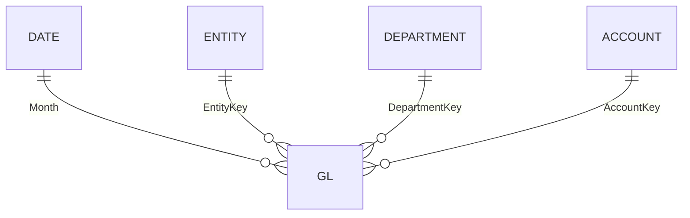

# Semantic model reference

> Generated by `scripts/document_model.py` from `scripts/model_def.py`. Do not edit by hand.

**17 tables · 216 measures · 4 relationships** · import mode · culture en-CA · fiscal year April-March named by the year it ends.

## Star schema



All relationships are many-to-one, single direction, from the `GL` fact to its dimensions. Report-line, selector and bridge tables are deliberately disconnected: measures apply them with `TREATAS` or `SELECTEDVALUE`, which is the Goodly "template table" pattern for financial statements.

## Power Query

Every query reads through one static source, `Folder.Files(DataRoot)`, and filters to the subfolder it needs. That keeps refresh free of privacy-level prompts and gateway requirements, and makes adding or removing a period a file operation.

| Function | Purpose |
|---|---|
| `fnReadCsv(subfolder, fileName)` | One UTF-8 CSV; blank strings become null |
| `fnLoadLedgerFolder(subfolder, scenario)` | Every `GL_*.csv` in a folder: columns matched by name (handles schema drift), exact duplicates removed, blank department mapped to 0 "Unassigned" |

## Tables

### Account

Chart of accounts (parent-child) with statement type. *Source: Power Query.*

| Column | Type | Notes |
|---|---|---|
| AccountKey | int64 |  |
| ParentAccountKey | int64 | hidden |
| AccountCode | string |  |
| AccountName | string |  |
| AccountType | string |  |
| UnaryOperator | string | hidden |
| Statement | string |  |
| Sign | int64 | calculated; hidden; Ledger stores revenue and costs as positive values; costs are shown negative so subtotals sum and a positive variance is always favourable. |

### Entity

Reporting entities with local currency and ownership %. *Source: Power Query.*

| Column | Type | Notes |
|---|---|---|
| EntityKey | int64 |  |
| ParentEntityKey | int64 | hidden |
| EntityName | string |  |
| OwnershipPct | double |  |
| CurrencyCode | string |  |
| Effective Ownership | double | calculated; Group economic interest: product of ownership % along the entity hierarchy. |
| Region | string | calculated; Operating region (level 2 of the entity hierarchy). |

### Department

Department groups; 0 = Unassigned (blank department in source). *Source: Power Query.*

| Column | Type | Notes |
|---|---|---|
| DepartmentKey | int64 |  |
| ParentDepartmentKey | int64 | hidden |
| DepartmentName | string |  |

### GL

General ledger fact in local currency: actuals one file per month, budgets one file per fiscal year. Grain: month x entity x department x account x scenario. *Source: Power Query.*

| Column | Type | Notes |
|---|---|---|
| Month | dateTime |  |
| EntityKey | int64 | hidden |
| DepartmentKey | int64 | hidden |
| AccountKey | int64 | hidden |
| AmountLC | double | hidden |
| Scenario | string |  |
| BudgetSource | string |  |
| SourceFile | string | hidden |
| Rate Type | string | calculated; hidden |
| Rate to CAD | double | calculated; hidden |
| Rate USD to CAD | double | calculated; hidden |
| Amount CAD | double | calculated; hidden |
| Amount USD | double | calculated; hidden |

### FX

Bank of Canada rates (CAD per unit): monthly average for P&L, month-end for balance sheet, budget rate = prior fiscal-year average. Months after the last observed rate carry it forward. *Source: Power Query.*

| Column | Type | Notes |
|---|---|---|
| FXKey | string | hidden |
| CurrencyCode | string |  |
| Month | dateTime |  |
| AvgRate | double |  |
| EndRate | double |  |
| BudgetRate | double |  |
| RateStatus | string |  |

### Report Line

Management P&L and balance-sheet template (Goodly method). Order follows LineKey. *Source: Power Query.*

| Column | Type | Notes |
|---|---|---|
| LineKey | int64 |  |
| LineName | string | sorted by LineKey |
| Section | string |  |
| LineType | string |  |
| Statement | string |  |

| Key | Line | Type | Accounts |
|---|---|---|---|
| 1 | Gross Sales | Detail | 52, 101 |
| 2 | Returns & Discounts | Detail | 53, 54 |
| 3 | Net Revenue | Subtotal | 52, 101, 53, 54 |
| 4 | Cost of Sales | Detail | 56, 57 |
| 5 | Gross Profit | Subtotal | 52, 101, 53, 54, 56, 57 |
| 6 | Salaries & Benefits | Detail | 60, 61, 62 |
| 7 | Commissions | Detail | 63 |
| 8 | Travel & Entertainment | Detail | 65, 66, 67, 68, 69 |
| 9 | Marketing | Detail | 71, 72 |
| 10 | Office, Professional & Software | Detail | 73, 74, 78, 102 |
| 11 | Occupancy & Utilities | Detail | 76, 77, 87 |
| 12 | Total Operating Expenses | Subtotal | 60, 61, 62, 63, 65, 66, 67, 68, 69, 71, 72, 73, 74, 78, 102, 76, 77, 87 |
| 13 | EBITDA | Total | 52, 101, 53, 54, 56, 57, 60, 61, 62, 63, 65, 66, 67, 68, 69, 71, 72, 73, 74, 78, 102, 76, 77, 87 |
| 14 | Depreciation & Amortization | Detail | 80, 81, 82, 83, 84, 85 |
| 15 | Operating Profit (EBIT) | Total | 52, 101, 53, 54, 56, 57, 60, 61, 62, 63, 65, 66, 67, 68, 69, 71, 72, 73, 74, 78, 102, 76, 77, 87, 80, 81, 82, 83, 84, 85 |
| 16 | Net Interest | Detail | 89, 90 |
| 17 | Other Income / (Expense) | Detail | 91, 92, 93 |
| 18 | Profit Before Tax | Total | 52, 101, 53, 54, 56, 57, 60, 61, 62, 63, 65, 66, 67, 68, 69, 71, 72, 73, 74, 78, 102, 76, 77, 87, 80, 81, 82, 83, 84, 85, 89, 90, 91, 92, 93 |
| 19 | Income Tax | Detail | 94 |
| 20 | Net Income | Total | 52, 101, 53, 54, 56, 57, 60, 61, 62, 63, 65, 66, 67, 68, 69, 71, 72, 73, 74, 78, 102, 76, 77, 87, 80, 81, 82, 83, 84, 85, 89, 90, 91, 92, 93, 94 |
| 101 | Cash | Detail | 4 |
| 102 | Receivables | Detail | 6, 7, 8 |
| 103 | Inventory | Detail | 10, 11, 12 |
| 104 | Other Current Assets (incl. intercompany) | Detail | 13, 14, 15 |
| 105 | Total Current Assets | Subtotal | 4, 6, 7, 8, 10, 11, 12, 13, 14, 15 |
| 106 | Property, Plant & Equipment | Detail | 18, 19, 20, 21, 22, 23 |
| 107 | Other Assets | Detail | 24 |
| 108 | Total Assets | Total | 4, 6, 7, 8, 10, 11, 12, 13, 14, 15, 18, 19, 20, 21, 22, 23, 24 |
| 109 | Accounts Payable | Detail | 29 |
| 110 | Accrued Liabilities | Detail | 31, 32, 33 |
| 111 | Short-term Debt | Detail | 28, 100 |
| 112 | Other Current Liabilities (incl. intercompany) | Detail | 34, 35 |
| 113 | Total Current Liabilities | Subtotal | 29, 31, 32, 33, 28, 100, 34, 35 |
| 114 | Long-term Debt | Detail | 37 |
| 115 | Pension & Other Long-term Liabilities | Detail | 38, 39, 40 |
| 116 | Total Liabilities | Subtotal | 29, 31, 32, 33, 28, 100, 34, 35, 37, 38, 39, 40 |
| 117 | Paid-in Capital | Detail | 42, 43 |
| 118 | Retained Earnings | Detail | 45, 46 |
| 119 | Total Equity | Subtotal | 42, 43, 45, 46 |
| 120 | Total Liabilities & Equity | Total | 29, 31, 32, 33, 28, 100, 34, 35, 37, 38, 39, 40, 42, 43, 45, 46 |

### Report Line Map (hidden)

Each report line mapped to every account it includes; subtotals repeat the accounts of the lines they roll up. *Source: Power Query.*

| Column | Type | Notes |
|---|---|---|
| LineKey | int64 |  |
| AccountKey | int64 |  |

### Date

Monthly fiscal calendar (April-March, named by the year it ends). Spans every fiscal year in GL, so a new year appears when its files land. *Source: calculated (DAX).*

| Column | Type | Notes |
|---|---|---|
| Month | dateTime |  |
| Year | int64 |  |
| Fiscal Year Number | int64 | hidden |
| Fiscal Year | string | sorted by Fiscal Year Number |
| Fiscal Month Number | int64 | hidden |
| Fiscal Quarter | string |  |
| Month Name | string | sorted by Fiscal Month Number |
| Year Month | string | sorted by Month Index |
| Month Index | int64 | hidden |
| IsClosed | boolean |  |
| Period Status | string |  |

### Reporting Currency

Slicer: presentation currency (CAD default). *Source: Power Query.*

| Column | Type | Notes |
|---|---|---|
| Currency | string | sorted by Sort |
| Sort | int64 | hidden |

### Period View

Slicer: MTD, QTD or YTD (default YTD). *Source: Power Query.*

| Column | Type | Notes |
|---|---|---|
| View | string | sorted by Sort |
| Sort | int64 | hidden |

### Metric

Slicer: which P&L measure the Budget vs Actual page analyses. *Source: Power Query.*

| Column | Type | Notes |
|---|---|---|
| Metric | string | sorted by Sort |
| LineKey | int64 | hidden |
| Sort | int64 | hidden |

### Revenue Bridge

Axis for the prior-year to current-year revenue bridge. *Source: Power Query.*

| Column | Type | Notes |
|---|---|---|
| Step | string | sorted by Sort |
| Sort | int64 | hidden |

### EBITDA Bridge

Axis for the budget to actual EBITDA bridge. *Source: Power Query.*

| Column | Type | Notes |
|---|---|---|
| Step | string | sorted by Sort |
| Sort | int64 | hidden |

### Insight

Rows for the insight tables: each topic shows one narrative measure. *Source: Power Query.*

| Column | Type | Notes |
|---|---|---|
| Key | int64 | hidden |
| Topic | string | sorted by Key |

### DQ File Log

Profile of every source file on each refresh: raw rows, exact duplicates, blank departments, schema drift. *Source: Power Query.*

| Column | Type | Notes |
|---|---|---|
| Name | string |  |
| Folder | string |  |
| RawRows | int64 |  |
| DuplicateRows | int64 |  |
| MissingDepartmentRows | int64 |  |
| SchemaDrift | boolean |  |
| Columns | string |  |

### DQ Injection Log

What the reproducible generator deliberately broke (data/dq_injection_log.csv), for reconciliation to what was detected. *Source: Power Query.*

| Column | Type | Notes |
|---|---|---|
| Month | string |  |
| Issue | string |  |
| RowsAffected | int64 |  |
| Cause | string |  |
| Treatment | string |  |

### _Measures

Home table for all measures, organised in display folders. *Source: Power Query.*

| Column | Type | Notes |
|---|---|---|
| Placeholder | string | hidden |

## Measures

Conventions: costs are stored negative, so every variance is "actual minus budget" and **positive is always favourable**. Period measures follow the **Period View** selector (MTD/QTD/YTD) and the **Selected Month**, which defaults to the latest closed month.

### 0 Base

**Amount** · format `#,0;(#,0);-`  
Ledger amount in the selected reporting currency (CAD default). Costs are negative.
```dax
IF ( SELECTEDVALUE ( 'Reporting Currency'[Currency], "CAD" ) = "USD", SUM ( GL[Amount USD] ), SUM ( GL[Amount CAD] ) )
```

**Currency Label**
```dax
SELECTEDVALUE ( 'Reporting Currency'[Currency], "CAD" )
```

**As Of Month** · format `mmm yyyy`  
Latest month with actuals loaded (the close). Moves forward automatically when a new actuals file is added.
```dax
CALCULATE ( MAX ( GL[Month] ), REMOVEFILTERS (), GL[Scenario] = "Actual" )
```

**Selected Month** · format `mmm yyyy`  
Reporting month: the latest month selected in the date slicers, capped at the close. Defaults to the close.
```dax
VAR picked = CALCULATE ( MAX ( 'Date'[Month] ), ALLSELECTED ( 'Date' ) )
VAR asOf = [As Of Month]
RETURN IF ( ISBLANK ( picked ) || picked > asOf, asOf, picked )
```

**Selected Fiscal Year**
```dax
VAR m = [Selected Month] RETURN "FY" & ( YEAR ( m ) + IF ( MONTH ( m ) >= 4, 1, 0 ) )
```

**Fiscal Month Of Selection** · format `0`
```dax
MOD ( MONTH ( [Selected Month] ) + 8, 12 ) + 1
```

**Period Label**
```dax
SELECTEDVALUE ( 'Period View'[View], "YTD" ) & " " & FORMAT ( [Selected Month], "mmm yyyy" ) & " · " & [Currency Label]
```

**Actual** · format `#,0;(#,0);-`
```dax
CALCULATE ( [Amount], GL[Scenario] = "Actual" )
```

**Budget** · format `#,0;(#,0);-`
```dax
CALCULATE ( [Amount], GL[Scenario] = "Budget" )
```

### 1 Period (fiscal)

**Actual MTD** · format `#,0;(#,0);-`
```dax
VAR m = [Selected Month]
RETURN CALCULATE ( [Actual], REMOVEFILTERS ( 'Date' ), 'Date'[Month] = m )
```

**Budget MTD** · format `#,0;(#,0);-`
```dax
VAR m = [Selected Month]
RETURN CALCULATE ( [Budget], REMOVEFILTERS ( 'Date' ), 'Date'[Month] = m )
```

**Prior Year MTD** · format `#,0;(#,0);-`
```dax
VAR m = EDATE ( [Selected Month], -12 )
RETURN CALCULATE ( [Actual], REMOVEFILTERS ( 'Date' ), 'Date'[Month] = m )
```

**Actual QTD** · format `#,0;(#,0);-`
```dax
VAR m = [Selected Month]
RETURN CALCULATE ( [Actual], REMOVEFILTERS ( 'Date' ), 'Date'[Month] >= DATE ( YEAR ( m ), INT ( ( MONTH ( m ) - 1 ) / 3 ) * 3 + 1, 1 ) && 'Date'[Month] <= m )
```

**Budget QTD** · format `#,0;(#,0);-`
```dax
VAR m = [Selected Month]
RETURN CALCULATE ( [Budget], REMOVEFILTERS ( 'Date' ), 'Date'[Month] >= DATE ( YEAR ( m ), INT ( ( MONTH ( m ) - 1 ) / 3 ) * 3 + 1, 1 ) && 'Date'[Month] <= m )
```

**Prior Year QTD** · format `#,0;(#,0);-`
```dax
VAR m = EDATE ( [Selected Month], -12 )
RETURN CALCULATE ( [Actual], REMOVEFILTERS ( 'Date' ), 'Date'[Month] >= DATE ( YEAR ( m ), INT ( ( MONTH ( m ) - 1 ) / 3 ) * 3 + 1, 1 ) && 'Date'[Month] <= m )
```

**Actual YTD** · format `#,0;(#,0);-`
```dax
VAR m = [Selected Month]
RETURN CALCULATE ( [Actual], REMOVEFILTERS ( 'Date' ), 'Date'[Month] >= DATE ( ( YEAR ( m ) + IF ( MONTH ( m ) >= 4, 1, 0 ) ) - 1, 4, 1 ) && 'Date'[Month] <= m )
```

**Budget YTD** · format `#,0;(#,0);-`
```dax
VAR m = [Selected Month]
RETURN CALCULATE ( [Budget], REMOVEFILTERS ( 'Date' ), 'Date'[Month] >= DATE ( ( YEAR ( m ) + IF ( MONTH ( m ) >= 4, 1, 0 ) ) - 1, 4, 1 ) && 'Date'[Month] <= m )
```

**Prior Year YTD** · format `#,0;(#,0);-`
```dax
VAR m = EDATE ( [Selected Month], -12 )
RETURN CALCULATE ( [Actual], REMOVEFILTERS ( 'Date' ), 'Date'[Month] >= DATE ( ( YEAR ( m ) + IF ( MONTH ( m ) >= 4, 1, 0 ) ) - 1, 4, 1 ) && 'Date'[Month] <= m )
```

**Budget FY** · format `#,0;(#,0);-`  
Full fiscal-year budget for the year of the selected month.
```dax
VAR m = [Selected Month] VAR fy = ( YEAR ( m ) + IF ( MONTH ( m ) >= 4, 1, 0 ) )
RETURN CALCULATE ( [Budget], REMOVEFILTERS ( 'Date' ), 'Date'[Fiscal Year Number] = fy )
```

**Outlook FY** · format `#,0;(#,0);-`  
Rolling fiscal-year outlook: actuals to the selected month + budget for the remaining months (Goodly level-3 pattern).
```dax
VAR m = [Selected Month] VAR fy = ( YEAR ( m ) + IF ( MONTH ( m ) >= 4, 1, 0 ) )
RETURN [Actual YTD] + CALCULATE ( [Budget], REMOVEFILTERS ( 'Date' ), 'Date'[Fiscal Year Number] = fy && 'Date'[Month] > m )
```

**Actual (Period)** · format `#,0;(#,0);-`
```dax
SWITCH ( SELECTEDVALUE ( 'Period View'[View], "YTD" ), "MTD", [Actual MTD], "QTD", [Actual QTD], [Actual YTD] )
```

**Budget (Period)** · format `#,0;(#,0);-`
```dax
SWITCH ( SELECTEDVALUE ( 'Period View'[View], "YTD" ), "MTD", [Budget MTD], "QTD", [Budget QTD], [Budget YTD] )
```

**Prior Year (Period)** · format `#,0;(#,0);-`
```dax
SWITCH ( SELECTEDVALUE ( 'Period View'[View], "YTD" ), "MTD", [Prior Year MTD], "QTD", [Prior Year QTD], [Prior Year YTD] )
```

**Closing Balance** · format `#,0;(#,0);-`  
Balance-sheet value at the selected month end.
```dax
VAR m = [Selected Month]
RETURN CALCULATE ( [Actual], REMOVEFILTERS ( 'Date' ), 'Date'[Month] = m )
```

**Prior Year-End Balance** · format `#,0;(#,0);-`  
Balance at the previous fiscal year end (31 March).
```dax
VAR m = [Selected Month] VAR ye = DATE ( ( YEAR ( m ) + IF ( MONTH ( m ) >= 4, 1, 0 ) ) - 1, 3, 1 )
RETURN CALCULATE ( [Actual], REMOVEFILTERS ( 'Date' ), 'Date'[Month] = ye )
```

### 1 Period (fiscal)\Month axis

**Monthly Actual (Selected FY)** · format `#,0;(#,0);-`  
Month-axis charts: actual for each fiscal month of the selected year, up to the selected month. Independent of which years the date slicer shows.
```dax
IF ( HASONEVALUE ( 'Date'[Fiscal Month Number] ),
    VAR fm = MAX ( 'Date'[Fiscal Month Number] ) VAR fy = ( YEAR ( [Selected Month] ) + IF ( MONTH ( [Selected Month] ) >= 4, 1, 0 ) )
    VAR d = DATE ( fy - 1, 3 + fm, 1 ) VAR sel = [Selected Month] VAR fyStart = DATE ( fy - 1, 4, 1 )
    RETURN IF ( d <= sel, CALCULATE ( [Actual], REMOVEFILTERS ( 'Date' ), 'Date'[Month] = d ) )
)
```

**Monthly Budget (Selected FY)** · format `#,0;(#,0);-`
```dax
IF ( HASONEVALUE ( 'Date'[Fiscal Month Number] ),
    VAR fm = MAX ( 'Date'[Fiscal Month Number] ) VAR fy = ( YEAR ( [Selected Month] ) + IF ( MONTH ( [Selected Month] ) >= 4, 1, 0 ) )
    VAR d = DATE ( fy - 1, 3 + fm, 1 ) VAR sel = [Selected Month] VAR fyStart = DATE ( fy - 1, 4, 1 )
    RETURN CALCULATE ( [Budget], REMOVEFILTERS ( 'Date' ), 'Date'[Month] = d )
)
```

**Monthly Outlook (Selected FY)** · format `#,0;(#,0);-`  
Budget shown as the outlook for months after the selected month.
```dax
IF ( HASONEVALUE ( 'Date'[Fiscal Month Number] ),
    VAR fm = MAX ( 'Date'[Fiscal Month Number] ) VAR fy = ( YEAR ( [Selected Month] ) + IF ( MONTH ( [Selected Month] ) >= 4, 1, 0 ) )
    VAR d = DATE ( fy - 1, 3 + fm, 1 ) VAR sel = [Selected Month] VAR fyStart = DATE ( fy - 1, 4, 1 )
    RETURN IF ( d > sel, CALCULATE ( [Budget], REMOVEFILTERS ( 'Date' ), 'Date'[Month] = d ) )
)
```

**Monthly Prior Year (Selected FY)** · format `#,0;(#,0);-`
```dax
IF ( HASONEVALUE ( 'Date'[Fiscal Month Number] ),
    VAR fm = MAX ( 'Date'[Fiscal Month Number] ) VAR fy = ( YEAR ( [Selected Month] ) + IF ( MONTH ( [Selected Month] ) >= 4, 1, 0 ) )
    VAR d = DATE ( fy - 1, 3 + fm, 1 ) VAR sel = [Selected Month] VAR fyStart = DATE ( fy - 1, 4, 1 )
    RETURN CALCULATE ( [Actual], REMOVEFILTERS ( 'Date' ), 'Date'[Month] = EDATE ( d, -12 ) )
)
```

**Cumulative Actual (Selected FY)** · format `#,0;(#,0);-`
```dax
IF ( HASONEVALUE ( 'Date'[Fiscal Month Number] ),
    VAR fm = MAX ( 'Date'[Fiscal Month Number] ) VAR fy = ( YEAR ( [Selected Month] ) + IF ( MONTH ( [Selected Month] ) >= 4, 1, 0 ) )
    VAR d = DATE ( fy - 1, 3 + fm, 1 ) VAR sel = [Selected Month] VAR fyStart = DATE ( fy - 1, 4, 1 )
    RETURN IF ( d <= sel, CALCULATE ( [Actual], REMOVEFILTERS ( 'Date' ), 'Date'[Month] >= fyStart && 'Date'[Month] <= d ) )
)
```

**Cumulative Outlook (Selected FY)** · format `#,0;(#,0);-`  
Actual to the selected month plus budget for later months, accumulated: where the year is heading.
```dax
IF ( HASONEVALUE ( 'Date'[Fiscal Month Number] ),
    VAR fm = MAX ( 'Date'[Fiscal Month Number] ) VAR fy = ( YEAR ( [Selected Month] ) + IF ( MONTH ( [Selected Month] ) >= 4, 1, 0 ) )
    VAR d = DATE ( fy - 1, 3 + fm, 1 ) VAR sel = [Selected Month] VAR fyStart = DATE ( fy - 1, 4, 1 )
    RETURN IF ( d >= sel, CALCULATE ( [Actual], REMOVEFILTERS ( 'Date' ), 'Date'[Month] >= fyStart && 'Date'[Month] <= sel ) + CALCULATE ( [Budget], REMOVEFILTERS ( 'Date' ), 'Date'[Month] > sel && 'Date'[Month] <= d ) )
)
```

**Cumulative Budget (Selected FY)** · format `#,0;(#,0);-`
```dax
IF ( HASONEVALUE ( 'Date'[Fiscal Month Number] ),
    VAR fm = MAX ( 'Date'[Fiscal Month Number] ) VAR fy = ( YEAR ( [Selected Month] ) + IF ( MONTH ( [Selected Month] ) >= 4, 1, 0 ) )
    VAR d = DATE ( fy - 1, 3 + fm, 1 ) VAR sel = [Selected Month] VAR fyStart = DATE ( fy - 1, 4, 1 )
    RETURN CALCULATE ( [Budget], REMOVEFILTERS ( 'Date' ), 'Date'[Month] >= fyStart && 'Date'[Month] <= d )
)
```

### 2 Statement Lines

**Line Actual** · format `#,0;(#,0);-`  
Report-line value for the Period View; one line at a time.
```dax
IF ( HASONEVALUE ( 'Report Line'[LineKey] ),
    VAR accts = CALCULATETABLE ( VALUES ( 'Report Line Map'[AccountKey] ), TREATAS ( VALUES ( 'Report Line'[LineKey] ), 'Report Line Map'[LineKey] ) )
    RETURN CALCULATE ( [Actual (Period)], TREATAS ( accts, Account[AccountKey] ) )
)
```

**Line Budget** · format `#,0;(#,0);-`
```dax
IF ( HASONEVALUE ( 'Report Line'[LineKey] ),
    VAR accts = CALCULATETABLE ( VALUES ( 'Report Line Map'[AccountKey] ), TREATAS ( VALUES ( 'Report Line'[LineKey] ), 'Report Line Map'[LineKey] ) )
    RETURN CALCULATE ( [Budget (Period)], TREATAS ( accts, Account[AccountKey] ) )
)
```

**Line Prior Year** · format `#,0;(#,0);-`
```dax
IF ( HASONEVALUE ( 'Report Line'[LineKey] ),
    VAR accts = CALCULATETABLE ( VALUES ( 'Report Line Map'[AccountKey] ), TREATAS ( VALUES ( 'Report Line'[LineKey] ), 'Report Line Map'[LineKey] ) )
    RETURN CALCULATE ( [Prior Year (Period)], TREATAS ( accts, Account[AccountKey] ) )
)
```

**Line Var vs Budget** · format `#,0;(#,0);-`  
Positive = favourable (costs are stored negative).
```dax
[Line Actual] - [Line Budget]
```

**Line Var % vs Budget** · format `0.0%;-0.0%;-`
```dax
IF ( NOT ISBLANK ( [Line Budget] ), DIVIDE ( [Line Actual] - [Line Budget], ABS ( [Line Budget] ) ) )
```

**Line Var vs Prior Year** · format `#,0;(#,0);-`
```dax
[Line Actual] - [Line Prior Year]
```

**Line Growth %** · format `0.0%;-0.0%;-`
```dax
IF ( NOT ISBLANK ( [Line Prior Year] ), DIVIDE ( [Line Actual] - [Line Prior Year], ABS ( [Line Prior Year] ) ) )
```

**Line % of Revenue** · format `0.0%;-0.0%;-`
```dax
DIVIDE ( [Line Actual], CALCULATE ( [Actual (Period)], TREATAS ( CALCULATETABLE ( VALUES ( 'Report Line Map'[AccountKey] ), 'Report Line Map'[LineKey] = 3 ), Account[AccountKey] ) ) )
```

**Line Outlook FY** · format `#,0;(#,0);-`
```dax
IF ( HASONEVALUE ( 'Report Line'[LineKey] ),
    VAR accts = CALCULATETABLE ( VALUES ( 'Report Line Map'[AccountKey] ), TREATAS ( VALUES ( 'Report Line'[LineKey] ), 'Report Line Map'[LineKey] ) )
    RETURN CALCULATE ( [Outlook FY], TREATAS ( accts, Account[AccountKey] ) )
)
```

**Line Budget FY** · format `#,0;(#,0);-`
```dax
IF ( HASONEVALUE ( 'Report Line'[LineKey] ),
    VAR accts = CALCULATETABLE ( VALUES ( 'Report Line Map'[AccountKey] ), TREATAS ( VALUES ( 'Report Line'[LineKey] ), 'Report Line Map'[LineKey] ) )
    RETURN CALCULATE ( [Budget FY], TREATAS ( accts, Account[AccountKey] ) )
)
```

**Line Closing Balance** · format `#,0;(#,0);-`
```dax
IF ( HASONEVALUE ( 'Report Line'[LineKey] ),
    VAR accts = CALCULATETABLE ( VALUES ( 'Report Line Map'[AccountKey] ), TREATAS ( VALUES ( 'Report Line'[LineKey] ), 'Report Line Map'[LineKey] ) )
    RETURN CALCULATE ( [Closing Balance], TREATAS ( accts, Account[AccountKey] ) )
)
```

**Line Prior Year-End Balance** · format `#,0;(#,0);-`
```dax
IF ( HASONEVALUE ( 'Report Line'[LineKey] ),
    VAR accts = CALCULATETABLE ( VALUES ( 'Report Line Map'[AccountKey] ), TREATAS ( VALUES ( 'Report Line'[LineKey] ), 'Report Line Map'[LineKey] ) )
    RETURN CALCULATE ( [Prior Year-End Balance], TREATAS ( accts, Account[AccountKey] ) )
)
```

**Line Balance Change** · format `#,0;(#,0);-`
```dax
[Line Closing Balance] - [Line Prior Year-End Balance]
```

### 8 Formatting

**Line Var Color**
```dax
IF ( [Line Var vs Budget] < 0, "#C0392B", "#2E7D32" )
```

**Revenue Var Color**
```dax
IF ( [Revenue Var vs Budget] < 0, "#C0392B", "#2E7D32" )
```

**Cost of Sales Var Color**
```dax
IF ( [Cost of Sales Var vs Budget] < 0, "#C0392B", "#2E7D32" )
```

**Gross Profit Var Color**
```dax
IF ( [Gross Profit Var vs Budget] < 0, "#C0392B", "#2E7D32" )
```

**Operating Expenses Var Color**
```dax
IF ( [Operating Expenses Var vs Budget] < 0, "#C0392B", "#2E7D32" )
```

**EBITDA Var Color**
```dax
IF ( [EBITDA Var vs Budget] < 0, "#C0392B", "#2E7D32" )
```

**EBIT Var Color**
```dax
IF ( [EBIT Var vs Budget] < 0, "#C0392B", "#2E7D32" )
```

**Net Income Var Color**
```dax
IF ( [Net Income Var vs Budget] < 0, "#C0392B", "#2E7D32" )
```

**Gross Margin Var Color**
```dax
IF ( [Gross Profit Margin pts vs Budget] < 0, "#C0392B", "#2E7D32" )
```

**Line Row Background**
```dax
IF ( HASONEVALUE ( 'Report Line'[LineKey] ), SWITCH ( SELECTEDVALUE ( 'Report Line'[LineType] ), "Subtotal", "#EEF1F5", "Total", "#DCE3EC", "#FFFFFF" ) )
```

**Line Growth Color**
```dax
IF ( [Line Growth %] < 0, "#C0392B", "#2E7D32" )
```

**Balance Change Color**
```dax
IF ( [Line Balance Change] < 0, "#C0392B", "#2E7D32" )
```

**Metric Var Color**
```dax
IF ( [Metric Var vs Budget] < 0, "#C0392B", "#2E7D32" )
```

**Metric Gap Color**
```dax
IF ( [Metric Outlook Gap] < 0, "#C0392B", "#2E7D32" )
```

**Entity Budget Status Color**
```dax
IF ( [Entity Budget Status] = "Not budgeted", "#C0392B", "#1F2A37" )
```

### 3 KPIs\Revenue

**Revenue** · format `#,0;(#,0);-`
```dax
CALCULATE ( [Actual (Period)], TREATAS ( CALCULATETABLE ( VALUES ( 'Report Line Map'[AccountKey] ), 'Report Line Map'[LineKey] = 3 ), Account[AccountKey] ) )
```

**Revenue Budget** · format `#,0;(#,0);-`
```dax
CALCULATE ( [Budget (Period)], TREATAS ( CALCULATETABLE ( VALUES ( 'Report Line Map'[AccountKey] ), 'Report Line Map'[LineKey] = 3 ), Account[AccountKey] ) )
```

**Revenue PY** · format `#,0;(#,0);-`
```dax
CALCULATE ( [Prior Year (Period)], TREATAS ( CALCULATETABLE ( VALUES ( 'Report Line Map'[AccountKey] ), 'Report Line Map'[LineKey] = 3 ), Account[AccountKey] ) )
```

**Revenue Var vs Budget** · format `#,0;(#,0);-`
```dax
[Revenue] - [Revenue Budget]
```

**Revenue Var % vs Budget** · format `0.0%;-0.0%;-`
```dax
DIVIDE ( [Revenue] - [Revenue Budget], ABS ( [Revenue Budget] ) )
```

**Revenue Growth %** · format `0.0%;-0.0%;-`
```dax
DIVIDE ( [Revenue] - [Revenue PY], ABS ( [Revenue PY] ) )
```

**Revenue Outlook FY** · format `#,0;(#,0);-`
```dax
CALCULATE ( [Outlook FY], TREATAS ( CALCULATETABLE ( VALUES ( 'Report Line Map'[AccountKey] ), 'Report Line Map'[LineKey] = 3 ), Account[AccountKey] ) )
```

**Revenue Budget FY** · format `#,0;(#,0);-`
```dax
CALCULATE ( [Budget FY], TREATAS ( CALCULATETABLE ( VALUES ( 'Report Line Map'[AccountKey] ), 'Report Line Map'[LineKey] = 3 ), Account[AccountKey] ) )
```

**Revenue Monthly Actual** · format `#,0;(#,0);-`
```dax
CALCULATE ( [Actual], TREATAS ( CALCULATETABLE ( VALUES ( 'Report Line Map'[AccountKey] ), 'Report Line Map'[LineKey] = 3 ), Account[AccountKey] ) )
```

**Revenue vs Budget Text**
```dax
FORMAT ( [Revenue Var % vs Budget], "▲ 0.0%;▼ 0.0%;0.0%" ) & " vs Bud  ·  " & FORMAT ( [Revenue Growth %], "▲ 0.0%;▼ 0.0%;0.0%" ) & " vs PY"
```

**Revenue Actual (in context)** · format `#,0;(#,0);-`  
Net revenue for whatever dates are on the axis (e.g. a fiscal-year column).
```dax
CALCULATE ( [Actual], TREATAS ( CALCULATETABLE ( VALUES ( 'Report Line Map'[AccountKey] ), 'Report Line Map'[LineKey] = 3 ), Account[AccountKey] ) )
```

### 3 KPIs\Cost of Sales

**Cost of Sales** · format `#,0;(#,0);-`
```dax
CALCULATE ( [Actual (Period)], TREATAS ( CALCULATETABLE ( VALUES ( 'Report Line Map'[AccountKey] ), 'Report Line Map'[LineKey] = 4 ), Account[AccountKey] ) )
```

**Cost of Sales Budget** · format `#,0;(#,0);-`
```dax
CALCULATE ( [Budget (Period)], TREATAS ( CALCULATETABLE ( VALUES ( 'Report Line Map'[AccountKey] ), 'Report Line Map'[LineKey] = 4 ), Account[AccountKey] ) )
```

**Cost of Sales PY** · format `#,0;(#,0);-`
```dax
CALCULATE ( [Prior Year (Period)], TREATAS ( CALCULATETABLE ( VALUES ( 'Report Line Map'[AccountKey] ), 'Report Line Map'[LineKey] = 4 ), Account[AccountKey] ) )
```

**Cost of Sales Var vs Budget** · format `#,0;(#,0);-`
```dax
[Cost of Sales] - [Cost of Sales Budget]
```

**Cost of Sales Var % vs Budget** · format `0.0%;-0.0%;-`
```dax
DIVIDE ( [Cost of Sales] - [Cost of Sales Budget], ABS ( [Cost of Sales Budget] ) )
```

**Cost of Sales Growth %** · format `0.0%;-0.0%;-`
```dax
DIVIDE ( [Cost of Sales] - [Cost of Sales PY], ABS ( [Cost of Sales PY] ) )
```

**Cost of Sales Outlook FY** · format `#,0;(#,0);-`
```dax
CALCULATE ( [Outlook FY], TREATAS ( CALCULATETABLE ( VALUES ( 'Report Line Map'[AccountKey] ), 'Report Line Map'[LineKey] = 4 ), Account[AccountKey] ) )
```

**Cost of Sales Budget FY** · format `#,0;(#,0);-`
```dax
CALCULATE ( [Budget FY], TREATAS ( CALCULATETABLE ( VALUES ( 'Report Line Map'[AccountKey] ), 'Report Line Map'[LineKey] = 4 ), Account[AccountKey] ) )
```

**Cost of Sales Monthly Actual** · format `#,0;(#,0);-`
```dax
CALCULATE ( [Actual], TREATAS ( CALCULATETABLE ( VALUES ( 'Report Line Map'[AccountKey] ), 'Report Line Map'[LineKey] = 4 ), Account[AccountKey] ) )
```

**Cost of Sales vs Budget Text**
```dax
FORMAT ( [Cost of Sales Var % vs Budget], "▲ 0.0%;▼ 0.0%;0.0%" ) & " vs Bud  ·  " & FORMAT ( [Cost of Sales Growth %], "▲ 0.0%;▼ 0.0%;0.0%" ) & " vs PY"
```

### 3 KPIs\Gross Profit

**Gross Profit** · format `#,0;(#,0);-`
```dax
CALCULATE ( [Actual (Period)], TREATAS ( CALCULATETABLE ( VALUES ( 'Report Line Map'[AccountKey] ), 'Report Line Map'[LineKey] = 5 ), Account[AccountKey] ) )
```

**Gross Profit Budget** · format `#,0;(#,0);-`
```dax
CALCULATE ( [Budget (Period)], TREATAS ( CALCULATETABLE ( VALUES ( 'Report Line Map'[AccountKey] ), 'Report Line Map'[LineKey] = 5 ), Account[AccountKey] ) )
```

**Gross Profit PY** · format `#,0;(#,0);-`
```dax
CALCULATE ( [Prior Year (Period)], TREATAS ( CALCULATETABLE ( VALUES ( 'Report Line Map'[AccountKey] ), 'Report Line Map'[LineKey] = 5 ), Account[AccountKey] ) )
```

**Gross Profit Var vs Budget** · format `#,0;(#,0);-`
```dax
[Gross Profit] - [Gross Profit Budget]
```

**Gross Profit Var % vs Budget** · format `0.0%;-0.0%;-`
```dax
DIVIDE ( [Gross Profit] - [Gross Profit Budget], ABS ( [Gross Profit Budget] ) )
```

**Gross Profit Growth %** · format `0.0%;-0.0%;-`
```dax
DIVIDE ( [Gross Profit] - [Gross Profit PY], ABS ( [Gross Profit PY] ) )
```

**Gross Profit Outlook FY** · format `#,0;(#,0);-`
```dax
CALCULATE ( [Outlook FY], TREATAS ( CALCULATETABLE ( VALUES ( 'Report Line Map'[AccountKey] ), 'Report Line Map'[LineKey] = 5 ), Account[AccountKey] ) )
```

**Gross Profit Budget FY** · format `#,0;(#,0);-`
```dax
CALCULATE ( [Budget FY], TREATAS ( CALCULATETABLE ( VALUES ( 'Report Line Map'[AccountKey] ), 'Report Line Map'[LineKey] = 5 ), Account[AccountKey] ) )
```

**Gross Profit Monthly Actual** · format `#,0;(#,0);-`
```dax
CALCULATE ( [Actual], TREATAS ( CALCULATETABLE ( VALUES ( 'Report Line Map'[AccountKey] ), 'Report Line Map'[LineKey] = 5 ), Account[AccountKey] ) )
```

**Gross Profit vs Budget Text**
```dax
FORMAT ( [Gross Profit Var % vs Budget], "▲ 0.0%;▼ 0.0%;0.0%" ) & " vs Bud  ·  " & FORMAT ( [Gross Profit Growth %], "▲ 0.0%;▼ 0.0%;0.0%" ) & " vs PY"
```

### 3 KPIs\Operating Expenses

**Operating Expenses** · format `#,0;(#,0);-`
```dax
CALCULATE ( [Actual (Period)], TREATAS ( CALCULATETABLE ( VALUES ( 'Report Line Map'[AccountKey] ), 'Report Line Map'[LineKey] = 12 ), Account[AccountKey] ) )
```

**Operating Expenses Budget** · format `#,0;(#,0);-`
```dax
CALCULATE ( [Budget (Period)], TREATAS ( CALCULATETABLE ( VALUES ( 'Report Line Map'[AccountKey] ), 'Report Line Map'[LineKey] = 12 ), Account[AccountKey] ) )
```

**Operating Expenses PY** · format `#,0;(#,0);-`
```dax
CALCULATE ( [Prior Year (Period)], TREATAS ( CALCULATETABLE ( VALUES ( 'Report Line Map'[AccountKey] ), 'Report Line Map'[LineKey] = 12 ), Account[AccountKey] ) )
```

**Operating Expenses Var vs Budget** · format `#,0;(#,0);-`
```dax
[Operating Expenses] - [Operating Expenses Budget]
```

**Operating Expenses Var % vs Budget** · format `0.0%;-0.0%;-`
```dax
DIVIDE ( [Operating Expenses] - [Operating Expenses Budget], ABS ( [Operating Expenses Budget] ) )
```

**Operating Expenses Growth %** · format `0.0%;-0.0%;-`
```dax
DIVIDE ( [Operating Expenses] - [Operating Expenses PY], ABS ( [Operating Expenses PY] ) )
```

**Operating Expenses Outlook FY** · format `#,0;(#,0);-`
```dax
CALCULATE ( [Outlook FY], TREATAS ( CALCULATETABLE ( VALUES ( 'Report Line Map'[AccountKey] ), 'Report Line Map'[LineKey] = 12 ), Account[AccountKey] ) )
```

**Operating Expenses Budget FY** · format `#,0;(#,0);-`
```dax
CALCULATE ( [Budget FY], TREATAS ( CALCULATETABLE ( VALUES ( 'Report Line Map'[AccountKey] ), 'Report Line Map'[LineKey] = 12 ), Account[AccountKey] ) )
```

**Operating Expenses Monthly Actual** · format `#,0;(#,0);-`
```dax
CALCULATE ( [Actual], TREATAS ( CALCULATETABLE ( VALUES ( 'Report Line Map'[AccountKey] ), 'Report Line Map'[LineKey] = 12 ), Account[AccountKey] ) )
```

**Operating Expenses vs Budget Text**
```dax
FORMAT ( [Operating Expenses Var % vs Budget], "▲ 0.0%;▼ 0.0%;0.0%" ) & " vs Bud  ·  " & FORMAT ( [Operating Expenses Growth %], "▲ 0.0%;▼ 0.0%;0.0%" ) & " vs PY"
```

### 3 KPIs\EBITDA

**EBITDA** · format `#,0;(#,0);-`
```dax
CALCULATE ( [Actual (Period)], TREATAS ( CALCULATETABLE ( VALUES ( 'Report Line Map'[AccountKey] ), 'Report Line Map'[LineKey] = 13 ), Account[AccountKey] ) )
```

**EBITDA Budget** · format `#,0;(#,0);-`
```dax
CALCULATE ( [Budget (Period)], TREATAS ( CALCULATETABLE ( VALUES ( 'Report Line Map'[AccountKey] ), 'Report Line Map'[LineKey] = 13 ), Account[AccountKey] ) )
```

**EBITDA PY** · format `#,0;(#,0);-`
```dax
CALCULATE ( [Prior Year (Period)], TREATAS ( CALCULATETABLE ( VALUES ( 'Report Line Map'[AccountKey] ), 'Report Line Map'[LineKey] = 13 ), Account[AccountKey] ) )
```

**EBITDA Var vs Budget** · format `#,0;(#,0);-`
```dax
[EBITDA] - [EBITDA Budget]
```

**EBITDA Var % vs Budget** · format `0.0%;-0.0%;-`
```dax
DIVIDE ( [EBITDA] - [EBITDA Budget], ABS ( [EBITDA Budget] ) )
```

**EBITDA Growth %** · format `0.0%;-0.0%;-`
```dax
DIVIDE ( [EBITDA] - [EBITDA PY], ABS ( [EBITDA PY] ) )
```

**EBITDA Outlook FY** · format `#,0;(#,0);-`
```dax
CALCULATE ( [Outlook FY], TREATAS ( CALCULATETABLE ( VALUES ( 'Report Line Map'[AccountKey] ), 'Report Line Map'[LineKey] = 13 ), Account[AccountKey] ) )
```

**EBITDA Budget FY** · format `#,0;(#,0);-`
```dax
CALCULATE ( [Budget FY], TREATAS ( CALCULATETABLE ( VALUES ( 'Report Line Map'[AccountKey] ), 'Report Line Map'[LineKey] = 13 ), Account[AccountKey] ) )
```

**EBITDA Monthly Actual** · format `#,0;(#,0);-`
```dax
CALCULATE ( [Actual], TREATAS ( CALCULATETABLE ( VALUES ( 'Report Line Map'[AccountKey] ), 'Report Line Map'[LineKey] = 13 ), Account[AccountKey] ) )
```

**EBITDA vs Budget Text**
```dax
FORMAT ( [EBITDA Var % vs Budget], "▲ 0.0%;▼ 0.0%;0.0%" ) & " vs Bud  ·  " & FORMAT ( [EBITDA Growth %], "▲ 0.0%;▼ 0.0%;0.0%" ) & " vs PY"
```

**EBITDA Bridge Value** · format `#,0;(#,0);-`  
EBITDA variance to budget split by driver; the waterfall total is the EBITDA variance.
```dax
SWITCH ( SELECTEDVALUE ( 'EBITDA Bridge'[Step] ), "Revenue", [Revenue Var vs Budget], "Cost of sales", [Cost of Sales Var vs Budget], "Operating expenses", [Operating Expenses Var vs Budget] )
```

### 3 KPIs\EBIT

**EBIT** · format `#,0;(#,0);-`
```dax
CALCULATE ( [Actual (Period)], TREATAS ( CALCULATETABLE ( VALUES ( 'Report Line Map'[AccountKey] ), 'Report Line Map'[LineKey] = 15 ), Account[AccountKey] ) )
```

**EBIT Budget** · format `#,0;(#,0);-`
```dax
CALCULATE ( [Budget (Period)], TREATAS ( CALCULATETABLE ( VALUES ( 'Report Line Map'[AccountKey] ), 'Report Line Map'[LineKey] = 15 ), Account[AccountKey] ) )
```

**EBIT PY** · format `#,0;(#,0);-`
```dax
CALCULATE ( [Prior Year (Period)], TREATAS ( CALCULATETABLE ( VALUES ( 'Report Line Map'[AccountKey] ), 'Report Line Map'[LineKey] = 15 ), Account[AccountKey] ) )
```

**EBIT Var vs Budget** · format `#,0;(#,0);-`
```dax
[EBIT] - [EBIT Budget]
```

**EBIT Var % vs Budget** · format `0.0%;-0.0%;-`
```dax
DIVIDE ( [EBIT] - [EBIT Budget], ABS ( [EBIT Budget] ) )
```

**EBIT Growth %** · format `0.0%;-0.0%;-`
```dax
DIVIDE ( [EBIT] - [EBIT PY], ABS ( [EBIT PY] ) )
```

**EBIT Outlook FY** · format `#,0;(#,0);-`
```dax
CALCULATE ( [Outlook FY], TREATAS ( CALCULATETABLE ( VALUES ( 'Report Line Map'[AccountKey] ), 'Report Line Map'[LineKey] = 15 ), Account[AccountKey] ) )
```

**EBIT Budget FY** · format `#,0;(#,0);-`
```dax
CALCULATE ( [Budget FY], TREATAS ( CALCULATETABLE ( VALUES ( 'Report Line Map'[AccountKey] ), 'Report Line Map'[LineKey] = 15 ), Account[AccountKey] ) )
```

**EBIT Monthly Actual** · format `#,0;(#,0);-`
```dax
CALCULATE ( [Actual], TREATAS ( CALCULATETABLE ( VALUES ( 'Report Line Map'[AccountKey] ), 'Report Line Map'[LineKey] = 15 ), Account[AccountKey] ) )
```

**EBIT vs Budget Text**
```dax
FORMAT ( [EBIT Var % vs Budget], "▲ 0.0%;▼ 0.0%;0.0%" ) & " vs Bud  ·  " & FORMAT ( [EBIT Growth %], "▲ 0.0%;▼ 0.0%;0.0%" ) & " vs PY"
```

### 3 KPIs\Net Income

**Net Income** · format `#,0;(#,0);-`
```dax
CALCULATE ( [Actual (Period)], TREATAS ( CALCULATETABLE ( VALUES ( 'Report Line Map'[AccountKey] ), 'Report Line Map'[LineKey] = 20 ), Account[AccountKey] ) )
```

**Net Income Budget** · format `#,0;(#,0);-`
```dax
CALCULATE ( [Budget (Period)], TREATAS ( CALCULATETABLE ( VALUES ( 'Report Line Map'[AccountKey] ), 'Report Line Map'[LineKey] = 20 ), Account[AccountKey] ) )
```

**Net Income PY** · format `#,0;(#,0);-`
```dax
CALCULATE ( [Prior Year (Period)], TREATAS ( CALCULATETABLE ( VALUES ( 'Report Line Map'[AccountKey] ), 'Report Line Map'[LineKey] = 20 ), Account[AccountKey] ) )
```

**Net Income Var vs Budget** · format `#,0;(#,0);-`
```dax
[Net Income] - [Net Income Budget]
```

**Net Income Var % vs Budget** · format `0.0%;-0.0%;-`
```dax
DIVIDE ( [Net Income] - [Net Income Budget], ABS ( [Net Income Budget] ) )
```

**Net Income Growth %** · format `0.0%;-0.0%;-`
```dax
DIVIDE ( [Net Income] - [Net Income PY], ABS ( [Net Income PY] ) )
```

**Net Income Outlook FY** · format `#,0;(#,0);-`
```dax
CALCULATE ( [Outlook FY], TREATAS ( CALCULATETABLE ( VALUES ( 'Report Line Map'[AccountKey] ), 'Report Line Map'[LineKey] = 20 ), Account[AccountKey] ) )
```

**Net Income Budget FY** · format `#,0;(#,0);-`
```dax
CALCULATE ( [Budget FY], TREATAS ( CALCULATETABLE ( VALUES ( 'Report Line Map'[AccountKey] ), 'Report Line Map'[LineKey] = 20 ), Account[AccountKey] ) )
```

**Net Income Monthly Actual** · format `#,0;(#,0);-`
```dax
CALCULATE ( [Actual], TREATAS ( CALCULATETABLE ( VALUES ( 'Report Line Map'[AccountKey] ), 'Report Line Map'[LineKey] = 20 ), Account[AccountKey] ) )
```

**Net Income vs Budget Text**
```dax
FORMAT ( [Net Income Var % vs Budget], "▲ 0.0%;▼ 0.0%;0.0%" ) & " vs Bud  ·  " & FORMAT ( [Net Income Growth %], "▲ 0.0%;▼ 0.0%;0.0%" ) & " vs PY"
```

### 3 KPIs\Margins

**Gross Profit Margin %** · format `0.0%;-0.0%;-`
```dax
DIVIDE ( [Gross Profit], [Revenue] )
```

**Gross Profit Margin % Budget** · format `0.0%;-0.0%;-`
```dax
DIVIDE ( [Gross Profit Budget], [Revenue Budget] )
```

**Gross Profit Margin pts vs Budget** · format `+0.0%;-0.0%;-`
```dax
[Gross Profit Margin %] - [Gross Profit Margin % Budget]
```

**EBITDA Margin %** · format `0.0%;-0.0%;-`
```dax
DIVIDE ( [EBITDA], [Revenue] )
```

**EBITDA Margin % Budget** · format `0.0%;-0.0%;-`
```dax
DIVIDE ( [EBITDA Budget], [Revenue Budget] )
```

**EBITDA Margin pts vs Budget** · format `+0.0%;-0.0%;-`
```dax
[EBITDA Margin %] - [EBITDA Margin % Budget]
```

**Net Income Margin %** · format `0.0%;-0.0%;-`
```dax
DIVIDE ( [Net Income], [Revenue] )
```

**Net Income Margin % Budget** · format `0.0%;-0.0%;-`
```dax
DIVIDE ( [Net Income Budget], [Revenue Budget] )
```

**Net Income Margin pts vs Budget** · format `+0.0%;-0.0%;-`
```dax
[Net Income Margin %] - [Net Income Margin % Budget]
```

**OpEx % of Revenue** · format `0.0%;-0.0%;-`
```dax
DIVIDE ( -[Operating Expenses], [Revenue] )
```

**Gross Margin Text**
```dax
FORMAT ( [Gross Profit Margin pts vs Budget] * 100, "▲ 0.0;▼ 0.0;0.0" ) & " pts vs budget"
```

### 3 KPIs\Perimeter

**Revenue Like-for-Like** · format `#,0;(#,0);-`  
Revenue from entities that also traded in the same period last year.
```dax
SUMX ( VALUES ( Entity[EntityKey] ), IF ( NOT ISBLANK ( [Revenue PY] ), [Revenue] ) )
```

**Revenue New Entities** · format `#,0;(#,0);-`  
Revenue from entities that joined the group within the last twelve months.
```dax
[Revenue] - [Revenue Like-for-Like]
```

**Organic Growth %** · format `0.0%;-0.0%;-`
```dax
DIVIDE ( [Revenue Like-for-Like] - [Revenue PY], ABS ( [Revenue PY] ) )
```

**Revenue Unbudgeted** · format `#,0;(#,0);-`  
Revenue earned by entities with no budget for the period (acquired after the budget was set).
```dax
SUMX ( VALUES ( Entity[EntityKey] ), IF ( ISBLANK ( [Revenue Budget] ), [Revenue] ) )
```

**Revenue Var vs Budget (Budgeted Entities)** · format `#,0;(#,0);-`
```dax
SUMX ( VALUES ( Entity[EntityKey] ), IF ( NOT ISBLANK ( [Revenue Budget] ), [Revenue] - [Revenue Budget] ) )
```

**Revenue Var % vs Budget (Budgeted Entities)** · format `0.0%;-0.0%;-`
```dax
DIVIDE ( [Revenue Var vs Budget (Budgeted Entities)], ABS ( [Revenue Budget] ) )
```

**Entities Reporting** · format `0`
```dax
VAR m = [Selected Month] RETURN CALCULATE ( DISTINCTCOUNT ( GL[EntityKey] ), GL[Scenario] = "Actual", REMOVEFILTERS ( 'Date' ), 'Date'[Month] = m )
```

**Revenue TTM** · format `#,0;(#,0);-`
```dax
VAR m = [Selected Month]
RETURN CALCULATE ( CALCULATE ( [Actual], TREATAS ( CALCULATETABLE ( VALUES ( 'Report Line Map'[AccountKey] ), 'Report Line Map'[LineKey] = 3 ), Account[AccountKey] ) ), REMOVEFILTERS ( 'Date' ), 'Date'[Month] > EDATE ( m, -12 ) && 'Date'[Month] <= m )
```

**Revenue Bridge Value** · format `#,0;(#,0);-`  
Revenue growth vs prior year split into organic (like-for-like entities) and new entities; the waterfall total is the total growth.
```dax
SWITCH ( SELECTEDVALUE ( 'Revenue Bridge'[Step] ), "Organic growth", [Revenue Like-for-Like] - [Revenue PY], "New entities", [Revenue New Entities] )
```

**Entity First Month** · format `mmm yyyy`  
First month the entity appears in the actuals ledger.
```dax
CALCULATE ( MIN ( GL[Month] ), GL[Scenario] = "Actual", REMOVEFILTERS ( 'Date' ) )
```

**Entity Joined FY**
```dax
VAR m = [Entity First Month] RETURN IF ( NOT ISBLANK ( m ), "FY" & ( YEAR ( m ) + IF ( MONTH ( m ) >= 4, 1, 0 ) ) )
```

**Entity Budget Status**  
Whether the entity has a budget for the selected fiscal year.
```dax
IF ( NOT ISBLANK ( [Entity First Month] ), IF ( ISBLANK ( [Budget FY] ), "Not budgeted", "Budgeted" ) )
```

### 3 KPIs\Ownership

**Net Income Attributable to Group** · format `#,0;(#,0);-`
```dax
SUMX ( VALUES ( Entity[EntityKey] ), CALCULATE ( [Net Income] ) * CALCULATE ( MAX ( Entity[Effective Ownership] ) ) )
```

**Net Income Attributable to NCI** · format `#,0;(#,0);-`  
Share of profit belonging to minority partners in partly owned entities.
```dax
[Net Income] - [Net Income Attributable to Group]
```

### 4 Balance Sheet KPIs

**Cash Balance (month)** · format `#,0;(#,0);-`  
Month-end cash for each month on the axis.
```dax
CALCULATE ( [Actual], TREATAS ( CALCULATETABLE ( VALUES ( 'Report Line Map'[AccountKey] ), 'Report Line Map'[LineKey] = 101 ), Account[AccountKey] ) )
```

**Working Capital (month)** · format `#,0;(#,0);-`  
Trade working capital at each month end: receivables + inventory - payables.
```dax
CALCULATE ( [Actual], TREATAS ( CALCULATETABLE ( VALUES ( 'Report Line Map'[AccountKey] ), 'Report Line Map'[LineKey] = 102 ), Account[AccountKey] ) ) + CALCULATE ( [Actual], TREATAS ( CALCULATETABLE ( VALUES ( 'Report Line Map'[AccountKey] ), 'Report Line Map'[LineKey] = 103 ), Account[AccountKey] ) ) - CALCULATE ( [Actual], TREATAS ( CALCULATETABLE ( VALUES ( 'Report Line Map'[AccountKey] ), 'Report Line Map'[LineKey] = 109 ), Account[AccountKey] ) )
```

**Cash** · format `#,0;(#,0);-`
```dax
CALCULATE ( [Closing Balance], TREATAS ( CALCULATETABLE ( VALUES ( 'Report Line Map'[AccountKey] ), 'Report Line Map'[LineKey] = 101 ), Account[AccountKey] ) )
```

**Total Assets** · format `#,0;(#,0);-`
```dax
CALCULATE ( [Closing Balance], TREATAS ( CALCULATETABLE ( VALUES ( 'Report Line Map'[AccountKey] ), 'Report Line Map'[LineKey] = 108 ), Account[AccountKey] ) )
```

**Total Equity** · format `#,0;(#,0);-`
```dax
CALCULATE ( [Closing Balance], TREATAS ( CALCULATETABLE ( VALUES ( 'Report Line Map'[AccountKey] ), 'Report Line Map'[LineKey] = 119 ), Account[AccountKey] ) )
```

**Current Ratio** · format `0.00`
```dax
DIVIDE ( CALCULATE ( [Closing Balance], TREATAS ( CALCULATETABLE ( VALUES ( 'Report Line Map'[AccountKey] ), 'Report Line Map'[LineKey] = 105 ), Account[AccountKey] ) ), CALCULATE ( [Closing Balance], TREATAS ( CALCULATETABLE ( VALUES ( 'Report Line Map'[AccountKey] ), 'Report Line Map'[LineKey] = 113 ), Account[AccountKey] ) ) )
```

**Debt to Equity** · format `0.00`
```dax
DIVIDE ( CALCULATE ( [Closing Balance], TREATAS ( CALCULATETABLE ( VALUES ( 'Report Line Map'[AccountKey] ), 'Report Line Map'[LineKey] = 111 ), Account[AccountKey] ) ) + CALCULATE ( [Closing Balance], TREATAS ( CALCULATETABLE ( VALUES ( 'Report Line Map'[AccountKey] ), 'Report Line Map'[LineKey] = 114 ), Account[AccountKey] ) ), CALCULATE ( [Closing Balance], TREATAS ( CALCULATETABLE ( VALUES ( 'Report Line Map'[AccountKey] ), 'Report Line Map'[LineKey] = 119 ), Account[AccountKey] ) ) )
```

**Cost of Sales TTM** · format `#,0;(#,0);-`
```dax
VAR m = [Selected Month]
RETURN CALCULATE ( CALCULATE ( [Actual], TREATAS ( CALCULATETABLE ( VALUES ( 'Report Line Map'[AccountKey] ), 'Report Line Map'[LineKey] = 4 ), Account[AccountKey] ) ), REMOVEFILTERS ( 'Date' ), 'Date'[Month] > EDATE ( m, -12 ) && 'Date'[Month] <= m )
```

**DSO (days)** · format `0`  
Receivables / trailing-twelve-month revenue x 365.
```dax
DIVIDE ( CALCULATE ( [Closing Balance], TREATAS ( CALCULATETABLE ( VALUES ( 'Report Line Map'[AccountKey] ), 'Report Line Map'[LineKey] = 102 ), Account[AccountKey] ) ), [Revenue TTM] ) * 365
```

**DPO (days)** · format `0`  
Payables / TTM cost of sales x 365.
```dax
DIVIDE ( CALCULATE ( [Closing Balance], TREATAS ( CALCULATETABLE ( VALUES ( 'Report Line Map'[AccountKey] ), 'Report Line Map'[LineKey] = 109 ), Account[AccountKey] ) ), -[Cost of Sales TTM] ) * 365
```

**DIO (days)** · format `0`  
Inventory / TTM cost of sales x 365.
```dax
DIVIDE ( CALCULATE ( [Closing Balance], TREATAS ( CALCULATETABLE ( VALUES ( 'Report Line Map'[AccountKey] ), 'Report Line Map'[LineKey] = 103 ), Account[AccountKey] ) ), -[Cost of Sales TTM] ) * 365
```

**Cash Conversion Cycle (days)** · format `0`
```dax
[DSO (days)] + [DIO (days)] - [DPO (days)]
```

### 5 Metric Selector

**Metric Name**
```dax
SELECTEDVALUE ( Metric[Metric], "Revenue" )
```

**Metric Actual** · format `#,0;(#,0);-`
```dax
VAR lk = SELECTEDVALUE ( Metric[LineKey], 3 )
VAR accts = CALCULATETABLE ( VALUES ( 'Report Line Map'[AccountKey] ), 'Report Line Map'[LineKey] = lk )
RETURN CALCULATE ( [Actual (Period)], TREATAS ( accts, Account[AccountKey] ) )
```

**Metric Budget** · format `#,0;(#,0);-`
```dax
VAR lk = SELECTEDVALUE ( Metric[LineKey], 3 )
VAR accts = CALCULATETABLE ( VALUES ( 'Report Line Map'[AccountKey] ), 'Report Line Map'[LineKey] = lk )
RETURN CALCULATE ( [Budget (Period)], TREATAS ( accts, Account[AccountKey] ) )
```

**Metric PY** · format `#,0;(#,0);-`
```dax
VAR lk = SELECTEDVALUE ( Metric[LineKey], 3 )
VAR accts = CALCULATETABLE ( VALUES ( 'Report Line Map'[AccountKey] ), 'Report Line Map'[LineKey] = lk )
RETURN CALCULATE ( [Prior Year (Period)], TREATAS ( accts, Account[AccountKey] ) )
```

**Metric Var vs Budget** · format `#,0;(#,0);-`
```dax
[Metric Actual] - [Metric Budget]
```

**Metric Var % vs Budget** · format `0.0%;-0.0%;-`
```dax
DIVIDE ( [Metric Actual] - [Metric Budget], ABS ( [Metric Budget] ) )
```

**Metric Growth %** · format `0.0%;-0.0%;-`
```dax
DIVIDE ( [Metric Actual] - [Metric PY], ABS ( [Metric PY] ) )
```

**Metric Outlook FY** · format `#,0;(#,0);-`
```dax
VAR lk = SELECTEDVALUE ( Metric[LineKey], 3 )
VAR accts = CALCULATETABLE ( VALUES ( 'Report Line Map'[AccountKey] ), 'Report Line Map'[LineKey] = lk )
RETURN CALCULATE ( [Outlook FY], TREATAS ( accts, Account[AccountKey] ) )
```

**Metric Budget FY** · format `#,0;(#,0);-`
```dax
VAR lk = SELECTEDVALUE ( Metric[LineKey], 3 )
VAR accts = CALCULATETABLE ( VALUES ( 'Report Line Map'[AccountKey] ), 'Report Line Map'[LineKey] = lk )
RETURN CALCULATE ( [Budget FY], TREATAS ( accts, Account[AccountKey] ) )
```

**Metric Outlook Gap** · format `#,0;(#,0);-`
```dax
[Metric Outlook FY] - [Metric Budget FY]
```

**Metric Monthly Actual** · format `#,0;(#,0);-`
```dax
VAR lk = SELECTEDVALUE ( Metric[LineKey], 3 )
VAR accts = CALCULATETABLE ( VALUES ( 'Report Line Map'[AccountKey] ), 'Report Line Map'[LineKey] = lk )
RETURN CALCULATE ( [Monthly Actual (Selected FY)], TREATAS ( accts, Account[AccountKey] ) )
```

**Metric Monthly Budget** · format `#,0;(#,0);-`
```dax
VAR lk = SELECTEDVALUE ( Metric[LineKey], 3 )
VAR accts = CALCULATETABLE ( VALUES ( 'Report Line Map'[AccountKey] ), 'Report Line Map'[LineKey] = lk )
RETURN CALCULATE ( [Monthly Budget (Selected FY)], TREATAS ( accts, Account[AccountKey] ) )
```

**Metric Monthly Outlook** · format `#,0;(#,0);-`
```dax
VAR lk = SELECTEDVALUE ( Metric[LineKey], 3 )
VAR accts = CALCULATETABLE ( VALUES ( 'Report Line Map'[AccountKey] ), 'Report Line Map'[LineKey] = lk )
RETURN CALCULATE ( [Monthly Outlook (Selected FY)], TREATAS ( accts, Account[AccountKey] ) )
```

**Metric Monthly Prior Year** · format `#,0;(#,0);-`
```dax
VAR lk = SELECTEDVALUE ( Metric[LineKey], 3 )
VAR accts = CALCULATETABLE ( VALUES ( 'Report Line Map'[AccountKey] ), 'Report Line Map'[LineKey] = lk )
RETURN CALCULATE ( [Monthly Prior Year (Selected FY)], TREATAS ( accts, Account[AccountKey] ) )
```

**Metric Cumulative Actual** · format `#,0;(#,0);-`
```dax
VAR lk = SELECTEDVALUE ( Metric[LineKey], 3 )
VAR accts = CALCULATETABLE ( VALUES ( 'Report Line Map'[AccountKey] ), 'Report Line Map'[LineKey] = lk )
RETURN CALCULATE ( [Cumulative Actual (Selected FY)], TREATAS ( accts, Account[AccountKey] ) )
```

**Metric Cumulative Outlook** · format `#,0;(#,0);-`
```dax
VAR lk = SELECTEDVALUE ( Metric[LineKey], 3 )
VAR accts = CALCULATETABLE ( VALUES ( 'Report Line Map'[AccountKey] ), 'Report Line Map'[LineKey] = lk )
RETURN CALCULATE ( [Cumulative Outlook (Selected FY)], TREATAS ( accts, Account[AccountKey] ) )
```

**Metric Cumulative Budget** · format `#,0;(#,0);-`
```dax
VAR lk = SELECTEDVALUE ( Metric[LineKey], 3 )
VAR accts = CALCULATETABLE ( VALUES ( 'Report Line Map'[AccountKey] ), 'Report Line Map'[LineKey] = lk )
RETURN CALCULATE ( [Cumulative Budget (Selected FY)], TREATAS ( accts, Account[AccountKey] ) )
```

### 6 Narrative

**Title Overview**
```dax
"Adventure Works Group · FY" & ( YEAR ( [Selected Month] ) + IF ( MONTH ( [Selected Month] ) >= 4, 1, 0 ) ) & " month " & [Fiscal Month Of Selection] & " of 12 (closed " & FORMAT ( [As Of Month], "mmm yyyy" ) & ") · " & [Currency Label]
```

**Title Executive**
```dax
"Executive summary · " & [Selected Fiscal Year] & " " & [Period Label]
```

**Headline**  
One-sentence executive headline that updates with every filter.
```dax
VAR rv = [Revenue Var % vs Budget] VAR og = [Organic Growth %] VAR ev = [EBITDA Var % vs Budget]
RETURN [Currency Label] & " " & FORMAT ( [Revenue] / 1e6, "#,0.0" ) & "M" & " revenue, " & FORMAT ( ABS ( rv ), "0.0%" ) & IF ( rv >= 0, " above", " below" ) & " budget ("
    & FORMAT ( og, "+0.0%;-0.0%" ) & " organic growth). EBITDA " & FORMAT ( [EBITDA] / 1e6, "#,0.0" ) & "M" & ", " & FORMAT ( ev, "+0.0%;-0.0%" ) & " vs budget."
```

**Insight Perimeter**
```dax
VAR nu = [Revenue New Entities] VAR ub = [Revenue Unbudgeted]
RETURN IF ( nu > 0 || ub > 0,
    "Entities new to the group added " & [Currency Label] & " " & FORMAT ( nu / 1e6, "#,0.0" ) & "M" & "; " & [Currency Label] & " " & FORMAT ( ub / 1e6, "#,0.0" ) & "M" & " of revenue has no budget behind it. Excluding unbudgeted entities, revenue is "
        & FORMAT ( [Revenue Var % vs Budget (Budgeted Entities)], "+0.0%;-0.0%" ) & " vs budget.",
    "No change in the group perimeter versus last year." )
```

**Insight Cost Absorption**
```dax
VAR gp = [Gross Profit Var vs Budget] VAR ox = [Operating Expenses Var vs Budget]
RETURN IF ( gp > 0 && ox < 0,
    "Operating expenses ran " & [Currency Label] & " " & FORMAT ( -ox / 1e6, "#,0.0" ) & "M" & " over budget, absorbing " & FORMAT ( DIVIDE ( -ox, gp ), "0%" ) & " of the gross-profit upside.",
    IF ( ox >= 0, "Operating expenses are within budget.", "Gross profit is below budget and operating expenses are over budget." ) )
```

**Insight Outlook**
```dax
VAR g = [Net Income Outlook FY] - [Net Income Budget FY]
RETURN "Full-year outlook: net income " & [Currency Label] & " " & FORMAT ( [Net Income Outlook FY] / 1e6, "#,0.0" ) & "M" & " vs budget " & FORMAT ( [Net Income Budget FY] / 1e6, "#,0.0" ) & "M"
    & " (" & FORMAT ( g / 1e6, "+#,0.0;-#,0.0" ) & "M), assuming the remaining months land on budget."
```

**Title BvA**
```dax
[Metric Name] & " · " & [Period Label] & ": " & [Currency Label] & " " & FORMAT ( [Metric Actual] / 1e6, "#,0.0" ) & "M" & ", " & FORMAT ( ABS ( [Metric Var % vs Budget] ), "0.0%" ) & IF ( [Metric Var vs Budget] >= 0, " favourable", " unfavourable" ) & " to budget"
```

**Title BvA Trend**
```dax
[Metric Name] & " by month, " & [Selected Fiscal Year] & ": actual to " & FORMAT ( [As Of Month], "mmm yyyy" ) & ", budget as outlook thereafter"
```

**Title BvA Outlook**
```dax
"Full-year outlook " & [Currency Label] & " " & FORMAT ( [Metric Outlook FY] / 1e6, "#,0.0" ) & "M" & " vs budget " & FORMAT ( [Metric Budget FY] / 1e6, "#,0.0" ) & "M" & " (" & FORMAT ( [Metric Outlook Gap] / 1e6, "+#,0.0;-#,0.0" ) & "M)"
```

**Title Variance by Entity**
```dax
"Where the " & LOWER ( [Metric Name] ) & " variance comes from: by entity (green = favourable)"
```

**Title Variance by Department**  
Fixed on operating expenses: in the source ledger all revenue and cost of sales post to one department, so only opex has a meaningful department split.
```dax
"Where operating expenses landed vs budget, by department: " & FORMAT ( [Operating Expenses Var vs Budget] / 1e6, "+#,0.0;-#,0.0" ) & "M in total (red = over budget)"
```

**Metric Var Text**
```dax
FORMAT ( [Metric Var vs Budget] / 1e6, "+#,0.0;-#,0.0" ) & "M (" & FORMAT ( [Metric Var % vs Budget], "+0.0%;-0.0%" ) & ") vs budget"
```

**Metric Gap Text**
```dax
FORMAT ( [Metric Outlook Gap] / 1e6, "+#,0.0;-#,0.0" ) & "M vs full-year budget"
```

**Metric Growth Text**
```dax
FORMAT ( [Metric Growth %], "+0.0%;-0.0%" ) & " vs prior year"
```

**Title Income Statement**
```dax
"Income statement · " & [Period Label] & " · costs shown negative, so a positive variance is favourable"
```

**Title Balance Sheet**
```dax
"Balance sheet at " & FORMAT ( [Selected Month], "mmm yyyy" ) & " vs year end " & FORMAT ( DATE ( ( YEAR ( [Selected Month] ) + IF ( MONTH ( [Selected Month] ) >= 4, 1, 0 ) ) - 1, 3, 1 ), "mmm yyyy" ) & " · " & [Currency Label]
```

**Title Overview Revenue**
```dax
"Net revenue by fiscal year and region · " & [Selected Fiscal Year] & " is year to date (" & FORMAT ( [As Of Month], "mmm yyyy" ) & ")"
```

**Title Revenue Bridge**
```dax
"Revenue growth vs prior year: " & FORMAT ( [Revenue Growth %], "+0.0%;-0.0%" ) & ", of which organic " & FORMAT ( [Organic Growth %], "+0.0%;-0.0%" )
```

**Title EBITDA Bridge**
```dax
"EBITDA vs budget: " & FORMAT ( [EBITDA Var vs Budget] / 1e6, "+#,0.0;-#,0.0" ) & "M, by driver"
```

**Title DQ**
```dax
"Data quality · " & [DQ Files Loaded] & " ledger files loaded · balance-sheet difference " & FORMAT ( [DQ Balance Sheet Difference], "#,0" )
```

**Insight Text**  
Narrative for the topic on the row of an insight table.
```dax
SWITCH ( SELECTEDVALUE ( Insight[Key] ), 1, [Insight Perimeter], 2, [Insight Cost Absorption], 3, [Insight Outlook] )
```

### 9 Data Quality

**DQ Balance Sheet Difference** · format `#,0;(#,0);0`  
Total assets minus total liabilities and equity at the selected month. Must be 0.
```dax
CALCULATE ( [Closing Balance], TREATAS ( CALCULATETABLE ( VALUES ( 'Report Line Map'[AccountKey] ), 'Report Line Map'[LineKey] = 108 ), Account[AccountKey] ) ) - CALCULATE ( [Closing Balance], TREATAS ( CALCULATETABLE ( VALUES ( 'Report Line Map'[AccountKey] ), 'Report Line Map'[LineKey] = 120 ), Account[AccountKey] ) )
```

**DQ Unmapped Accounts With Activity** · format `0`
```dax
COUNTROWS ( FILTER ( VALUES ( GL[AccountKey] ), NOT ( GL[AccountKey] IN VALUES ( 'Report Line Map'[AccountKey] ) ) && LOOKUPVALUE ( Account[Statement], Account[AccountKey], GL[AccountKey] ) <> "Statistical" ) ) + 0
```

**DQ Accounts Missing From Chart** · format `0`
```dax
COUNTROWS ( FILTER ( VALUES ( GL[AccountKey] ), ISBLANK ( LOOKUPVALUE ( Account[AccountKey], Account[AccountKey], GL[AccountKey] ) ) ) ) + 0
```

**DQ Rows Missing FX Rate** · format `0`
```dax
COUNTROWS ( FILTER ( GL, ISBLANK ( GL[Rate to CAD] ) ) ) + 0
```

**DQ Duplicates Removed** · format `0`
```dax
SUM ( 'DQ File Log'[DuplicateRows] ) + 0
```

**DQ Blank Departments Fixed** · format `0`
```dax
SUM ( 'DQ File Log'[MissingDepartmentRows] ) + 0
```

**DQ Files With Schema Drift** · format `0`
```dax
CALCULATE ( COUNTROWS ( 'DQ File Log' ), 'DQ File Log'[SchemaDrift] = TRUE () ) + 0
```

**DQ Files Loaded** · format `0`
```dax
DISTINCTCOUNT ( GL[SourceFile] )
```

**DQ Synthetic Budget Share** · format `0.0%;-0.0%;-`
```dax
DIVIDE ( CALCULATE ( COUNTROWS ( GL ), GL[BudgetSource] = "Synthetic" ), CALCULATE ( COUNTROWS ( GL ), GL[Scenario] = "Budget" ) )
```

