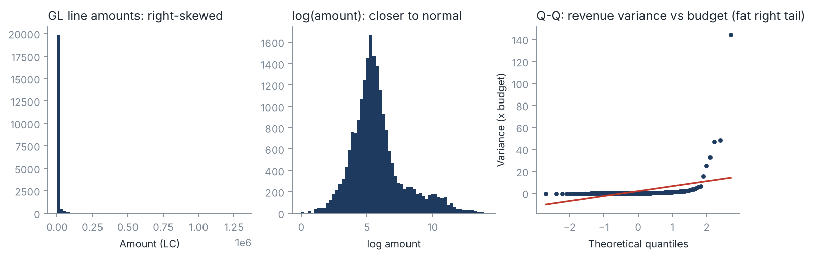
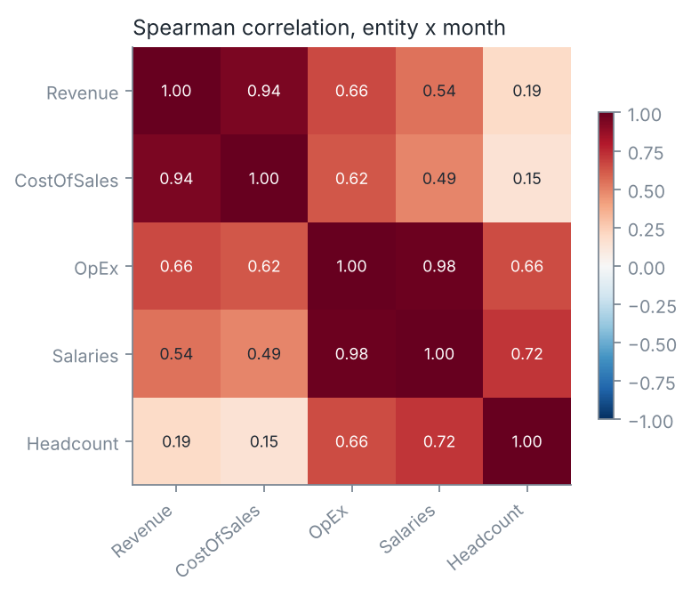
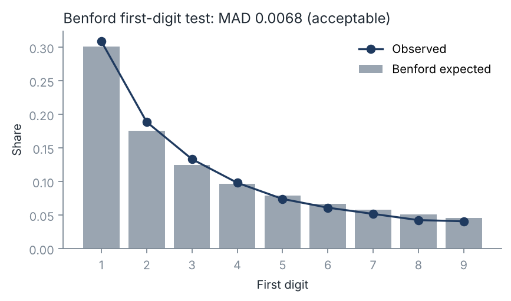
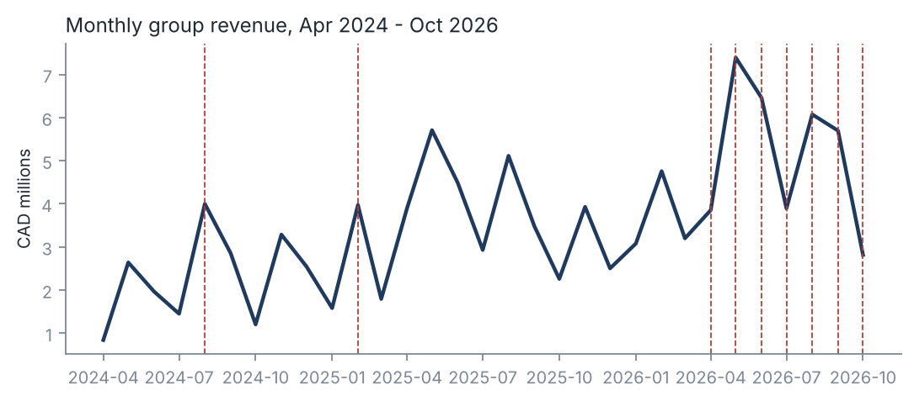
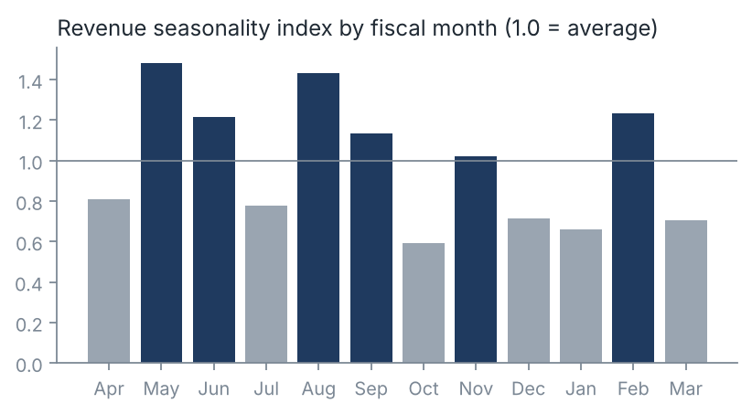

# Exploratory data analysis and data-quality profile

Generated by `scripts/eda.py` from the files in `data/`. Rerun it after any data change; output is deterministic.

## 1. Source-file profile (before cleaning)

34 files and 48,851 raw rows were profiled. Files with at least one issue:

| file                  |   rows |   exact_duplicates |   blank_department |   unknown_account |   non_numeric_amount | schema_drift   |
|:----------------------|-------:|-------------------:|-------------------:|------------------:|---------------------:|:---------------|
| GL_Actual_2025-06.csv |   1047 |                 15 |                  0 |                 0 |                    0 | False          |
| GL_Actual_2025-08.csv |   1004 |                  0 |                 30 |                 0 |                    0 | False          |
| GL_Actual_2026-01.csv |   1019 |                 15 |                  0 |                 0 |                    0 | False          |
| GL_Actual_2026-09.csv |   1153 |                  0 |                  0 |                 0 |                    0 | True           |

**Reconciliation to the injection log** (`data/dq_injection_log.csv`): every injected issue was detected.

| Issue                 |   Injected |   Detected | Reconciled   |
|:----------------------|-----------:|-----------:|:-------------|
| Exact duplicate rows  |         30 |         30 | Yes          |
| Missing DepartmentKey |         30 |         30 | Yes          |
| Schema drift (files)  |          1 |          1 | Yes          |

The new GL account 102 (Software Subscriptions) has no unknown-account rows because it was added to the chart of accounts; the report-line map includes it.

## 2. After cleaning (same rules as Power Query)

- Rows: 48,821. Exact duplicates remaining: 0.
- Nulls in key columns: Month 0, EntityKey 0, DepartmentKey 0, AccountKey 0, AmountLC 0, AccountType 0, CurrencyCode 0.
- Balance sheet integrity: 231 entity-months checked; largest |Assets - (Liabilities + Equity)| = 0.0000 (local currency).

## 3. Consolidation perimeter

| EntityName         | CurrencyCode   |   OwnershipPct | first_actual   | joined_FY   | first_budget   |
|:-------------------|:---------------|---------------:|:---------------|:------------|:---------------|
| Australia          | AUD            |           0.5  | Apr 2026       | FY2027      | never          |
| Canadian Division  | CAD            |           0.75 | Apr 2024       | FY2025      | Apr 2024       |
| Central Division   | USD            |           1    | Apr 2024       | FY2025      | Apr 2024       |
| France             | EUR            |           0.5  | Apr 2025       | FY2026      | Apr 2026       |
| Germany            | EUR            |           0.25 | Apr 2025       | FY2026      | Apr 2026       |
| Northeast Division | USD            |           1    | Apr 2024       | FY2025      | Apr 2024       |
| Northwest Division | USD            |           1    | Apr 2024       | FY2025      | Apr 2024       |
| Southeast Division | USD            |           1    | Apr 2024       | FY2025      | Apr 2024       |
| Southwest Division | USD            |           1    | Apr 2024       | FY2025      | Apr 2024       |

The group perimeter changes every fiscal year. FY2027 year-to-date revenue is CAD 36.2M against CAD 27.9M for the same months of FY2026 (+29.8%). Like-for-like entities contributed CAD 34.3M (organic growth +23.1%); entities new this year added CAD 1.9M. CAD 1.9M of FY2027 revenue comes from entities that have no FY2027 budget, so a total-company budget variance overstates operating performance.

## 4. Distribution and normality

| series                                                 |    n |   skew |   excess_kurtosis |   shapiro_p |   dagostino_p | normal_at_5pct   |
|:-------------------------------------------------------|-----:|-------:|------------------:|------------:|--------------:|:-----------------|
| GL line amounts (P&L, abs) - sample 5,000              | 5000 |  14.07 |            238    |    7.58e-93 |     0         | False            |
| log(GL line amounts)                                   | 5000 |   0.98 |              1.42 |    7.54e-42 |     2.31e-159 | False            |
| Monthly group revenue (CAD)                            |   31 |   0.5  |             -0.29 |    0.519    |     0.434     | True             |
| Month-on-month revenue growth                          |   30 |   1.01 |             -0.15 |    0.000565 |     0.0565    | False            |
| Revenue variance vs budget % (budgeted entity x month) |  200 |  10.05 |            114.1  |    5.5e-29  |     5.37e-82  | False            |

Reading: GL line amounts (P&L, abs) is not normal (skew 14.07, excess kurtosis 238.0); log(GL line amounts) is not normal (skew 0.98, excess kurtosis 1.42); Monthly group revenue (CAD) is normal (skew 0.5, excess kurtosis -0.29); Month-on-month revenue growth is not normal (skew 1.01, excess kurtosis -0.15); Revenue variance vs budget % (budgeted entity x month) is not normal (skew 10.05, excess kurtosis 114.1). Ledger line amounts are heavily right-skewed (many small postings, few large ones), so outlier rules use median and MAD, not mean +/- 3 SD. Monthly group revenue passes both normality tests, so simple normal-based ranges are reasonable for a revenue outlook band. Variance-to-budget percentages are fat-tailed even for budgeted entities: a small number of entity-months carry most of the variance, which is why the report ranks variances instead of averaging them.

## 5. Correlation

| pair                   |   n |   pearson_r |   pearson_p |   spearman_rho |
|:-----------------------|----:|------------:|------------:|---------------:|
| Revenue vs CostOfSales | 231 |       0.943 |    1.8e-111 |          0.944 |
| Revenue vs OpEx        | 231 |       0.674 |    5.9e-32  |          0.663 |
| Headcount vs Salaries  | 231 |       0.532 |    3e-18    |          0.716 |
| Revenue vs Headcount   | 231 |       0.057 |    0.39     |          0.191 |

Reading: Revenue vs CostOfSales: very strong (Spearman 0.944, Pearson 0.943, p 1.8e-111); Revenue vs OpEx: strong (Spearman 0.663, Pearson 0.674, p 5.9e-32); Headcount vs Salaries: strong (Spearman 0.716, Pearson 0.532, p 3e-18); Revenue vs Headcount: weak (Spearman 0.191, Pearson 0.057, p 0.39). Cost of sales scales almost one-for-one with revenue, so margin is protected by pricing and mix rather than volume. Operating expenses also track revenue, which means they are being added as the group grows rather than held fixed. Headcount relates to salaries but not to revenue across entities, so revenue per head varies widely by entity: a productivity question for the CFO.

## 6. Outliers (robust z-score > 3.5, account x entity monthly series)

519 of 7,782 monthly points flagged. Largest:

| AccountName              | EntityName   | Month    |   Signed |   robust_z |
|:-------------------------|:-------------|:---------|---------:|-----------:|
| Amortization of Goodwill | Germany      | Apr 2026 |     6051 |      772.7 |
| Marketing Collateral     | Germany      | Jul 2026 |    -1577 |     -350.8 |
| Other Income             | Germany      | Apr 2026 |    55587 |      317.7 |
| Marketing Collateral     | Germany      | Sep 2026 |    -1316 |     -292.7 |
| Commissions              | Germany      | May 2026 |   -16636 |     -271.9 |
| Marketing Collateral     | Germany      | Aug 2026 |    -1141 |     -253.7 |
| Marketing Collateral     | Germany      | May 2026 |    -1110 |     -246.6 |
| Telephone                | Germany      | May 2026 |    -5363 |     -213.5 |
| Other Income             | France       | Apr 2026 |    62750 |      190.7 |
| Telephone                | Germany      | Aug 2026 |    -4633 |     -183.9 |

## 7. Benford's law (first digit of actual GL amounts >= 10)

n = 28,083; chi-square = 145.7 (p = 1.56e-27); mean absolute deviation = 0.0068 -> Nigrini conformity: **acceptable**. With large n, chi-square rejects almost any real dataset, so MAD is the accepted measure.

## 8. Trend and seasonality

## Method notes

- Translation follows the semantic model: actual P&L at the Bank of Canada monthly average rate, budgets at the prior fiscal year's average rate (balance sheet at month-end rates in the model). Returns and discounts are netted off revenue in both actuals and budget.
- Normality: Shapiro-Wilk (n <= 5,000) and D'Agostino K-squared; skew and excess kurtosis reported. GL amounts are sampled to 5,000 rows with a fixed seed.
- Outliers: median and MAD per account x entity series, robust z = (x - median) / (1.4826 x MAD).
- Benford: first significant digit, chi-square goodness of fit and MAD thresholds from Nigrini (close < 0.006, acceptable < 0.012, marginal < 0.015).
